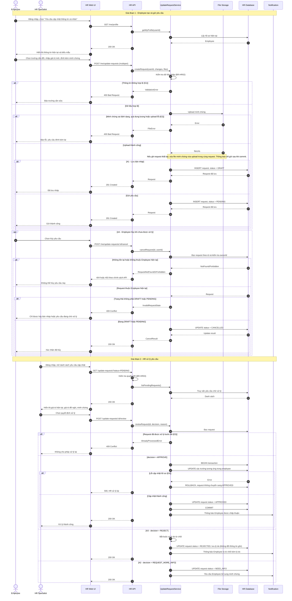
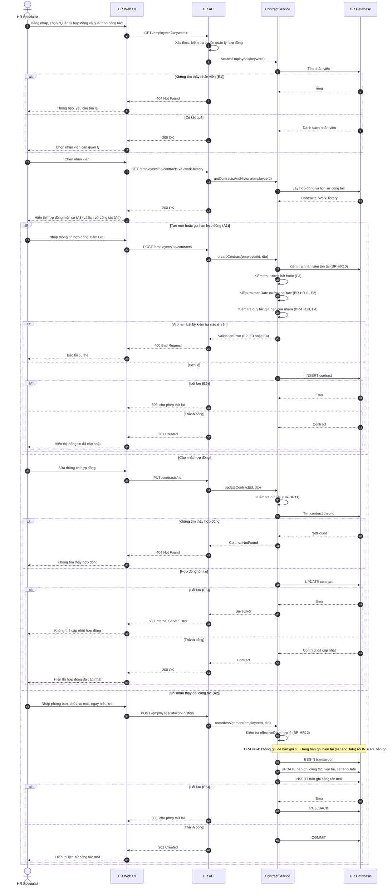
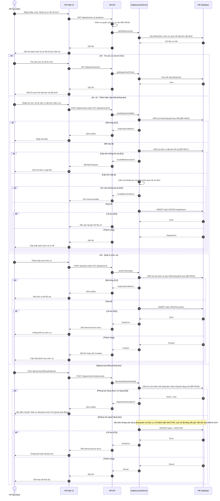
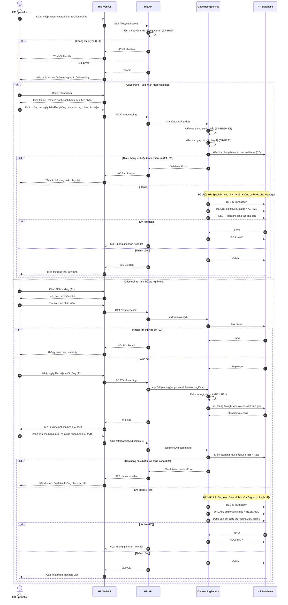

# HR Service – Sequence Diagrams & Vibe Coding Control Guide

Nguồn: báo cáo S4_Nhom02 – Báo cáo lần 2 (mục 5.1 – 5.6 và BR-HR01 → BR-HR29).
Bản cập nhật phục vụ triển khai C# và kiểm soát code. Giữ nguyên các mã `A#`, `E#`, `BR-HR##` để đối chiếu báo cáo đã nộp. Đây là tài liệu kỹ thuật để code. Khi sinh code, chỉ dùng file này.

**Nền tảng:** project `src/HR`, .NET 10, ASP.NET Core Web API, EF Core, PostgreSQL. Clean Architecture tinh giản giống Payroll: `Controllers`, `Core`, `Infrastructure`.

**Quyết định đã chốt (29/10/2026):** xem mục 8.7. Các sơ đồ bên dưới đã chỉnh theo các quyết định đó.

**Quy ước lifeline (map sang code):**

| Lifeline | Tầng trong code |
| --- | --- |
| HR Web UI | Frontend |
| HR API | Controller / Router, auth + phân quyền |
| XxxService | Service layer, chứa business rule |
| HR Database | Repository / ORM |
| Notification | Gửi thông báo trong hệ thống |

> Tên endpoint và trạng thái của UC-HR02 trở đi vẫn là hợp đồng kỹ thuật để code các use case chưa làm. UC-HR01 đã được triển khai trong `src/HR`; route và trường hồ sơ ở mục 1.1 là API thật. Không thêm quy tắc nghiệp vụ ngoài mục 8.7.

---

## 1. UC-HR01 – Quản lý Hồ sơ Nhân viên

```mermaid
sequenceDiagram
    autonumber
    actor HR as HR Specialist
    participant UI as HR Web UI
    participant API as HR API
    participant SVC as EmployeeService
    participant DB as HR Database

    HR->>UI: Đăng nhập, mở "Quản lý hồ sơ nhân viên"
    UI->>API: GET /employees
    API->>API: Xác thực token, kiểm tra quyền HR (BR-HR03)
    alt Không đủ quyền (E3)
        API-->>UI: 403 Forbidden
        UI-->>HR: Thông báo không đủ quyền truy cập
    else Có quyền
        API->>SVC: listEmployees(keyword, page)
        SVC->>DB: Truy vấn danh sách hồ sơ
        DB-->>SVC: Danh sách hồ sơ
        SVC-->>API: EmployeeList
        API-->>UI: 200 OK
        UI-->>HR: Hiển thị danh sách và chức năng thêm, sửa, tra cứu, khóa
    end

    alt A1 - Thêm hồ sơ mới
        HR->>UI: Nhập thông tin, bấm Lưu
        UI->>API: POST /employees
        API->>SVC: createEmployee(dto)
        SVC->>SVC: Kiểm tra trường bắt buộc và định dạng (BR-HR02)
        alt Dữ liệu thiếu hoặc không hợp lệ (E1)
            SVC-->>API: ValidationError
            API-->>UI: 400 Bad Request
            UI-->>HR: Báo lỗi, yêu cầu chỉnh sửa
        else Dữ liệu hợp lệ
            SVC->>DB: Kiểm tra mã nhân viên đã tồn tại (BR-HR01)
            DB-->>SVC: exists = true/false
            alt Mã nhân viên trùng (E2)
                SVC-->>API: DuplicateCodeError
                API-->>UI: 409 Conflict
                UI-->>HR: Mã đã tồn tại, nhập mã khác
            else Mã chưa tồn tại
                SVC->>DB: INSERT employee, status = ACTIVE
                alt Lỗi lưu dữ liệu (E4)
                    DB-->>SVC: Error
                    SVC-->>API: SaveError
                    API-->>UI: 500 Internal Error
                    UI-->>HR: Báo lỗi, cho phép thử lại
                else Lưu thành công
                    DB-->>SVC: Employee đã lưu
                    SVC-->>API: Employee
                    API-->>UI: 201 Created
                    UI-->>HR: Thông báo thành công, hiển thị hồ sơ
                end
            end
        end

    else A2 - Tra cứu hồ sơ
        HR->>UI: Nhập mã nhân viên hoặc từ khóa
        UI->>API: GET /employees?keyword=...
        API->>SVC: searchEmployees(keyword)
        SVC->>DB: Truy vấn theo điều kiện
        DB-->>SVC: Kết quả
        SVC-->>API: EmployeeList
        API-->>UI: 200 OK
        UI-->>HR: Hiển thị kết quả, chọn xem chi tiết

    else Cập nhật hồ sơ
        HR->>UI: Chọn hồ sơ, sửa thông tin, bấm Lưu
        UI->>API: PUT /employees/:id
        API->>SVC: updateEmployee(id, dto)
        SVC->>SVC: Kiểm tra dữ liệu (BR-HR02)
        alt Dữ liệu không hợp lệ (E1)
            SVC-->>API: ValidationError
            API-->>UI: 400 Bad Request
        else Hợp lệ
            SVC->>DB: Kiểm tra employee tồn tại và cập nhật
            alt Không tìm thấy hồ sơ
                DB-->>SVC: NotFound
                SVC-->>API: EmployeeNotFound
                API-->>UI: 404 Not Found
                UI-->>HR: Thông báo không tìm thấy hồ sơ
            else Lỗi lưu (E4)
                DB-->>SVC: Error
                SVC-->>API: SaveError
                API-->>UI: 500 Internal Server Error
                UI-->>HR: Báo lỗi, cho phép thử lại
            else Thành công
                DB-->>SVC: Employee đã cập nhật
                SVC-->>API: Employee
                API-->>UI: 200 OK
                UI-->>HR: Hiển thị hồ sơ đã cập nhật
            end
        end

    else A3 - Khóa hồ sơ
        HR->>UI: Chọn hồ sơ, yêu cầu khóa
        UI-->>HR: Hiển thị thông tin để xác nhận
        HR->>UI: Xác nhận khóa
        UI->>API: POST /employees/:id/lock
        API->>SVC: lockEmployee(id)
        Note over SVC,DB: BR-HR04: khóa mềm (đổi trạng thái), không xóa vật lý, giữ lịch sử
        SVC->>DB: Kiểm tra hồ sơ tồn tại và trạng thái hiện tại
        alt Không tìm thấy hồ sơ
            DB-->>SVC: NotFound
            SVC-->>API: EmployeeNotFound
            API-->>UI: 404 Not Found
            UI-->>HR: Không tìm thấy hồ sơ
        else Hồ sơ tồn tại
            SVC->>DB: UPDATE status = LOCKED
            alt Lỗi cập nhật trạng thái
                DB-->>SVC: Error
                SVC-->>API: SaveError
                API-->>UI: 500 Internal Server Error
                UI-->>HR: Không thể khóa hồ sơ, thử lại sau
            else Thành công
                DB-->>SVC: OK
                SVC-->>API: LockResult
                API-->>UI: 200 OK
                UI-->>HR: Thông báo đã khóa hồ sơ
            end
        end
    end
```



### 1.1 HR01 đã code trong `src/HR`

| Thao tác | API | Kết quả |
| --- | --- | --- |
| Danh sách và tra cứu | `GET /employees?keyword=&page=1&pageSize=20` | `200` |
| Xem chi tiết | `GET /employees/{id}` | `200`, hoặc `404` nếu không có hồ sơ |
| Thêm hồ sơ | `POST /employees` | `201`, trạng thái `ACTIVE` |
| Cập nhật | `PUT /employees/{id}` | `200`; `400` nếu dữ liệu sai; `404` nếu không có hồ sơ |
| Khóa mềm | `POST /employees/{id}/lock` | `200`, trạng thái `LOCKED` (BR-HR04) |

Quyền tạm thời cho đến khi nhóm có đăng nhập chung: header `X-Role: HR`. Thiếu header trả `401`. Sai quyền trả `403` (E3, BR-HR03).

Trường hồ sơ: mã nhân viên (duy nhất, BR-HR01), họ tên, ngày sinh, giới tính, email, số điện thoại, CCCD/CMND, địa chỉ. Mã không đổi khi cập nhật. Phòng ban và chức vụ thuộc HR04, chưa gắn vào hồ sơ ở bước này. Trạng thái `RESIGNED` dành cho HR05, HR01 không gán trạng thái này.

Chuỗi kết nối là `ConnectionStrings:HrDatabase` trong `appsettings.Development.json`, database `hrm_hr`. Không ghi mật khẩu vào tài liệu này.

---

## 2. UC-HR02 – Yêu cầu Cập nhật Thông tin Cá nhân



---

## 3. UC-HR03 – Quản lý Hợp đồng & Công tác



---

## 4. UC-HR04 – Quản lý Cơ cấu Tổ chức



---

## 5. UC-HR05 – Onboarding & Offboarding



---

## 6. UC-HR06 – Cảnh báo Hợp đồng Hết hạn

```mermaid
sequenceDiagram
    autonumber
    participant SCH as Scheduler
    participant JOB as ContractExpiryJob
    participant DB as HR Database
    actor HR as HR Specialist
    participant UI as HR Web UI
    participant API as HR API
    participant SVC as ContractAlertService

    Note over SCH,DB: Giai đoạn 1 - Hệ thống tự kiểm tra theo lịch (BR-HR25)
    SCH->>JOB: Kích hoạt theo lịch đã cấu hình
    JOB->>DB: Lấy các hợp đồng đang được quản lý
    alt Lỗi truy xuất dữ liệu (E3)
        DB-->>JOB: Error
        JOB->>DB: Ghi log lỗi, không báo đã kiểm tra thành công (BR-HR29)
    else Lấy được danh sách
        DB-->>JOB: Danh sách hợp đồng
        loop Từng hợp đồng
            alt Không có ngày hết hạn hợp lệ (E1)
                JOB->>DB: Ghi nhận dữ liệu thiếu, bỏ qua
            else Hợp đồng hết hạn trước hôm nay, không còn ACTIVE, hoặc đã RENEWED (E2, A4, BR-HR28)
                JOB->>JOB: Loại khỏi danh sách cần cảnh báo
            else Còn hiệu lực
                JOB->>JOB: Cảnh báo khi còn từ 0 đến 30 ngày, tính cả ngày hết hạn (BR-HR26)
                opt Đạt ngưỡng cảnh báo
                    JOB->>DB: Kiểm tra đã có cảnh báo cho (contractId, endDate) chưa (BR-HR27)
                    alt Chưa có cảnh báo
                        JOB->>DB: INSERT contract_alert, status = NEW
                        alt INSERT thành công
                            DB-->>JOB: Alert đã lưu
                            JOB->>JOB: Ghi nhận xử lý thành công cho hợp đồng này
                        else Lỗi tạo cảnh báo (E4)
                            DB-->>JOB: Error
                            JOB->>JOB: Ghi log lỗi theo BR-HR29
                            Note over JOB,DB: Chỉ retry nếu job thực tế có cơ chế retry; không đánh dấu hợp đồng đã xử lý thành công
                        end
                    else Đã có cảnh báo
                        JOB->>JOB: Bỏ qua, không tạo trùng
                    end
                end
            end
        end
    end

    Note over HR,API: Giai đoạn 2 - HR xem và xử lý cảnh báo
    HR->>UI: Mở "Cảnh báo hợp đồng hết hạn"
    UI->>API: GET /contract-alerts?status=...
    API->>API: Kiểm tra quyền HR
    API->>SVC: listAlerts(filters)
    SVC->>DB: Lấy danh sách cảnh báo kèm thông tin hợp đồng
    alt Lỗi truy vấn (E5)
        DB-->>SVC: Error
        SVC-->>API: QueryError
        API-->>UI: 500 Internal Server Error
        UI-->>HR: Không tải được, cho phép thử lại
    else Thành công
        DB-->>SVC: Danh sách cảnh báo
        SVC-->>API: AlertList
        API-->>UI: 200 OK
        UI-->>HR: Hiển thị danh sách, lọc theo ngày hết hạn, trạng thái, nhân viên (A1)
    end

    HR->>UI: Chọn một cảnh báo
    UI->>API: GET /contract-alerts/:id
    API->>SVC: getAlertDetail(id)
    SVC->>DB: Lấy chi tiết hợp đồng và hồ sơ nhân viên
    alt Không tìm thấy cảnh báo
        DB-->>SVC: NotFound
        SVC-->>API: AlertNotFound
        API-->>UI: 404 Not Found
        UI-->>HR: Không tìm thấy cảnh báo
    else Thành công
        DB-->>SVC: Chi tiết
        SVC-->>API: AlertDetail
        API-->>UI: 200 OK
        UI-->>HR: Hiển thị chi tiết (A2)
    end

    opt A3 - Hệ thống hỗ trợ trạng thái xử lý
        HR->>UI: Đánh dấu đã xem hoặc đang xử lý
        UI->>API: PATCH /contract-alerts/:id
        API->>SVC: updateAlertStatus(id, status)
        SVC->>DB: Kiểm tra cảnh báo tồn tại và UPDATE status
        alt Lỗi cập nhật
            DB-->>SVC: Error
            SVC-->>API: SaveError
            API-->>UI: 500 Internal Server Error
            UI-->>HR: Không thể cập nhật trạng thái
        else Thành công
            DB-->>SVC: OK
            SVC-->>API: UpdateResult
            API-->>UI: 200 OK
            UI-->>HR: Trạng thái đã cập nhật
        end
    end
```

> Phần "HR thực hiện bước tiếp theo" (gia hạn) chính là UC-HR03 – tạo hợp đồng tiếp theo. Sau khi gia hạn, job lần chạy sau sẽ thấy hợp đồng cũ đã được thay thế và không phát cảnh báo nữa (A4).

---

## 7. (Bổ sung) HR Service làm nguồn dữ liệu cho phân hệ khác

Báo cáo có BR-PRJ20: nhân viên phải có hồ sơ hợp lệ trong HR Service mới được gán vào dự án (UC-PRJ03). Hợp đồng đã chốt: Project chỉ nhận nhân viên `ACTIVE`, và chỉ nhận các trường phục vụ gán việc. Lương cơ bản và người phụ thuộc là endpoint nội bộ khác cho Payroll (`IHrClient`), không trả qua API này.

```mermaid
sequenceDiagram
    autonumber
    actor PM as Project Manager
    participant PRJ as Project Service
    participant HRAPI as HR API
    participant HRSVC as EmployeeService
    participant DB as HR Database

    PM->>PRJ: Gán nhân viên vào dự án, nhập Hourly Rate
    PRJ->>PRJ: Kiểm tra dữ liệu đầu vào và quyền Project Manager
    PRJ->>HRAPI: GET /internal/employees/:id (xác thực giữa các service)
    alt HR API không khả dụng hoặc timeout
        HRAPI--xPRJ: Timeout/5xx
        PRJ->>PRJ: Ghi log, không coi nhân viên là hợp lệ
        PRJ-->>PM: Tạm thời không thể xác minh nhân viên; thử lại sau
    else HR API phản hồi
        HRAPI->>HRSVC: getAssignableEmployee(id)
        HRSVC->>DB: Lấy hồ sơ
        alt Không tồn tại, LOCKED hoặc RESIGNED
            DB-->>HRSVC: Rỗng hoặc status không phải ACTIVE
            HRSVC-->>HRAPI: EmployeeNotAssignable
            HRAPI-->>PRJ: 404 Not Found
            PRJ-->>PM: Từ chối gán (BR-PRJ20)
        else status = ACTIVE
            DB-->>HRSVC: Employee
            HRSVC-->>HRAPI: Employee
            HRAPI-->>PRJ: 200 OK (id, họ tên, phòng ban, chức vụ, status)
            PRJ->>PRJ: Kiểm tra BR-PRJ21, BR-PRJ22 và lưu bản gán
            alt Lỗi lưu bản gán
                PRJ-->>PM: Không thể lưu phân công; thử lại
            else Thành công
                PRJ-->>PM: Gán thành công
            end
        end
    end
```


---

## 8. Quy ước kiểm soát code khi Vibe Coding

Mục tiêu của phần này là giữ cho code sinh ra bởi AI nhất quán với nghiệp vụ, tránh để AI tự ý tạo thêm chức năng hoặc làm lệch kiến trúc solution hiện có.

### 8.1 Quy tắc không được tự ý thay đổi

1. **OOAD đã nộp là baseline nghiệp vụ.** Không tự thêm actor, Use Case, trạng thái nghiệp vụ, điều kiện duyệt hoặc quy tắc mới nếu không có căn cứ trong báo cáo hay quyết định được nhóm thống nhất.
2. **Không tự tạo kiến trúc song song.** Trước khi tạo file mới, tìm Controller, Service, Entity, DTO, Repository và pattern tương ứng đang có trong solution.
3. **Không hard-code bí mật.** Không ghi connection string, password, JWT signing key hoặc token vào source, prompt, log hay tài liệu.
4. **Không báo thành công trước khi database xác nhận.** Với INSERT/UPDATE/DELETE, chỉ trả success sau khi thao tác hoàn tất.
5. **Transaction phải có ý nghĩa.** Dùng transaction khi một nghiệp vụ cần nhiều thay đổi dữ liệu cùng thành công hoặc cùng rollback; không bọc mọi truy vấn đơn giản vào transaction một cách máy móc.
6. **Không nuốt exception.** Ghi log có ngữ cảnh, trả lỗi API nhất quán; không trả stack trace hoặc thông tin nhạy cảm về database cho client.
7. **Không tự ý đổi API contract.** Trước khi đổi route, request DTO, response DTO hoặc HTTP status, kiểm tra caller và các service phụ thuộc.
8. **Không tự tuyên bố đã kiểm thử.** Chỉ ghi build/test thành công khi đã chạy lệnh tương ứng và đọc kết quả.

### 8.2 Mapping từ sơ đồ sang code

| Thành phần sơ đồ | Vị trí code gợi ý | Trách nhiệm |
| --- | --- | --- |
| HR Web UI | Frontend | Hiển thị form, gửi request, hiển thị kết quả; không tự quyết định quy tắc nghiệp vụ. |
| HR API | Controller / Endpoint | Xác thực, phân quyền, validate request cơ bản, gọi service và trả HTTP response. |
| EmployeeService, ContractService… | Application / Service | Thực thi nghiệp vụ và phối hợp các thao tác dữ liệu. |
| HR Database | EF Core DbContext / Repository | Truy vấn và lưu dữ liệu; ràng buộc duy nhất nên được bảo vệ cả ở database khi phù hợp. |
| File Storage | Storage service | Kiểm tra loại/kích thước file, lưu file và xử lý file mồ côi nếu ghi DB thất bại. |
| Notification | Notification service / outbox nếu có | Gửi thông báo sau khi nghiệp vụ chính đã commit; tránh thông báo thành công trước commit. |
| Scheduler / Job | Hosted Service / Background Job | Chạy định kỳ, có logging, tránh tạo cảnh báo trùng và xử lý lỗi có kiểm soát. |

Tên lớp trên là ví dụ. Dùng tên và kiến trúc thực tế của nhóm nếu đã có.

### 8.3 Chuẩn hóa lỗi API

Dùng quy ước thống nhất với API hiện có; bảng sau là gợi ý, không bắt buộc đổi toàn bộ project chỉ để khớp bảng:

| Trường hợp | HTTP status thường phù hợp |
| --- | --- |
| Request sai định dạng / thiếu trường bắt buộc | `400 Bad Request` |
| Chưa xác thực | `401 Unauthorized` |
| Đã đăng nhập nhưng không đủ quyền | `403 Forbidden` |
| Không tìm thấy hồ sơ/hợp đồng/yêu cầu | `404 Not Found` |
| Trùng mã hoặc trạng thái không cho phép thao tác | `409 Conflict` |
| Dữ liệu đúng định dạng nhưng không đạt điều kiện nghiệp vụ | `422 Unprocessable Entity` nếu API của nhóm áp dụng quy ước này; nếu không, dùng chuẩn hiện tại |
| Lỗi không dự kiến | `500 Internal Server Error` |
| Tạo tài nguyên thành công | `201 Created` |
| Cập nhật/thao tác thành công | Thường là `200 OK` hoặc `204 No Content` theo API hiện có |

Không trả `500` cho lỗi validation hoặc dữ liệu không tồn tại. Không trả chi tiết exception nội bộ cho frontend.

### 8.4 Checklist hoàn tất một UC trước khi chuyển sang UC tiếp theo

- [ ] Đã tìm hiểu các file hiện có trước khi thêm/sửa code.
- [ ] Đã xác định endpoint, request DTO, response DTO và quyền cần thiết.
- [ ] Service thực thi đúng luồng chính đã mô tả.
- [ ] Các nhánh lỗi trong sơ đồ có xử lý tương ứng trong code.
- [ ] Các cập nhật nhiều bảng có transaction/rollback khi nghiệp vụ yêu cầu tính nguyên tử.
- [ ] Các quy tắc quan trọng được bảo vệ bằng validation và constraint database phù hợp.
- [ ] Đã chạy build và test; ghi lại kết quả thực tế.
- [ ] Đã kiểm tra caller hoặc service khác bị ảnh hưởng bởi thay đổi API.
- [ ] Không thêm nghiệp vụ mới ngoài baseline OOAD nếu chưa được nhóm thống nhất.

### 8.5 Prompt mẫu dùng cho Vibe Coding

Sao chép prompt sau và thay `[UC]`, `[file]`, `[yêu cầu cụ thể]` trước khi sử dụng:

```text
Bạn đang sửa project HR Service bằng C#/.NET hiện có.

Baseline nghiệp vụ:
- Tuân thủ báo cáo OOAD đã nộp và Use Case [UC].
- Dùng file docs/HR_Sequence_Diagrams_VibeCoding_Updated.md làm hướng dẫn kỹ thuật, gồm các quyết định đã chốt ở mục 8.7. Nếu có khác biệt với OOAD đã nộp, không tự quyết định thay đổi nghiệp vụ mà phải nêu rõ điểm xung đột.
- Không tự thêm actor, trạng thái, endpoint hoặc quy tắc nghiệp vụ mới nếu chưa có căn cứ.

Trước khi sửa:
1. Đọc cấu trúc solution và các file liên quan.
2. Tìm Controller, Service, DTO, Entity, DbContext/Repository và test hiện có.
3. Nêu ngắn gọn file sẽ sửa/thêm và lý do; không tạo kiến trúc song song.
4. Giữ tương thích với các caller/API hiện tại.

Yêu cầu thực hiện: [yêu cầu cụ thể].

Tiêu chí:
- Tách trách nhiệm Controller và Service theo pattern hiện có.
- Validate input, quyền và trạng thái nghiệp vụ phù hợp.
- Không trả success trước khi lưu dữ liệu thành công.
- Dùng transaction nếu một nghiệp vụ cập nhật nhiều bản ghi cần cùng thành công/rollback.
- Xử lý lỗi nhất quán, log lỗi nhưng không lộ secret/stack trace cho client.
- Không ghi secret vào source code.
- Cập nhật hoặc thêm test cho happy path và các nhánh lỗi liên quan.
- Chạy build/test nếu môi trường cho phép; báo chính xác lệnh đã chạy và kết quả.
- Cuối cùng liệt kê file thay đổi, hành vi API và các điểm còn chưa xác minh.
```

### 8.6 Thứ tự triển khai đề xuất

Thứ tự phụ thuộc database và source hiện tại; dùng đây làm gợi ý chứ không phải yêu cầu phải viết lại từ đầu:

1. **Khảo sát solution và schema** — xác nhận project nào đang chứa HR API, entity, DbContext, auth và migration.
2. **HR01 – Hồ sơ nhân viên** — API danh sách, tra cứu, thêm, sửa và khóa mềm đã có trong `src/HR`. Phòng ban và chức vụ làm ở HR04.
3. **HR04 – Cơ cấu tổ chức** — làm trước hoặc song song với HR01 nếu Employee tham chiếu Department/Position.
4. **HR03 – Hợp đồng và công tác** — phụ thuộc Employee, Department và Position.
5. **HR02 – Yêu cầu cập nhật** — cần định nghĩa rõ trường được cập nhật và transaction khi duyệt.
6. **HR05 – Onboarding/Offboarding** — tái sử dụng Employee và Work History, tránh tạo luồng cập nhật hồ sơ trùng lặp.
7. **HR06 – Cảnh báo hết hạn** — chỉ làm sau khi Contract, ngày hết hạn, trạng thái hợp đồng và quy tắc cảnh báo đã ổn định.
8. **HR–Project integration** — hợp đồng API đã chốt ở mục 7. Khi code cần thêm xác thực giữa các service.

Nếu source hiện tại đã có nghiệp vụ nào chạy được, tiếp tục từ đó thay vì triển khai lại theo thứ tự trên.

### 8.7 Quyết định đã chốt

Các điểm này là baseline khi code. Sơ đồ ở các mục trên đã được chỉnh cho khớp.

1. **HR04.** Phòng ban và chức vụ không xóa vật lý. API chỉ đặt `INACTIVE`. Còn nhân viên đang làm hoặc bản ghi công tác đang mở (`endDate` trống) thì trả `409` (BR-HR18). Lịch sử đã đóng vẫn giữ. Mã vẫn duy nhất trên cả bản ghi `INACTIVE`.
2. **HR05.** HR Specialist xác nhận onboarding là đủ. Không có bước chờ Manager. Request hợp lệ tạo hồ sơ `ACTIVE` và bản ghi công tác đầu tiên, trả `201`. Offboarding đủ checklist thì chuyển `RESIGNED`, không xóa hồ sơ hay lịch sử (BR-HR23).
3. **Trạng thái nhân viên.** `ACTIVE`, `LOCKED`, `RESIGNED`. `INACTIVE` chỉ dùng cho phòng ban và chức vụ.
4. **HR06.** Job chạy mỗi ngày. Cảnh báo khi hợp đồng `ACTIVE`, có `endDate`, và còn từ 0 đến 30 ngày tính cả ngày hết hạn (BR-HR26). Một đợt là một cặp `(contractId, endDate)`; đã có cảnh báo thì không tạo thêm (BR-HR27). Gia hạn thành công thì hợp đồng cũ chuyển `RENEWED` và không còn bị cảnh báo (BR-HR28). Job không tự retry trong cùng lần chạy; lỗi ghi log (BR-HR29), lần chạy sau sẽ xét lại hợp đồng chưa có cảnh báo.
5. **HR02.** Employee chỉ hủy yêu cầu của chính mình khi trạng thái là `DRAFT` hoặc `PENDING`. Trạng thái khác trả `409`. Không đúng chủ yêu cầu trả `404`. File minh chứng upload trước; nếu ghi database lỗi thì xóa file vừa upload trong cùng request. Thông báo chỉ gửi sau khi commit.
6. **HR và Project.** Project gọi `GET /internal/employees/{id}`. Chỉ hồ sơ `ACTIVE` trả `200` với `id`, họ tên, phòng ban, chức vụ và `status`. Không trả CCCD, lương, tài khoản ngân hàng hay file cá nhân. `LOCKED`, `RESIGNED` hoặc không tồn tại trả `404` (BR-PRJ20). Timeout hoặc `5xx` thì Project không coi nhân viên là hợp lệ. Hourly rate do Project nhập. Lương cơ bản và người phụ thuộc dành cho endpoint nội bộ của Payroll, không nằm trong API này.
