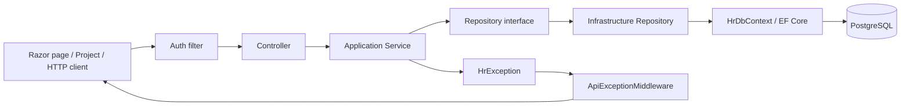

# Hướng dẫn hiểu và kiểm soát HR Service

Cập nhật: 10/11/2026. Tài liệu mô tả **source thực tế hiện tại**, gồm HR01–HR06 và API danh mục nhân viên cho Project. Dữ liệu lương/người phụ thuộc cho Payroll chưa nằm trong đợt triển khai này.

Đọc cùng:

- [Sơ đồ và quyết định nghiệp vụ](HR_Sequence_Diagrams_improvement.md): baseline nghiệp vụ; mục 8.7 là các quyết định đã chốt.
- [Tracker](HR_work_tracker.md): phần đã làm, đã kiểm tra và còn cần cải thiện.
- Tài liệu này: mỗi file làm gì, request chạy qua đâu, vì sao code được viết như vậy và cần sửa ở đâu.

## 1. HR Service nằm ở đâu và hoạt động thế nào?

HR được chia thành **4 project .NET 10**, theo cùng cách phân lớp với Payroll. Project khởi động là [HR.API.csproj](../src/HR/HR.API/HR.API.csproj); mỗi lớp còn lại là một class library riêng.

```text
src/HR/
├── HR.API/
│   ├── Controllers/             HTTP request/response
│   ├── Auth/                    Filter quyền/danh tính/service key
│   ├── Middleware/              Chuẩn hóa lỗi HTTP
│   ├── Pages/                   Giao diện web Razor gọi API
│   ├── Properties/              Profile chạy local
│   ├── Program.cs               Ghép các lớp và khởi động web
│   ├── appsettings*.json        Cấu hình host
│   └── HR.API.csproj
├── HR.Application/
│   ├── DTOs/                    Chia theo Employees, Organization, Contracts,
│   │                            ProfileUpdates, Lifecycle, ContractAlerts
│   ├── Services/                Cùng các nhóm nghiệp vụ như DTOs
│   ├── Interfaces/              Services, Repositories, Storage
│   ├── Exceptions/              HrException và ApiError
│   ├── DependencyInjection.cs   Đăng ký service nghiệp vụ
│   └── HR.Application.csproj
├── HR.Domain/
│   ├── Entities/                Đối tượng nghiệp vụ và quan hệ
│   ├── Constants/               Trạng thái và mã quy ước
│   └── HR.Domain.csproj
└── HR.Infrastructure/
    ├── Persistence/             DbContext, factory, Configurations, Migrations
    ├── Repositories/            Truy vấn/lưu PostgreSQL
    ├── Storage/                 Lưu file minh chứng HR02
    ├── Jobs/                    Quét hợp đồng hết hạn HR06
    ├── DependencyInjection.cs   Đăng ký DB/repository/storage/job
    └── HR.Infrastructure.csproj

tests/HR.Tests/                  Test nghiệp vụ, kiến trúc, model, auth và HR–Project
FE/HR/                          Project WinForms riêng; hiện mới có khung form
```

Hướng tham chiếu: API → Application và Infrastructure; Application → Domain; Infrastructure → Application và Domain. Domain độc lập với các lớp còn lại. Namespace tương ứng `HR.API.*`, `HR.Application.*`, `HR.Domain.*`, `HR.Infrastructure.*`; không còn namespace `HR.Core`.

Ví dụ tìm code nghỉ việc: HTTP ở `HR.API/Controllers/LifecycleController.cs`, quy trình ở `HR.Application/Services/Lifecycle/LifecycleService.cs`, dữ liệu ở `HR.Domain/Entities/OffboardingRecord.cs`, truy vấn ở `HR.Infrastructure/Repositories/LifecycleRepository.cs`.

Luồng gọi thông thường:



Controller biết HTTP. Service quyết định nghiệp vụ. Repository biết cách đọc/lưu dữ liệu. DbContext theo dõi entity và gửi SQL. Các phần này dùng dependency injection để không tự tạo đối tượng kết nối database trong mỗi hàm.

## 2. Khởi động và cấu hình: file nào có vai trò gì?

| File | Ý nghĩa và điểm cần hiểu |
| --- | --- |
| [HR.API.csproj](../src/HR/HR.API/HR.API.csproj) | Web host .NET 10, OpenAPI và EF tooling; tham chiếu Application/Infrastructure. |
| [HR.Application.csproj](../src/HR/HR.Application/HR.Application.csproj) | Class library nghiệp vụ, tham chiếu Domain và logging/DI abstractions. |
| [HR.Domain.csproj](../src/HR/HR.Domain/HR.Domain.csproj) | Entity/hằng nghiệp vụ, không tham chiếu API, Application hay EF Core. |
| [HR.Infrastructure.csproj](../src/HR/HR.Infrastructure/HR.Infrastructure.csproj) | Class library persistence/file/job, tham chiếu Application/Domain, Npgsql/EF và shared framework cho hosting/configuration/file store. |
| [Application DependencyInjection.cs](../src/HR/HR.Application/DependencyInjection.cs) | `AddApplication()` đăng ký các service nghiệp vụ và TimeProvider. |
| [Infrastructure DependencyInjection.cs](../src/HR/HR.Infrastructure/DependencyInjection.cs) | `AddInfrastructure(configuration)` kiểm tra connection string, đăng ký DbContext, repository, storage và job. |
| [HR.API/Program.cs](../src/HR/HR.API/Program.cs) | Điểm khởi động. Gọi AddApplication/AddInfrastructure, đăng ký filter HTTP, dựng app và map API/Razor pages. |
| [HR.API/HR.http](../src/HR/HR.API/HR.http) | Các HTTP request mẫu để gọi bằng IDE. Biến URL/header chỉ phục vụ thao tác local; không phải logic nghiệp vụ. |
| [appsettings.json](../src/HR/HR.API/appsettings.json) | Logging, AllowedHosts và lịch job `ContractExpiryJob`. Không chứa service key thật. |
| [appsettings.Development.json](../src/HR/HR.API/appsettings.Development.json) | Ghi đè cấu hình khi chạy Development. Kiểm tra cấu hình local của nhóm, không đưa bí mật thật vào Git. |
| [Properties/launchSettings.json](../src/HR/HR.API/Properties/launchSettings.json) | Profile local `http`/`https`, environment Development và cổng mặc định HR `5012`/`7115`. Không phải cấu hình deployment. |
| [HR.Infrastructure/Persistence/HrDbContextFactory.cs](../src/HR/HR.Infrastructure/Persistence/HrDbContextFactory.cs) | Tạo DbContext lúc chạy `dotnet ef`. Đọc appsettings theo thư mục hiện hành, nên lệnh trong hướng dẫn chạy từ `src/HR/HR.API`. |

HR đọc `ConnectionStrings:HrDatabase` qua hệ thống configuration của ASP.NET Core. Tên biến môi trường tương đương là `ConnectionStrings__HrDatabase`; dấu `__` biểu diễn dấu `:`. HR hiện không tự đọc file `.env` bằng DotNetEnv.

### Các dòng khởi động cốt lõi

```csharp
var builder = WebApplication.CreateBuilder(args);
builder.Services.AddApplication();
builder.Services.AddInfrastructure(builder.Configuration);
// Bên trong HR.Infrastructure/DependencyInjection.cs:
var connectionString = builder.Configuration.GetConnectionString("HrDatabase");
builder.Services.AddDbContext<HrDbContext>(options => options.UseNpgsql(connectionString));
builder.Services.AddScoped<IEmployeeRepository, EmployeeRepository>();
builder.Services.AddScoped<IEmployeeService, EmployeeService>();
```

- `CreateBuilder`: chuẩn bị cấu hình, logging và container dependency injection.
- `AddApplication` và `AddInfrastructure`: gọi các extension method đăng ký dependency theo từng lớp; Program.cs tập trung ghép ứng dụng.
- `GetConnectionString`: lấy khóa `ConnectionStrings:HrDatabase`; code dừng khởi động nếu thiếu.
- `UseNpgsql`: chọn PostgreSQL làm provider EF Core; chưa thực thi truy vấn ở dòng đăng ký này.
- `AddScoped<A,B>`: khi một request cần `A`, container cung cấp `B`. Một request dùng chung một instance scoped tương ứng, bao gồm DbContext.
- Nhiều repository trong một request dùng cùng DbContext: vì vậy transaction HR02 có thể lưu cả Employee, request và notification.

```csharp
app.UseMiddleware<ApiExceptionMiddleware>();
app.MapControllers();
app.MapRazorPages();
app.Run();
```

Middleware bao quanh việc xử lý request và chuyển exception thành lỗi API. `MapControllers` bật các route HTTP từ controller; `MapRazorPages` bật màn hình `.cshtml`. `Run` bắt đầu phục vụ request.

`TimeProvider` và evidence store được đăng ký singleton. Repository/service/DbContext được đăng ký scoped. Hosted job là singleton nhưng **tạo scope mới mỗi lần chạy**, tránh giữ DbContext lâu dài hoặc dùng cùng DbContext cho nhiều luồng.

## 3. Controllers: cửa vào của từng nghiệp vụ

Folder này không phải nơi viết SQL hay đặt toàn bộ điều kiện nghiệp vụ. Controller lấy tham số/body/file, gọi service rồi trả `200`, `201`, `404`... Các điều kiện sâu hơn nằm trong Application Services.

| File | Chức năng và các route chính |
| --- | --- |
| [EmployeesController.cs](../src/HR/HR.API/Controllers/EmployeesController.cs) | HR01: `GET /employees`, `GET /employees/{id:guid}`, `POST`, `PUT`, `POST /employees/{id}/lock`. Dùng EmployeeId GUID thống nhất. |
| [InternalEmployeesController.cs](../src/HR/HR.API/Controllers/InternalEmployeesController.cs) | Danh sách/chi tiết nhân viên `ACTIVE` cho service khác: `GET /internal/employees`, `GET /internal/employees/{employeeId:guid}`. Cùng EmployeeId với API quản trị, DTO tối thiểu. |
| [DepartmentsController.cs](../src/HR/HR.API/Controllers/DepartmentsController.cs) | HR04: danh sách/tạo/sửa phòng ban, `GET /departments/tree`, `POST /departments/{id}/deactivate`. |
| [PositionsController.cs](../src/HR/HR.API/Controllers/PositionsController.cs) | HR04: danh sách/tạo/sửa chức vụ, `POST /positions/{id}/deactivate`. |
| [EmploymentController.cs](../src/HR/HR.API/Controllers/EmploymentController.cs) | HR03: `GET/POST /employees/{id}/contracts`, `PUT /contracts/{id}`, `GET/POST /employees/{id}/work-history`. |
| [EmployeeSelfServiceController.cs](../src/HR/HR.API/Controllers/EmployeeSelfServiceController.cs) | HR02 phía nhân viên: `/me/profile`, `/me/update-requests`, sửa/hủy yêu cầu, tải file của chính mình và `/me/notifications`. File này còn chứa lớp bind multipart `ProfileUpdateForm`. |
| [ProfileUpdateReviewController.cs](../src/HR/HR.API/Controllers/ProfileUpdateReviewController.cs) | HR02 phía HR: danh sách/chi tiết `/update-requests`, `POST /update-requests/{id}/review`, tải file minh chứng. |
| [LifecycleController.cs](../src/HR/HR.API/Controllers/LifecycleController.cs) | HR05: `/lifecycle/options`, `/onboarding`, `/offboarding`, chỉnh ngày nghỉ/checklist và `POST /offboarding/{id}/complete`. |
| [ContractAlertsController.cs](../src/HR/HR.API/Controllers/ContractAlertsController.cs) | HR06: `GET /contract-alerts`, `GET /contract-alerts/{id}`, `PATCH /contract-alerts/{id}`. Lọc trạng thái/nhân viên/khoảng ngày hạn và phân trang. |

### Cách đọc một action

```csharp
[ApiController]
[Route("employees")]
[ServiceFilter(typeof(HrRoleFilter))]
public sealed class EmployeesController : ControllerBase
```

- `[ApiController]`: bật hành vi API, bao gồm lỗi binding/validation cơ bản tự động.
- `[Route("employees")]`: tiền tố đường dẫn của controller.
- `[ServiceFilter(...)]`: lấy filter đã đăng ký trong DI và kiểm tra quyền trước action.
- `ControllerBase`: cung cấp `Ok`, `NotFound`, `CreatedAtAction`, `File`...; không render view trực tiếp.
- `sealed`: không cho kế thừa lớp này; không thay đổi nghiệp vụ HTTP.

```csharp
[HttpGet("{id:guid}")]
public async Task<ActionResult<EmployeeDto>> Get(Guid id, CancellationToken cancellationToken)
{
    return Ok(await _employees.GetAsync(id, cancellationToken));
}
```

`{id:guid}` chỉ khớp định dạng GUID, ví dụ `6ccd5ae5-4266-4745-8dc0-4ab0721e2861`; ID số cũ không còn khớp route. `await` đợi I/O database mà không giữ thread để chờ. `CancellationToken` giúp ngừng truy vấn khi request bị hủy. `ActionResult<EmployeeDto>` cho biết payload thành công là DTO nhưng action vẫn có thể trả HTTP error. `Ok` tương ứng `200`.

`CreatedAtAction` trong HR01 tạo response `201` và đường dẫn đọc lại tài nguyên. Các action tạo khác hiện có thể trả `201` bằng `StatusCode`, nên không phải mọi endpoint tạo đều có header Location.

## 4. HR.Domain/Entities: dữ liệu nghiệp vụ

Entity là đối tượng được EF Core map vào bảng. Thuộc tính số/GUID/string/ngày là dữ liệu; navigation như `Employee`, `Department`, `Attachments` biểu diễn quan hệ. Navigation không tự động có dữ liệu nếu query chưa load nó.

| File | Bảng/ý nghĩa |
| --- | --- |
| [Employee.cs](../src/HR/HR.Domain/Entities/Employee.cs) | `employee`: hồ sơ cá nhân, EmployeeId GUID ổn định, trạng thái, tổ chức hiện tại và version. |
| [Department.cs](../src/HR/HR.Domain/Entities/Department.cs) | `department`: mã/tên/mô tả, phòng ban cha, các phòng ban con, trạng thái hoạt động. |
| [Position.cs](../src/HR/HR.Domain/Entities/Position.cs) | `position`: danh mục chức vụ độc lập, mã/tên/mô tả/trạng thái. |
| [EmploymentContract.cs](../src/HR/HR.Domain/Entities/EmploymentContract.cs) | `employment_contract`: số/loại hợp đồng, khoảng ngày, trạng thái và liên kết hợp đồng trước/sau khi gia hạn. Chưa lưu lương hợp đồng. |
| [WorkHistory.cs](../src/HR/HR.Domain/Entities/WorkHistory.cs) | `work_history`: nhân viên thuộc phòng ban/chức vụ nào trong từng khoảng ngày. `EndDate = null` là bản ghi chưa đóng. |
| [ProfileUpdateRequest.cs](../src/HR/HR.Domain/Entities/ProfileUpdateRequest.cs) | `profile_update_request`: proposed profile JSON, chủ yêu cầu, trạng thái, lý do xử lý và các mốc thời gian/version. |
| [ProfileUpdateAttachment.cs](../src/HR/HR.Domain/Entities/ProfileUpdateAttachment.cs) | `profile_update_attachment`: metadata file và storage key; không chứa nội dung file trong DB. |
| [EmployeeNotification.cs](../src/HR/HR.Domain/Entities/EmployeeNotification.cs) | `employee_notification`: inbox thông báo nội bộ cho nhân viên, liên kết request HR02. Chưa có email/SMS dispatcher. |
| [OffboardingRecord.cs](../src/HR/HR.Domain/Entities/OffboardingRecord.cs) | `offboarding_record`: ngày làm việc cuối cùng, trạng thái quy trình, version, ghi chú và thời điểm hoàn tất. |
| [OffboardingChecklistItem.cs](../src/HR/HR.Domain/Entities/OffboardingChecklistItem.cs) | `offboarding_checklist_item`: tiêu đề, thứ tự, bắt buộc/tùy chọn, đã xong/chưa, ghi chú và ngày hoàn thành. |
| [ContractAlert.cs](../src/HR/HR.Domain/Entities/ContractAlert.cs) | `contract_alert`: cảnh báo cho một cặp hợp đồng/ngày hết hạn; ngày hạn được lưu snapshot để giữ các đợt cảnh báo cũ. |

Các file hằng trạng thái cũng nằm trong Entities:

| File | Giá trị đang dùng |
| --- | --- |
| [OrgStatuses.cs](../src/HR/HR.Domain/Constants/OrgStatuses.cs) | `ACTIVE`, `INACTIVE` cho phòng ban/chức vụ. |
| [ContractStatuses.cs](../src/HR/HR.Domain/Constants/ContractStatuses.cs) | `ACTIVE`, `RENEWED` cho hợp đồng. |
| [ProfileUpdateStatuses.cs](../src/HR/HR.Domain/Constants/ProfileUpdateStatuses.cs) | `DRAFT`, `PENDING`, `NEED_INFO`, `APPROVED`, `REJECTED`, `CANCELLED`. |
| [LifecycleStatuses.cs](../src/HR/HR.Domain/Constants/LifecycleStatuses.cs) | `IN_PROGRESS`, `COMPLETED` cho quy trình nghỉ việc. |
| [ContractAlertStatuses.cs](../src/HR/HR.Domain/Constants/ContractAlertStatuses.cs) | `NEW`, `VIEWED`, `IN_PROGRESS` cho xử lý cảnh báo. |

[HR.Domain/Constants/EmployeeCodes.cs](../src/HR/HR.Domain/Constants/EmployeeCodes.cs) chứa `EmployeeStatuses` (`ACTIVE`, `LOCKED`, `RESIGNED`) và `Genders.TryNormalize`: nhận Nam/Nữ/Khác hoặc Male/Female/Other rồi đưa về dạng lưu thống nhất.

[HR.Application/Exceptions/HrException.cs](../src/HR/HR.Application/Exceptions/HrException.cs) chứa exception nghiệp vụ với `StatusCode`, `Code`, `Message`, cùng record `ApiError`. Ví dụ `throw new HrException(409, "DuplicateEmployeeCode", "...")` giúp API trả đúng lỗi xung đột thay vì `500`.

### Quy ước ID: dùng GUID thống nhất

```csharp
public Guid EmployeeId { get; set; } = Guid.NewGuid();
public Guid? DepartmentId { get; set; }
```

Theo thống nhất của nhóm, toàn bộ khóa chính/khóa ngoại của 11 entity HR dùng `Guid`; quan hệ tùy chọn dùng `Guid?`. C# tạo ID bằng `Guid.NewGuid()`, PostgreSQL lưu kiểu `uuid` và có default `gen_random_uuid()` khi insert trực tiếp không truyền ID. ID là định danh ổn định của bản ghi, không tạo lại khi sửa hoặc nghỉ việc.

`EmployeeDto.EmployeeId` và `EmployeeDirectoryEntry.EmployeeId` cùng là `Guid`, cùng giá trị. API quản trị và Project/Attendance dùng chung EmployeeId. Đã bỏ field EmployeeGuid trùng nghĩa; migration lấy **employee_guid cũ làm employee_id mới** để giữ liên kết giữa các service. Header demo `X-Employee-Guid` vẫn giữ tên cũ nhưng chứa EmployeeId này.

JSON biểu diễn GUID bằng chuỗi; frontend giữ nguyên chuỗi, không gọi `Number(id)`/`parseInt(id)`. Ví dụ `{ "departmentId": "6ccd5ae5-4266-4745-8dc0-4ab0721e2861", "positionId": null }` chỉ minh họa kiểu dữ liệu, cần thay ID có thật. `Guid.Empty` là GUID toàn số 0, không dùng làm ID bản ghi. Trong dựng cây tổ chức, Guid.Empty chỉ làm khóa nhóm phòng ban gốc.

`Page`, `PageSize`, `Total`, `Version`, `ExpectedVersion`, `SortOrder` vẫn là số nguyên; chúng là số đếm/thứ tự, không phải ID. `CitizenId` là số CCCD nên giữ chuỗi; mã nhân viên/phòng ban/hợp đồng cũng giữ chuỗi nghiệp vụ. Quy ước này đã áp dụng trong HR; việc đổi các khóa nội bộ còn dùng int của Payroll thuộc phần service đó.

## 5. HR.Application/DTOs: dữ liệu vào/ra

DTO giúp giới hạn thông tin API nhận và trả. Entity Employee có CCCD; DTO directory chỉ chứa GUID, mã, tên, trạng thái và tên phòng ban/chức vụ. Trả entity thẳng có thể lộ dữ liệu hoặc kéo theo vòng navigation.

| File | Các DTO chính và nhiệm vụ |
| --- | --- |
| [EmployeeDtos.cs](../src/HR/HR.Application/DTOs/Employees/EmployeeDtos.cs) | `CreateEmployeeRequest`, `UpdateEmployeeRequest`, `EmployeeDto`; `EmployeeListDto`/directory list có Items, Page, PageSize, Total. Update không nhận mã/trạng thái/tổ chức. |
| [OrgStructureDtos.cs](../src/HR/HR.Application/DTOs/Organization/OrgStructureDtos.cs) | DTO tạo/sửa/phản hồi phòng ban/chức vụ; `DepartmentTreeDto.Children` biểu diễn cây. |
| [EmploymentDtos.cs](../src/HR/HR.Application/DTOs/Contracts/EmploymentDtos.cs) | `EmploymentContractDto`, request tạo/sửa hợp đồng, `WorkHistoryDto`, `CreateWorkAssignmentRequest`. Gia hạn truyền `RenewalOfContractId`. |
| [ProfileUpdateDtos.cs](../src/HR/HR.Application/DTOs/ProfileUpdates/ProfileUpdateDtos.cs) | Request HR02, attachment metadata, review decision, notification và các gói stream upload/download. Storage key không nằm trong attachment DTO trả cho browser. |
| [LifecycleDtos.cs](../src/HR/HR.Application/DTOs/Lifecycle/LifecycleDtos.cs) | Options, request tiếp nhận có Employee lồng bên trong, kết quả onboarding, DTO offboarding/checklist và ExpectedVersion khi sửa. |
| [ContractAlertDtos.cs](../src/HR/HR.Application/DTOs/ContractAlerts/ContractAlertDtos.cs) | Chi tiết/danh sách cảnh báo, request PATCH trạng thái và thống kê một lần quét. Có ngày hạn snapshot và ngày hạn hiện tại để phân biệt đợt cũ. |

`record` tạo kiểu dữ liệu gọn với các thuộc tính từ constructor. DTO không tự lưu database; service phải kiểm tra và chuyển vào entity.

### Các danh sách không dùng ArrayList

```csharp
public List<OffboardingChecklistItem> Checklist { get; set; } = [];
IReadOnlyList<EmployeeDto> Items;
```

`List<T>` là danh sách có kiểu phần tử rõ ràng; `[]` trong dòng đầu khởi tạo List rỗng theo kiểu đã khai báo. `IReadOnlyList<T>` là interface đọc danh sách, không có thao tác Add/Remove qua interface; nó có thể được hiện thực bởi `List<T>` hoặc mảng `T[]`, không đảm bảo mọi object bên trong bất biến.

`ToListAsync()` tạo `List<T>` từ query EF; `ToArray()`/`ToArrayAsync()` tạo mảng. JSON truyền qua HTTP có mảng `items`. JavaScript trong Pages đọc mảng này bằng `for...of`. Không có `System.Collections.ArrayList` trong luồng HR hiện tại.

## 6. HR.Application/Interfaces và HR.Application/Services

Interface nêu công việc mà tầng khác cần cung cấp. Service không phải biết SQL/đường dẫn file cụ thể để thực thi nghiệp vụ.

| Interface | Hợp đồng |
| --- | --- |
| [IEmployeeService.cs](../src/HR/HR.Application/Interfaces/Services/IEmployeeService.cs) | Các thao tác hồ sơ/directory và helper chuẩn bị hồ sơ mới/validate/apply thông tin cá nhân để HR02/HR05 dùng lại. |
| [IEmployeeRepository.cs](../src/HR/HR.Application/Interfaces/Repositories/IEmployeeRepository.cs) | Tìm nhân viên, phân trang, lookup EmployeeId GUID, kiểm tra mã và lưu. |
| [IOrgStructureRepository.cs](../src/HR/HR.Application/Interfaces/Repositories/IOrgStructureRepository.cs) | Danh mục tổ chức, kiểm tra mã, người/công tác đang sử dụng danh mục và lưu. |
| [IEmploymentRepository.cs](../src/HR/HR.Application/Interfaces/Repositories/IEmploymentRepository.cs) | Hợp đồng, gia hạn, công tác đang mở, thêm và lưu transaction. |
| [IProfileUpdateRepository.cs](../src/HR/HR.Application/Interfaces/Repositories/IProfileUpdateRepository.cs) | Yêu cầu HR02 của owner, hàng chờ HR, notification và lưu transaction. |
| [IEmployeeUpdateEvidenceStore.cs](../src/HR/HR.Application/Interfaces/Storage/IEmployeeUpdateEvidenceStore.cs) | Save/Delete/OpenRead file; che giấu nơi lưu trữ khỏi service. |
| [ILifecycleRepository.cs](../src/HR/HR.Application/Interfaces/Repositories/ILifecycleRepository.cs) | Thêm employee+công tác đầu tiên, hồ sơ nghỉ việc, checklist và transaction. |
| [IContractAlertRepository.cs](../src/HR/HR.Application/Interfaces/Repositories/IContractAlertRepository.cs) | Lấy hợp đồng cho job, kiểm tra/tạo cảnh báo không trùng, tìm/lọc/cập nhật cảnh báo. |

| Service | Nghiệp vụ cốt lõi |
| --- | --- |
| [EmployeeService.cs](../src/HR/HR.Application/Services/Employees/EmployeeService.cs) | HR01: normalize/validate hồ sơ, mã duy nhất, cập nhật, khóa mềm; map DTO đầy đủ và DTO directory tối thiểu. `PrepareNewEmployee` không save, để HR05 tạo nguyên tử. |
| [OrgStructureService.cs](../src/HR/HR.Application/Services/Organization/OrgStructureService.cs) | HR04: mã duy nhất cả khi INACTIVE, kiểm tra parent/cycle, dựng cây, kiểm tra người/công tác đang dùng trước khi ngừng hoạt động. |
| [ContractService.cs](../src/HR/HR.Application/Services/Contracts/ContractService.cs) | HR03: ngày hợp đồng, gia hạn, trạng thái hợp đồng trước, ghi chuyển công tác bằng đóng record cũ/thêm record mới; chặn công tác mới sau nghỉ việc. |
| [ProfileUpdateService.cs](../src/HR/HR.Application/Services/ProfileUpdates/ProfileUpdateService.cs) | HR02: tạo/sửa/gửi/hủy đúng owner/state, file upload và cleanup, HR review, apply profile và notification cùng transaction. |
| [LifecycleService.cs](../src/HR/HR.Application/Services/Lifecycle/LifecycleService.cs) | HR05: tiếp nhận, tham chiếu tổ chức, checklist, ngày nghỉ, chống xử lý dữ liệu cũ, hoàn tất nghỉ việc và đóng công tác. |
| [ContractAlertService.cs](../src/HR/HR.Application/Services/ContractAlerts/ContractAlertService.cs) | HR06: điều kiện 0–30 ngày, skip trạng thái/ngày sai, chống trùng, thống kê/lỗi từng hợp đồng, đọc/lọc/PATCH cảnh báo. |

## 7. HR.Infrastructure: lưu dữ liệu, quyền, file và job

### 7.1 Repositories

| File | Công việc cụ thể |
| --- | --- |
| [EmployeeRepository.cs](../src/HR/HR.Infrastructure/Repositories/EmployeeRepository.cs) | Truy vấn ILike, phân trang, lookup GUID. Đọc tổ chức có hiệu lực từ work history; tái dùng navigation đã tracked để tránh gắn hai object cùng primary key. Chuyển lỗi trùng mã/concurrency thành `409`. |
| [OrgStructureRepository.cs](../src/HR/HR.Infrastructure/Repositories/OrgStructureRepository.cs) | Query danh mục, mã duy nhất, con đang ACTIVE, employee legacy chưa có history, work history hiện tại/đang mở. Công tác đã đóng của nhân viên RESIGNED không chặn ngừng danh mục. |
| [EmploymentRepository.cs](../src/HR/HR.Infrastructure/Repositories/EmploymentRepository.cs) | Query hợp đồng/history và thực thi Save trong transaction; thay đổi công tác tham gia version Employee để tránh ghi sau khi bị nghỉ việc đồng thời. |
| [ProfileUpdateRepository.cs](../src/HR/HR.Infrastructure/Repositories/ProfileUpdateRepository.cs) | Include attachments, query owner/state, lưu notification; tăng version request trước save và trả `409` khi có xung đột. |
| [LifecycleRepository.cs](../src/HR/HR.Infrastructure/Repositories/LifecycleRepository.cs) | Thêm graph onboarding, query offboarding có employee/checklist, lưu transaction, map lỗi FK/mã trùng/quy trình trùng/concurrency. |
| [ContractAlertRepository.cs](../src/HR/HR.Infrastructure/Repositories/ContractAlertRepository.cs) | Query hợp đồng ACTIVE và cảnh báo; INSERT…SELECT…ON CONFLICT chống trùng và kiểm tra lại trạng thái hợp đồng ngay trong SQL; PATCH dùng concurrency token. |

### 7.2 Data và Configurations

[HrDbContext.cs](../src/HR/HR.Infrastructure/Persistence/HrDbContext.cs) chứa DbSet, chạy mapping và tăng version Employee/Offboarding/ContractAlert khi entity thay đổi. Nó **không phải database nằm trong RAM**; đây là đối tượng làm việc với database trong một scope.

Mỗi file configuration map entity cùng tên vào bảng:

| File trong `Infrastructure/Data/Configurations` | Điểm riêng cần biết |
| --- | --- |
| [EmployeeConfiguration.cs](../src/HR/HR.Infrastructure/Persistence/Configurations/EmployeeConfiguration.cs) | Cột snake_case, khóa chính UUID có default, giới hạn độ dài, unique mã, version, FK tổ chức Restrict. |
| [DepartmentConfiguration.cs](../src/HR/HR.Infrastructure/Persistence/Configurations/DepartmentConfiguration.cs) | Unique mã và self-FK phòng ban cha; không cascade xóa cây. |
| [PositionConfiguration.cs](../src/HR/HR.Infrastructure/Persistence/Configurations/PositionConfiguration.cs) | Unique mã chức vụ, trạng thái và các mốc thời gian. |
| [EmploymentContractConfiguration.cs](../src/HR/HR.Infrastructure/Persistence/Configurations/EmploymentContractConfiguration.cs) | Unique số hợp đồng và predecessor gia hạn; FK employee/predecessor Restrict. |
| [WorkHistoryConfiguration.cs](../src/HR/HR.Infrastructure/Persistence/Configurations/WorkHistoryConfiguration.cs) | Unique **EmployeeId** với filter `end_date IS NULL`: mỗi nhân viên chỉ có một công tác chưa đóng. |
| [ProfileUpdateRequestConfiguration.cs](../src/HR/HR.Infrastructure/Persistence/Configurations/ProfileUpdateRequestConfiguration.cs) | `ChangesJson` lưu `jsonb`, version là concurrency token, index owner/status, quan hệ attachments. |
| [ProfileUpdateAttachmentConfiguration.cs](../src/HR/HR.Infrastructure/Persistence/Configurations/ProfileUpdateAttachmentConfiguration.cs) | Unique storage key, metadata file, kích thước kiểu long. |
| [EmployeeNotificationConfiguration.cs](../src/HR/HR.Infrastructure/Persistence/Configurations/EmployeeNotificationConfiguration.cs) | Inbox theo nhân viên/ngày, FK request, cột read_at. |
| [OffboardingRecordConfiguration.cs](../src/HR/HR.Infrastructure/Persistence/Configurations/OffboardingRecordConfiguration.cs) | Unique EmployeeId với filter `status = 'IN_PROGRESS'`, version và FK employee. |
| [OffboardingChecklistItemConfiguration.cs](../src/HR/HR.Infrastructure/Persistence/Configurations/OffboardingChecklistItemConfiguration.cs) | Hạng mục theo record, unique thứ tự trong checklist, completion note/thời gian. |
| [ContractAlertConfiguration.cs](../src/HR/HR.Infrastructure/Persistence/Configurations/ContractAlertConfiguration.cs) | Unique `(ContractId, ExpiryDate)`, index status/ngày hạn, version và FK hợp đồng Restrict. |

`OnDelete(DeleteBehavior.Restrict)` không cho xóa cha khi còn dữ liệu tham chiếu; nó không tự thay thế quy tắc ngừng hoạt động mềm. Các API HR không xóa vật lý employee/phòng ban/chức vụ/lịch sử.

### 7.3 Migrations: các file thay đổi schema

| Migration `.cs` | Thay đổi |
| --- | --- |
| `20261029164855_CreateEmployeeSchema.cs` | Tạo schema hồ sơ nhân viên ban đầu. |
| `20261104172202_AddEmployeeGuid.cs` | Thêm GUID ổn định và unique index. |
| `20261110092618_AddOrgStructure.cs` | Tạo department/position và FK nullable trên employee. |
| `20261110094523_AddContractsAndWorkHistory.cs` | Tạo hợp đồng, chuỗi gia hạn và quá trình công tác. |
| `20261110100546_AddProfileUpdateWorkflow.cs` | Tạo request HR02, attachments và notification. |
| `20261110100704_AddProfileUpdateRequestConcurrency.cs` | Thêm version request HR02. |
| `20261110120837_AddEmployeeLifecycle.cs` | Thêm version Employee, hồ sơ nghỉ việc và checklist. |
| `20261110134410_AddContractExpiryAlerts.cs` | Tạo bảng cảnh báo HR06 và unique key của đợt cảnh báo. |
| `20261110143701_UnifyHrIdentifiersAsGuid.cs` | Chuyển khóa chính/ngoại HR sang UUID và bỏ EmployeeGuid riêng; gọi helper chuyển dữ liệu. |

[20261110143701_UnifyHrIdentifiersAsGuid.Conversion.cs](../src/HR/HR.Infrastructure/Persistence/Migrations/20261110143701_UnifyHrIdentifiersAsGuid.Conversion.cs) chứa phần chuyển đổi của cùng migration (`partial class`): khóa ghi vào 11 bảng trong transaction, lập bảng ánh xạ ID cũ → GUID, điền cột UUID mới rồi khôi phục toàn bộ FK/index. Employee tái sử dụng GUID cũ; các entity còn lại được cấp UUID. Không cast trực tiếp int thành uuid.

`hr_legacy_id_map` là bảng kỹ thuật giữ số ID cũ để đối chiếu/rollback; không phải entity hay API nghiệp vụ. `Down` khôi phục ID số ban đầu và cấp số cho các bản ghi được tạo sau chuyển đổi, giữ employee_guid để nâng cấp lại. Bảng ánh xạ được giữ qua rollback. Các migration lịch sử vẫn có int vì mô tả schema cũ; model hiện tại dùng UUID.

Mỗi migration trên có một file **cùng tiền tố, đuôi `.Designer.cs`**: ví dụ `20261110134410_AddContractExpiryAlerts.Designer.cs` lưu metadata/model đích để EF nhận diện migration. Đợt tổ chức lại chỉ chuyển file/assembly và cập nhật namespace/type name trong metadata cho khớp Domain; không tạo migration mới hay đổi schema. `Up` áp dụng thay đổi; `Down` là hướng hoàn tác schema, có thể mất dữ liệu nếu drop bảng/cột.

[HrDbContextModelSnapshot.cs](../src/HR/HR.Infrastructure/Persistence/Migrations/HrDbContextModelSnapshot.cs) là model cuối cùng để EF so sánh khi tạo migration tiếp theo. Thêm entity mà không tạo migration thì database đang chạy chưa có bảng tương ứng. Không sửa migration đã apply ở các máy khác để thay thế một migration mới.

### 7.4 API/Auth, API/Middleware, Infrastructure/Storage và Jobs

| File | Vai trò thực tế |
| --- | --- |
| [Auth/HrRoleFilter.cs](../src/HR/HR.API/Auth/HrRoleFilter.cs) | Quyền HR demo qua `X-Role: HR`: thiếu header `401`, sai role `403`. Đây chưa phải đăng nhập có chữ ký/token. |
| [Auth/EmployeeIdentityFilter.cs](../src/HR/HR.API/Auth/EmployeeIdentityFilter.cs) | Danh tính employee demo qua `X-Employee-Guid`; lookup nhân viên ACTIVE rồi lưu ID vào HttpContext.Items. Header này có thể bị giả mạo. |
| [Auth/InternalEmployeeDirectoryFilter.cs](../src/HR/HR.API/Auth/InternalEmployeeDirectoryFilter.cs) | Xác thực API directory bằng khóa service; có key thì không cho dùng X-Role thay thế. Không có key chỉ fallback role ở Development; ngoài Development trả `503`. |
| [Middleware/ApiExceptionMiddleware.cs](../src/HR/HR.API/Middleware/ApiExceptionMiddleware.cs) | Bắt HrException, trả `{code,message}`; lỗi không dự kiến ghi log và trả thông báo chung, không trả stack trace. |
| [Storage/LocalEmployeeUpdateEvidenceStore.cs](../src/HR/HR.Infrastructure/Storage/LocalEmployeeUpdateEvidenceStore.cs) | Kiểm tra tên/đuôi/signature/kích thước file, lưu tên ngẫu nhiên ngoài web root, đọc và cleanup file. Mặc định `%LOCALAPPDATA%/HRM/EmployeeUpdateEvidence`; có thể đổi bằng cấu hình. |
| [Jobs/ContractExpiryJobOptions.cs](../src/HR/HR.Infrastructure/Jobs/ContractExpiryJobOptions.cs) | Enabled, RunOnStartup và DailyRunTimeUtc. |
| [Jobs/ContractExpiryJob.cs](../src/HR/HR.Infrastructure/Jobs/ContractExpiryJob.cs) | Hosted job: mỗi lần tạo scope riêng, gọi scan service, log kết quả/lỗi, chờ lần chạy kế tiếp, dừng bằng CancellationToken. |

## 8. Pages và phần WinForms

| File | Route màn hình và nội dung |
| --- | --- |
| [Pages/Index.cshtml](../src/HR/HR.API/Pages/Index.cshtml) | `/`: hồ sơ, tìm kiếm, tạo/sửa/khóa, hiển thị tổ chức/GUID, liên kết các module. |
| [Pages/Organization.cshtml](../src/HR/HR.API/Pages/Organization.cshtml) | `/organization`: danh mục phòng ban/chức vụ và cây phòng ban. |
| [Pages/Employment.cshtml](../src/HR/HR.API/Pages/Employment.cshtml) | `/employment`: chọn nhân viên, hợp đồng/gia hạn và công tác; nhận link từ cảnh báo để chọn sẵn employee/hợp đồng. |
| [Pages/ProfileUpdates.cshtml](../src/HR/HR.API/Pages/ProfileUpdates.cshtml) | `/profile-updates`: nhân viên tải profile, tạo/sửa/gửi/hủy request và xem thông báo/file. Nhập GUID chỉ là cách dùng demo hiện tại. |
| [Pages/ProfileUpdateReview.cshtml](../src/HR/HR.API/Pages/ProfileUpdateReview.cshtml) | `/profile-update-review`: HR so sánh hiện tại/đề nghị, tải minh chứng và review. |
| [Pages/Lifecycle.cshtml](../src/HR/HR.API/Pages/Lifecycle.cshtml) | `/lifecycle`: onboarding, mở hồ sơ nghỉ việc, nhập/cập nhật checklist và xác nhận hoàn tất. |
| [Pages/ContractExpiry.cshtml](../src/HR/HR.API/Pages/ContractExpiry.cshtml) | `/contract-expiry`: lọc/phân trang cảnh báo, xem chi tiết, PATCH trạng thái và chuyển sang HR03 gia hạn. |

Các file này có `@page` để đăng ký Razor page. Hiện không có `.cshtml.cs` PageModel riêng; JavaScript trong page gọi API bằng `fetch`. Quy tắc nghiệp vụ nằm ở service nên gọi trực tiếp HTTP vẫn phải qua kiểm tra backend.

`textContent` được dùng khi hiển thị dữ liệu nhập để tránh biến dữ liệu thành HTML. Khi dùng `FormData` upload HR02, browser tự đặt multipart boundary; không tự đặt Content-Type JSON cho request đó. Trong Razor, CSS `@@media` được render thành `@media`.

`FE/HR` là project WinForms riêng: `HR.csproj` chọn ứng dụng desktop; `Program.cs` khởi động form; `Form1.cs` hiện chỉ gọi InitializeComponent; `Form1.Designer.cs` chứa code thiết kế; `Form1.resx` chứa resource. Các nghiệp vụ ở trên hiện chạy bằng web Pages, chưa được nối vào Form1 WinForms.

## 9. Các đoạn code nghiệp vụ cần nắm

### 9.1 Chuẩn hóa và kiểm tra hồ sơ HR01

Trong `EmployeeService.Normalize`:

```csharp
var code = (employeeCode ?? string.Empty).Trim().ToUpperInvariant();
var name = (fullName ?? string.Empty).Trim();
```

`??` xử lý null; Trim loại khoảng trắng thừa đầu/cuối; mã được viết hoa để `nv001` và `NV001` không trở thành hai nhân viên khác nhau. Tên không bị tự viết hoa toàn bộ.

Hàm còn kiểm tra độ dài/định dạng, ngày sinh, email, số điện thoại, CCCD và giới tính. `NormalizePhone` đưa `+84...` về `0...`. Các lỗi được gom rồi ném `HrException(400, "ValidationError", ...)`.

`PrepareNewEmployee` tạo entity hợp lệ nhưng **chưa lưu**. HR01 gọi Add/Save; HR05 dùng lại entity đó cùng công tác đầu tiên rồi Save trong một transaction. Không gọi CreateAsync HR01 trước rồi thêm lịch sử bên ngoài transaction, vì cách đó có thể để lại một nhân viên tiếp nhận dở dang.

```csharp
if (await _employees.CodeExistsAsync(employee.EmployeeCode, cancellationToken))
    throw new HrException(409, "DuplicateEmployeeCode", "...");
```

Kiểm tra ở service cho thông báo dễ hiểu. Unique index database vẫn cần thiết vì hai request có thể cùng vượt qua bước kiểm tra trước khi một request lưu.

### 9.2 LINQ, DbSet và lúc nào SQL chạy

Ví dụ rút từ `EmployeeRepository`:

```csharp
IQueryable<Employee> query = _db.Employees.AsNoTracking()
    .Include(employee => employee.Department)
    .Include(employee => employee.Position);
var items = await query.OrderBy(employee => employee.EmployeeCode)
    .Skip((page - 1) * pageSize).Take(pageSize)
    .ToListAsync(cancellationToken);
```

- `DbSet<Employee>` là điểm bắt đầu truy vấn bảng employee.
- `IQueryable` giữ biểu thức để EF chuyển thành SQL; chưa lấy toàn bộ bảng ở bước khai báo.
- `AsNoTracking` dùng cho dữ liệu chỉ đọc, không đưa các entity kết quả vào danh sách cần theo dõi thay đổi.
- `Include` lấy navigation cần để map tên phòng ban/chức vụ, thay vì giả định chúng đã có dữ liệu.
- `OrderBy` tạo thứ tự ổn định; Skip/Take phân trang ở database.
- `ToListAsync` thực thi truy vấn và tạo List trong RAM cho kết quả của trang này.

`EF.Functions.ILike` trong HR dùng tìm kiếm PostgreSQL không phân biệt hoa/thường. Hàm EscapeLike xử lý `%`, `_`, `\` để từ khóa người dùng không tự biến thành wildcard ngoài ý muốn.

### 9.3 Phòng ban/chức vụ có hiệu lực theo ngày

```csharp
history.StartDate <= today
    && (history.EndDate == null || history.EndDate >= today)
```

Một công tác được tính đang có hiệu lực khi ngày hiện tại nằm trong khoảng **bao gồm cả đầu và cuối**. Khi chuyển công tác vào ngày 01/06, record trước được đóng ngày 31/05; record mới bắt đầu 01/06.

`ApplyCurrentWorkHistoryAsync` tra các khoảng này để trả đúng tổ chức, kể cả khi đã ghi công tác tương lai. Các FK tổ chức trên Employee là thông tin hỗ trợ/fallback; dữ liệu lịch sử có hiệu lực được ưu tiên khi đọc.

Danh sách dùng AsNoTracking; lookup chi tiết `GetByIdAsync(Guid)` dùng entity được theo dõi và được tái sử dụng cho directory. Khi gắn tổ chức cho entity tracked, code ưu tiên `_db.Departments.Local`/`_db.Positions.Local` hoặc Attach một object hiện có; tránh để EF theo dõi hai instance cùng primary key.

### 9.4 Transaction: nhiều bảng cùng thành công

Mẫu rút gọn trong các repository nghiệp vụ:

```csharp
await using var transaction = await db.Database.BeginTransactionAsync(cancellationToken);
await db.SaveChangesAsync(cancellationToken);
await transaction.CommitAsync(cancellationToken);
```

Service đã thay đổi các entity được cùng DbContext theo dõi. SaveChanges gửi toàn bộ thay đổi đó, không chỉ entity có tên trong repository. Commit xác nhận transaction hoàn tất. Nếu exception xảy ra trước Commit, dispose transaction sẽ rollback.

Ứng dụng:

- HR02: thay hồ sơ Employee + trạng thái request + notification.
- HR03: đóng công tác cũ + thêm công tác mới + cập nhật Employee; gia hạn tạo hợp đồng mới + đổi trạng thái hợp đồng trước.
- HR05 onboarding: thêm Employee + công tác đầu tiên.
- HR05 offboarding: đổi Employee sang RESIGNED + đóng công tác + hoàn tất quy trình.

Các kiểm tra đọc có thể xảy ra trước transaction Save. Vì vậy transaction không tự giải quyết mọi cập nhật đồng thời: vẫn cần unique index và concurrency token; việc kiểm tra ACTIVE của danh mục rồi ngừng danh mục đồng thời vẫn cần kiểm thử/đồng bộ sâu hơn.

### 9.5 Version: tránh ghi đè dữ liệu vừa được người khác sửa

Mapping:

```csharp
builder.Property(record => record.Version)
    .HasColumnName("version").HasDefaultValue(1).IsConcurrencyToken();
```

`IsConcurrencyToken` khiến EF bổ sung version cũ vào điều kiện UPDATE. Mô hình ý nghĩa của SQL là:

```sql
UPDATE offboarding_record
SET status = 'COMPLETED', version = 4
WHERE offboarding_record_id = '6ccd5ae5-4266-4745-8dc0-4ab0721e2861'::uuid AND version = 3;
```

Nếu người khác đã tăng version lên 4, UPDATE không tác động dòng nào; EF ném DbUpdateConcurrencyException và repository trả `409`.

```csharp
entry.Entity.Version = checked(entry.Property(record => record.Version).OriginalValue + 1);
```

HrDbContext lấy **version gốc đã đọc**, cộng một trước Save. Dùng OriginalValue tránh tăng hai lần nếu logic chuẩn bị Save chạy lại khi chưa chấp nhận thay đổi. HR02 request có cơ chế tương tự trong ProfileUpdateRepository.

API sửa offboarding/cảnh báo còn nhận `ExpectedVersion`. Đó là version từ response gần nhất trên màn hình. Service phát hiện browser đang xem dữ liệu cũ trước khi save. Cập nhật checklist cũng tăng version của hồ sơ cha, vì thay đổi một mục có thể làm thay đổi điều kiện được hoàn tất.

### 9.6 HR02: owner, trạng thái và thay đổi hồ sơ

```csharp
request.ProfileUpdateRequestId == requestId && request.EmployeeId == employeeId
```

Owner được đưa vào điều kiện lookup để người dùng không đọc/sửa/hủy request của người khác. Không tìm thấy request thuộc owner trả `404`. Trong bản demo, employeeId được suy ra từ GUID header; phải thay cơ chế header này bằng identity thật để việc kiểm tra owner có ý nghĩa bảo mật.

Các trạng thái:

```text
DRAFT ──gửi──> PENDING ──chấp thuận──> APPROVED
  │                ├──từ chối─────> REJECTED
  │                └──bổ sung─────> NEED_INFO ──gửi lại──> PENDING
  └──hủy──> CANCELLED       PENDING cũng được hủy
```

Chỉ DRAFT/NEED_INFO sửa được. Chỉ DRAFT/PENDING hủy được. HR chỉ review PENDING. Từ chối/yêu cầu bổ sung phải có lý do theo lựa chọn triển khai hiện tại.

`ChangesJson` đang chứa toàn bộ bộ trường cá nhân cho phép sửa (`UpdateEmployeeRequest`), không phải patch từng field. Không nhận mã nhân viên, trạng thái, department hay position qua request này. Khi APPROVE, `ApplyPersonalInfoUpdate` dùng lại chuẩn hóa HR01 nhưng chưa tự save; repository lưu nó cùng request và notification trong transaction.

Giới hạn cần biết: nếu HR đã sửa hồ sơ trong thời gian một request đang chờ, bản proposed toàn bộ hồ sơ có thể chứa giá trị cũ ở những field nhân viên không định sửa. Chưa có cơ chế so sánh snapshot ban đầu/merge từng field; cần chốt trước khi dùng nghiệp vụ thật.

### 9.7 File minh chứng và thông báo

`EvidenceUpload` chứa stream để Core không lệ thuộc trực tiếp IFormFile. Controller mở stream từ multipart và luôn Dispose sau khi service hoàn tất.

Evidence store kiểm tra đuôi PDF/JPG/JPEG/PNG và chữ ký byte đầu tương ứng, giới hạn 10 MB/file. Service giới hạn 5 file/request. Tên trên đĩa là GUID ngẫu nhiên; tên gốc chỉ là metadata/download filename. File không được xuất thành static URL dưới web root; tải qua action có kiểm tra quyền/owner.

Luồng lưu: kiểm tra đề nghị → upload file → lưu request/metadata. Nếu database lỗi, service yêu cầu xóa các file vừa upload. Cleanup hiện là best effort; việc dọn file mồ côi và antivirus/retention policy vẫn cần hoàn thiện.

Notification inbox được INSERT cùng transaction review. Nhân viên chỉ đọc thấy thông báo khi transaction đã commit; hiện không có sender email/SMS. Không nên mô tả đây là email đã gửi thành công.

### 9.8 HR03: gia hạn và thay đổi công tác

Gia hạn hiện dùng một hợp đồng mới với `RenewalOfContractId` trỏ hợp đồng trước. Code kiểm tra cùng nhân viên, hợp đồng trước ACTIVE, chưa có successor, và ngày bắt đầu mới sau thời gian hợp đồng trước. Sau khi lưu thành công, hợp đồng trước thành RENEWED. Số lần gia hạn tối đa hay loại hợp đồng nào được gia hạn chưa được tài liệu nhóm mô tả chi tiết.

```csharp
openHistory.EndDate = request.EffectiveDate.AddDays(-1);
await _repository.AddWorkHistoryAsync(newHistory, cancellationToken);
await _repository.SaveChangesInTransactionAsync(cancellationToken);
```

Không sửa DepartmentId của record lịch sử cũ thành đơn vị mới. Chỉ đóng khoảng thời gian cũ và tạo record mới. Request mới phải sau công tác gần nhất; hiện chưa có luồng sửa/hủy phân công tương lai.

Nhân viên RESIGNED không được mở công tác mới. Employee.Version bảo vệ tình huống HR03 đọc nhân viên ACTIVE rồi HR05 hoàn tất nghỉ việc trước khi HR03 save.

### 9.9 HR04: cây tổ chức và ngừng hoạt động mềm

Parent phải tồn tại/ACTIVE. Không cho chọn chính mình làm parent hoặc đặt phòng ban dưới một hậu duệ của nó. `HashSet<Guid>` ghi nhận node đã đi qua; `Stack<Guid>` hỗ trợ duyệt các cấp con. `Dictionary<Guid, Department[]>` nhóm con theo parent để dựng cây.

Ngừng hoạt động đổi Status thành INACTIVE. Code kiểm tra cấp con ACTIVE, nhân viên legacy đang dùng tổ chức và công tác hiện tại/đang mở. History đã đóng của nhân viên RESIGNED được giữ, không coi là nhân viên đang làm. Unique mã vẫn áp dụng cho cả record INACTIVE.

### 9.10 HR05: checklist, ngày nghỉ và giữ lịch sử

HR tự khai báo 1–50 mục checklist và IsRequired; tên các mục chưa được baseline chốt. Các giới hạn số lượng/độ dài là lựa chọn kỹ thuật, không phải nội dung checklist bắt buộc của nhóm.

```csharp
if (record.LastWorkingDate > Today())
    throw new HrException(409, "OffboardingNotEffective", "...");
var missing = record.Checklist.Where(item => item.IsRequired && !item.IsCompleted);
```

Điều kiện không xác nhận nghỉ trước ngày cuối là lựa chọn triển khai nhằm tránh loại nhân viên khỏi directory sớm. `Today()` hiện dùng UTC. Đây chưa phải kiểm tra giờ kết thúc ca làm. Không có job tự chuyển RESIGNED; HR phải bấm xác nhận.

Khi đủ điều kiện, giữ EmployeeId GUID và các record, đặt EndDate công tác về ngày làm việc cuối cùng, Employee.Status = RESIGNED và Offboarding.Status = COMPLETED trong transaction. Mục tùy chọn chưa xong không chặn. Hoàn tất lại một hồ sơ đã COMPLETED trả kết quả cũ, không nghỉ việc lần nữa.

Nếu có công tác bắt đầu sau ngày nghỉ dự kiến, code trả `409` thay vì xóa hoặc sửa ngầm record đó. HR01 cũng không cho đổi nhân viên RESIGNED thành LOCKED để tránh phá trạng thái nghỉ việc.

### 9.11 HR06: điều kiện cảnh báo và chống trùng

```csharp
var daysRemaining = expiryDate.DayNumber - today.DayNumber;
if (daysRemaining is < 0 or > 30) { /* skip */ }
```

0 và 30 đều được cảnh báo; -1 và 31 bị bỏ qua. Hợp đồng không ACTIVE/đã RENEWED, không có EndDate hoặc EndDate không hợp lệ cũng bị bỏ qua. EndDate null có thể là hợp đồng không xác định thời hạn, không tự gán ngày giả để cảnh báo.

Service kiểm tra trước xem cặp ContractId/ExpiryDate đã có cảnh báo. Database vẫn có unique index cho cặp đó. Để tránh một hợp đồng vừa đổi trạng thái/ngày hạn sau khi query, repository kiểm tra lại ngay lúc INSERT:

```sql
INSERT INTO contract_alert (...)
SELECT ... FROM employment_contract
WHERE contract_id = @id AND status = 'ACTIVE' AND end_date = @expiryDate
ON CONFLICT (contract_id, expiry_date) DO NOTHING;
```

Các giá trị được gửi bằng `ExecuteSqlInterpolatedAsync`, EF/Npgsql parameterize chúng; không nối dữ liệu người dùng thành SQL. Nếu instance khác đã tạo cùng cảnh báo, INSERT trả 0 dòng thay vì tạo trùng. Nếu EndDate đổi, đợt mới có key khác; đợt cũ vẫn còn để tra cứu.

Lỗi query danh sách hợp đồng làm lần quét thất bại và được job ghi log. Lỗi INSERT của một hợp đồng được ghi log, tăng FailedCount và xử lý hợp đồng khác; không retry trong cùng lần quét. Lần chạy sau xét lại các cặp chưa tạo được.

`ContractAlertDto.IsCurrentCycle` so sánh trạng thái/ngày hạn hợp đồng hiện tại với snapshot. Màn hình phân biệt cảnh báo cũ, không giả định NEW luôn có nghĩa hợp đồng vẫn cần gia hạn.

### 9.12 Hosted job và lịch chạy

```csharp
await using var scope = scopeFactory.CreateAsyncScope();
var service = scope.ServiceProvider.GetRequiredService<ContractAlertService>();
await service.GenerateAlertsAsync(cancellationToken);
```

Mỗi lần quét có scope mới, DbContext riêng và được giải phóng sau khi xong. Không inject DbContext scoped trực tiếp vào job singleton.

Job mặc định quét một lần khi khởi động, sau đó mỗi ngày lúc **01:00 UTC** (08:00 UTC+7). Chờ bằng `Task.Delay(..., TimeProvider, CancellationToken)`, không giữ thread ngủ. Khi app dừng, cancellation kết thúc chờ/quét. Nếu app không chạy thì job không chạy; RunOnStartup giúp xét lại khi service được bật lại.

Job không tự gia hạn hợp đồng, không đổi trạng thái nhân viên, không gửi email và không tự sửa hợp đồng ACTIVE của nhân viên RESIGNED. Theo baseline hiện tại, điều kiện quét dựa trên trạng thái hợp đồng; chính sách contract sau offboarding cần nhóm chốt riêng.

### 9.13 Quyền người dùng và quyền service là hai luồng khác nhau

Các màn hình HR hiện dùng X-Role demo. Nhân viên HR02 dùng X-Employee-Guid demo. Hai cơ chế này chưa xác minh mật khẩu/token, nên phải thay bằng hệ thống đăng nhập chung trước deployment thật.

API `/internal/employees` dùng `InternalEmployeeDirectoryFilter`:

1. Có cấu hình `InternalServices:EmployeeDirectoryApiKey`: yêu cầu `X-HR-Directory-Key`, so sánh bằng FixedTimeEquals. Thiếu trả 401, sai trả 403. X-Role không bypass được key đã cấu hình.
2. Không có key và đang Development: fallback HrRoleFilter để giữ caller local cũ hoạt động.
3. Không có key ngoài Development: trả 503, không mở API cho caller tự nhận role HR.

Key chỉ có scope thực tế là đọc directory tối thiểu, không cấp quyền sửa hồ sơ hoặc đọc CCCD. Nó là shared secret service, không phải tài khoản HR. Cấu hình qua môi trường/secret store và dùng HTTPS khi kết nối ngoài máy local.

### 9.14 HR–Project: contract, timeout và từ chối khi không xác minh được

HR trả:

```json
{
  "employeeId": "6ccd5ae5-4266-4745-8dc0-4ab0721e2861",
  "employeeCode": "NV001",
  "fullName": "Nguyễn Văn A",
  "status": "ACTIVE",
  "departmentName": "Nhân sự",
  "positionName": "Chuyên viên"
}
```

Không trả CCCD, email, địa chỉ, ngày sinh, lương hoặc file cá nhân. LOCKED/RESIGNED/không tồn tại đều trả 404 ở endpoint chi tiết. Danh sách chỉ chứa ACTIVE.

Các file ngoài HR liên quan:

| File | Vai trò trong tích hợp |
| --- | --- |
| [Project Program.cs](../src/Project/Project.API/Program.cs) | Đăng ký HttpClient tới HR, timeout 10 giây, gửi service key khi cấu hình; fallback role local nếu chưa có key. |
| [Project HrEmployeeDirectoryClient.cs](../src/Project/Project.API/Services/HrEmployeeDirectoryClient.cs) | Gọi directory bằng GUID, đọc tên tổ chức; 404 → không hợp lệ, 5xx/timeout/JSON sai/GUID sai/status không ACTIVE → không coi là nhân viên hợp lệ. |
| [Project EmployeesController.cs](../src/Project/Project.API/Controllers/EmployeesController.cs) | Proxy danh mục nhân viên cho frontend Project; lỗi HR được chuyển thành 503. |
| [Project ProjectMembersController.cs](../src/Project/Project.API/Controllers/ProjectMembersController.cs) | Các action tạo/sửa phân công gọi HR kiểm tra trước khi ghi ProjectMembers. |
| [Project ProjectMemberService.cs](../src/Project/Project.API/Services/ProjectMemberService.cs) | Nhánh tạo/sửa qua service cũng kiểm tra HR trước khi ghi, để caller nội bộ không bỏ qua BR-PRJ20. |
| [Attendance Program.cs](../src/Attendance/Attendance.API/Program.cs) | Cùng gửi directory key khi có cấu hình, để caller Attendance tiếp tục hoạt động khi HR bật key. |

Client Project phân biệt timeout của HttpClient với việc caller chủ động hủy:

```csharp
catch (OperationCanceledException exception) when (!cancellationToken.IsCancellationRequested)
{
    throw new HttpRequestException("HR employee directory timed out.", exception);
}
```

Timeout trở thành lỗi directory unavailable để controller trả 503. Caller chủ động hủy không bị hiểu là nhân viên hợp lệ hay bị nuốt thành một kết quả thành công. Project vẫn chịu trách nhiệm các quy tắc dự án, vai trò, đơn giá giờ và quyền Project Manager của nó.

### 9.15 Đọc lỗi API

Business exception được map thành `{code,message}`. Lỗi model binding tự động của `[ApiController]` có thể là ProblemDetails với `errors`; frontend không nên giả định mọi lỗi đều có cùng field message.

| HTTP | Ví dụ |
| --- | --- |
| 400 | Hồ sơ sai định dạng, ngày sai, bộ lọc không hợp lệ, parent không hợp lệ. |
| 401 | Thiếu danh tính/header/key. |
| 403 | Sai quyền HR hoặc sai key service. |
| 404 | Không tìm thấy/không đúng owner/employee không ACTIVE ở directory. |
| 409 | Mã trùng, version cũ, trạng thái không cho sửa, chưa đến ngày nghỉ. |
| 422 | Thiếu mục bàn giao bắt buộc, cây tổ chức tạo vòng lặp. |
| 500 | Lỗi lưu/query hoặc lỗi không dự kiến. |
| 503 | Directory chưa cấu hình ngoài Development, hoặc Project không liên hệ/xác minh được HR. |

## 10. Bản đồ thay đổi nghiệp vụ: cần sửa file nào?

| Muốn thay đổi | Nơi cần đọc/sửa trước |
| --- | --- |
| Thêm field hồ sơ | Employee + EmployeeDtos + EmployeeService normalize/map + EmployeeConfiguration + UI + migration + test; kiểm tra field có được tự cập nhật trong HR02 không. |
| Thay quy tắc mã/phone/gender | EmployeeService + EmployeeCodes + EmployeeServiceTests; không chỉ sửa form. |
| Đổi quy tắc gia hạn | ContractService + EmploymentDtos/config nếu đổi schema; kiểm tra HR06 và BR-HR13. |
| Thay parent/cycle/inactivate | OrgStructureService + OrgStructureRepository và constraint phù hợp. |
| Thêm trạng thái HR02 | ProfileUpdateStatuses + service guards + DTO/UI + test; vẽ lại các chuyển trạng thái trước. |
| Thay giới hạn file | LocalEmployeeUpdateEvidenceStore + MaxAttachments ở ProfileUpdateService + request size controller + UI + tracker. |
| Checklist chuẩn/cancel offboarding | LifecycleDtos/Service/Entities/Controller/UI + migration nếu schema đổi; không đổi những hồ sơ đã hoàn tất một cách ngầm định. |
| Đổi ngưỡng 30 ngày | ContractAlertService + boundary tests + tài liệu nghiệp vụ. Hiện là baseline cố định, không phải config tùy người dùng. |
| Đổi giờ chạy | appsettings/env `ContractExpiryJob:DailyRunTimeUtc`; không cần sửa service điều kiện cảnh báo. |
| Thêm field cho Project | EmployeeDirectoryEntry + mapper + DTO client Project + contract tests; cân nhắc tối thiểu dữ liệu. |
| Thay login | Auth filters + Program + frontend identity + ownership/review audit; không coi header demo là token đã ký. |

## 11. Chạy service, migration và test

Từ `src/HR/HR.API`, cấu hình connection string qua môi trường hoặc cấu hình local. Mẫu bên dưới là placeholder, thay bằng cấu hình của máy:

```powershell
$env:ConnectionStrings__HrDatabase = '<PostgreSQL connection string>'
dotnet ef database update --project ../HR.Infrastructure/HR.Infrastructure.csproj --startup-project HR.API.csproj
dotnet run --project HR.API.csproj --launch-profile http
```

HR không tự apply migration lúc startup. Sau khi thêm migration vào source, database cũ vẫn cần bước update. Job HR06 sẽ log lỗi nếu bảng contract_alert chưa được tạo; log lỗi này không có nghĩa migration đã được áp dụng.

Migration GUID thay kiểu khóa trên toàn bộ HR và khóa ghi các bảng khi chạy. Trước khi cập nhật database dùng chung: sao lưu, thử trên bản sao, dừng các process đang ghi HR và cập nhật caller quản trị còn gửi ID số. Sau đó chạy `database update` như trên, kiểm tra EmployeeId mới trùng employee_guid cũ rồi khởi động lại service. Phiên triển khai này chỉ chạy migration trên PostgreSQL tạm để kiểm tra; **chưa cập nhật database dự án**.

Các trang: `/`, `/organization`, `/employment`, `/profile-updates`, `/profile-update-review`, `/lifecycle`, `/contract-expiry`. OpenAPI trong Development ở `/openapi/v1.json`.

Cấu hình job trong appsettings:

```json
"ContractExpiryJob": {
  "Enabled": true,
  "RunOnStartup": true,
  "DailyRunTimeUtc": "01:00:00"
}
```

Biến môi trường tương đương: `ContractExpiryJob__Enabled`, `ContractExpiryJob__RunOnStartup`, `ContractExpiryJob__DailyRunTimeUtc`. Có thể tắt job khi chạy môi trường không có database; điều này không tạo cảnh báo thay thế.

Để bật service key, đặt cùng một giá trị bí mật ở các process tương ứng:

```text
HR:                  InternalServices__EmployeeDirectoryApiKey
Project/Attendance:  Services__HR__ApiKey
Project/Attendance:  Services__HR__BaseUrl=https://<hr-host>/
Header gửi tới HR:   X-HR-Directory-Key
```

Không dán key thật vào file HTTP mẫu, source hoặc log. Default Development vẫn hỗ trợ X-Role: HR khi HR chưa cấu hình directory key. Production không có key trả 503.

Từ root solution:

```powershell
dotnet build src/HR/HR.API/HR.API.csproj
dotnet test tests/HR.Tests/HR.Tests.csproj
```

Kiểm tra model/migration từ `src/HR/HR.API`:

```powershell
dotnet ef migrations has-pending-model-changes --project ../HR.Infrastructure/HR.Infrastructure.csproj --startup-project HR.API.csproj
```

Lệnh kiểm tra model không xác nhận database thực tế đã update. Migration scripts cũng không tự thực thi chỉ vì file được tạo.

### Mẫu gọi HR06 và tích hợp

```http
GET http://localhost:5012/contract-alerts?status=NEW&page=1&pageSize=20
X-Role: HR
```

```http
PATCH http://localhost:5012/contract-alerts/60eb3b35-51e1-42ab-bc14-e930b70d9667
X-Role: HR
Content-Type: application/json

{"status":"IN_PROGRESS","expectedVersion":1}
```

Thay GUID cảnh báo bằng ContractAlertId thực tế và lấy ExpectedVersion từ response vừa tải, không cố định luôn là 1. Để có dữ liệu demo HR06, tạo hợp đồng có EndDate trong khoảng hôm nay đến hôm nay+30 ngày rồi để job chạy/restart service với RunOnStartup bật. Hợp đồng không xác định hạn không tạo cảnh báo.

```http
GET http://localhost:5012/internal/employees/6ccd5ae5-4266-4745-8dc0-4ab0721e2861
X-HR-Directory-Key: <key của môi trường>
```

GUID ở ví dụ phải thay bằng EmployeeId thực tế từ `/employees`; cùng giá trị dùng được cho `/employees/{id}` và `/internal/employees/{id}`.

## 12. Tests: file nào kiểm tra phần nào?

| File trong `tests/HR.Tests` | Phạm vi |
| --- | --- |
| `HR.Tests.csproj` | xUnit/test SDK, tham chiếu HR và Project để chạy consumer contract tests; pin EF Relational patch tương thích các assembly test. |
| `EmployeeServiceTests.cs` | Normalize/validate/unique/update/lock, directory chỉ ACTIVE, GUID/tổ chức và không lộ trường cá nhân. |
| `LifecycleServiceTests.cs` | HR05: onboarding, mã/tham chiếu, lịch tương lai, checklist, dữ liệu cũ, giữ lịch sử, idempotency và ngày nghỉ. |
| `LifecycleConcurrencyTests.cs` | Hook tăng version Employee/Offboarding/ContractAlert và unique indexes trong model EF; interceptor chặn thao tác DB thật. |
| `ResignedAssignmentTests.cs` | HR03 không mở công tác sau khi Employee đã RESIGNED. |
| `ContractAlertServiceTests.cs` | Biên -1/0/30/31 ngày, vô hạn/ngày sai/RENEWED, chống trùng/đợt mới, lỗi từng hợp đồng, query lỗi, trạng thái/version, lịch UTC. |
| `InternalDirectoryAuthTests.cs` | Đúng/sai/thiếu key, không bypass bằng X-Role, Development fallback và fail closed Production. |
| `HrProjectContractTests.cs` | Payload HR được client Project thật đọc bằng HttpMessageHandler giả; thử 404/401/403/5xx/timeout/JSON sai/GUID sai/status sai. |
| `ArchitectureTests.cs` | Kiểm tra 4 assembly độc lập, hướng tham chiếu và đăng ký DI đủ để tạo tất cả controller/service/job mà không gọi database. |
| `GuidTestIds.cs` | Sinh GUID xác định từ seed số cho fixture test, không dùng cấp ID trong nghiệp vụ. |
| `GuidIdentifierTests.cs` | Khóa chính/ngoại và DTO dùng GUID, ID mới không rỗng, constraint/index của migration khớp model, tạo SQL upgrade/rollback và giữ GUID nhân viên cũ. |

Mốc 10/11/2026 sau đổi GUID: **76/76 test pass**, HR/Project/Attendance build thành công. Suite xUnit không gọi database thật; dùng fake repository/HTTP handler, model EF và sinh SQL offline. Riêng migration GUID đã được chạy trên PostgreSQL 18 tạm với dữ liệu đủ 11 bảng: giữ employee_guid cũ, đủ 15 FK, quan hệ nullable, rollback trả đúng dữ liệu gốc, thêm bản ghi UUID mới rồi rollback/nâng cấp lại giữ ID, sequence sau rollback hoạt động và GUID nhân viên rỗng làm migration rollback. Không áp dụng vào database dự án.

Mốc HTTP smoke trước đổi GUID: cả 7 trang HR trả HTML `200`; `/contract-alerts` và `/internal/employees` thiếu xác thực trả `401`, tắt job và không truy cập database. Chưa kiểm tra tương tác JavaScript trong browser hoặc toàn bộ race nghiệp vụ trên SQL; đây vẫn là bước nghiệm thu riêng.

Mốc mới nhất sau khi tách 4 project: `dotnet build HRM.slnx --no-restore` thành công không warning/error; `dotnet test HRM.slnx --no-restore` có **78 test HR + 9 test Payroll pass**, không skip. EF nhận đủ 9 migration, model không có thay đổi chờ tạo migration. Đã chạy toàn bộ migration và HTTP smoke trên PostgreSQL 18 tạm: 7 trang/OpenAPI, kiểm tra thiếu quyền, tổ chức, onboarding, hồ sơ/directory/self-service, hợp đồng, danh sách cảnh báo, checklist/nghỉ việc và giữ lịch sử công tác đều pass. Job tắt trong smoke test; database dự án không bị sửa và chưa kiểm tra tương tác JavaScript trong browser.

## 13. Khi gặp lỗi, lần theo đâu?

| Dấu hiệu | Kiểm tra |
| --- | --- |
| `Missing ConnectionStrings:HrDatabase` | appsettings/env của process HR; HR không tự load .env. |
| PostgreSQL báo relation/column không tồn tại | Migration chưa apply vào đúng database, hoặc app đang trỏ nhầm database. |
| HR06 màn hình trống | Hợp đồng có ACTIVE và EndDate trong 0–30 ngày không? Job Enabled/RunOnStartup? Bảng đã migrate? Xem log lần quét. |
| `401` ở trang employee | GUID header hợp lệ và Employee ACTIVE chưa? Đây là demo identity, chưa có login tự cấp. |
| Directory có X-Role nhưng vẫn `401/403` | Khi đã cấu hình key, bắt buộc dùng X-HR-Directory-Key; role không bypass. |
| Project trả 503 | HR URL/key/HTTPS, timeout 10 giây, HR có đang chạy và trả JSON đúng không? Không tự fallback thành nhân viên hợp lệ. |
| `409` khi lưu | Đọc `code`: mã trùng, version cũ, trạng thái đã hoàn tất/gia hạn, ngày nghỉ chưa đến hoặc công tác sau ngày nghỉ. |
| `422 ChecklistIncomplete` | Các mục IsRequired chưa xong được nêu trong message; mục tùy chọn không chặn. |
| Cập nhật entity rồi dữ liệu không đổi | Có gọi SaveChanges/Commit chưa? Entity AsNoTracking chỉ để đọc; metadata file và nội dung file là hai nơi khác nhau. |

Trình tự debug một lỗi nghiệp vụ: xem URL/body → controller action → service guard → repository query/Save → configuration/index/DB → log middleware/job. Không sửa UI để bỏ qua lỗi backend rồi coi nghiệp vụ đã hợp lệ.

## 14. Những phần chưa nên hiểu là đã hoàn thiện production

- Đăng nhập/authorization người dùng thật, reviewer identity và audit bất biến chưa hoàn thiện; header demo còn tồn tại.
- Payload HR–Project đã có key/contract/timeout tests, nhưng chưa chạy một môi trường HR+Project+PostgreSQL thật từ đầu đến cuối.
- Payroll profile/base salary/dependents chưa có, theo phạm vi người dùng đã chọn. Không giả lập số lương hoặc số người phụ thuộc thành dữ liệu thật.
- BR-HR13, checklist chuẩn, múi giờ nghiệp vụ, hủy phân công tương lai, tái tuyển dụng và chính sách contract sau nghỉ việc còn cần nhóm chốt.
- UI đã được Razor build và HTTP render, chưa chạy browser automation/kiểm tra tương tác JavaScript; các migrations mới chưa được apply vào DB của người dùng trong phiên này.
- Chưa có antivirus/retention/cleanup bền vững cho file và external email/SMS.
- Không gọi việc có đủ HR01–HR06 trong source là đã nghiệm thu mọi nhánh hoặc hoàn tất triển khai. Dùng tracker để phân biệt code, kiểm thử và quyết định nghiệp vụ.
