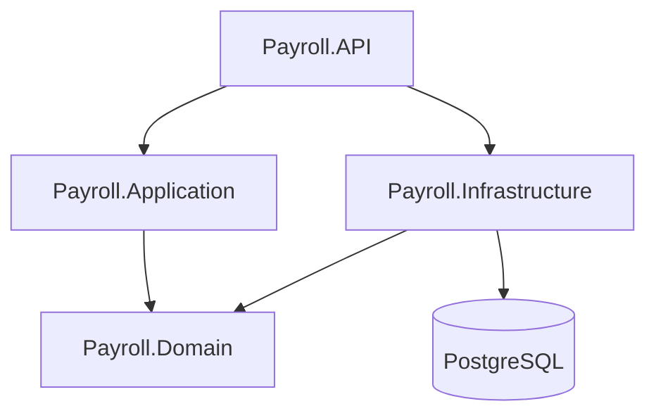

# PACKAGES

1. dotnet add package Npgsql.EntityFrameworkCore.PostgreSQL
2. dotnet add package DotNetEnv

# CHIỀU PHỤ THUỘC PAYROLL SERVICE

## Payroll.API

1. Payroll.Application
2. Payroll.Infrastructure

## Payroll.Application

1. Payroll.Domain

## Payroll.Infrastructure

1. Payroll.Application
2. Payroll.Domain

## Payroll.Domain

1. Không phụ thuộc project Payroll nào khác

## Diagram

## Payroll Architecture

Program.cs
|
| AddInfrastructure()
v
DependencyInjection.cs
|
| AddDbContext()
v
PayrollDbContext
|
| UseNpgsql()
v
PostgreSQL
