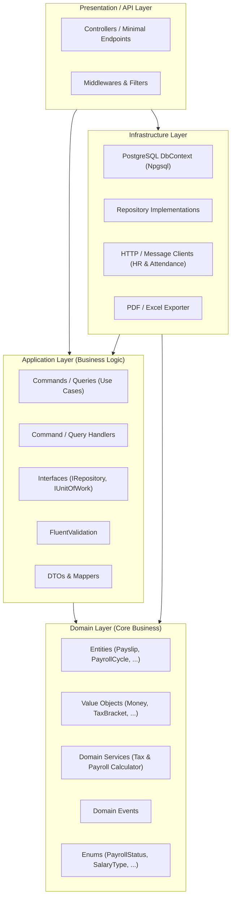
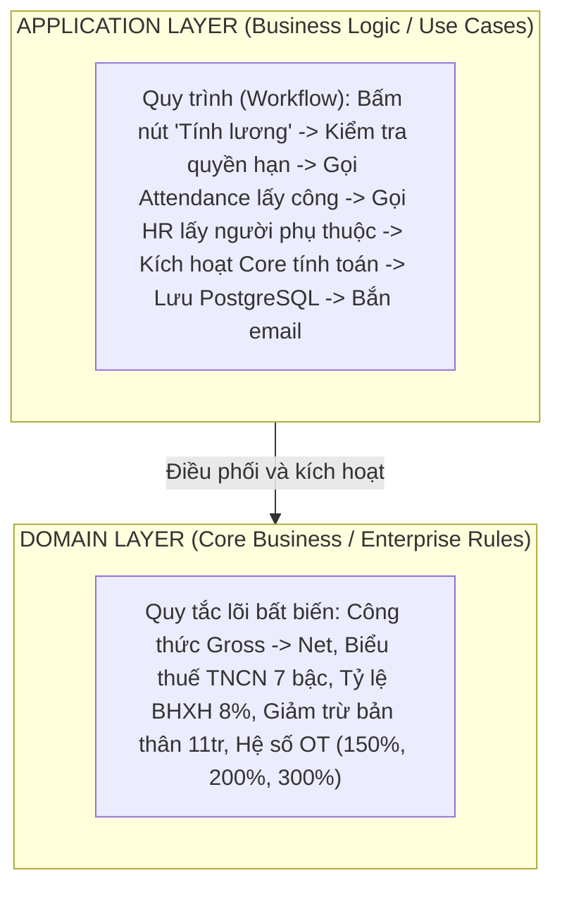
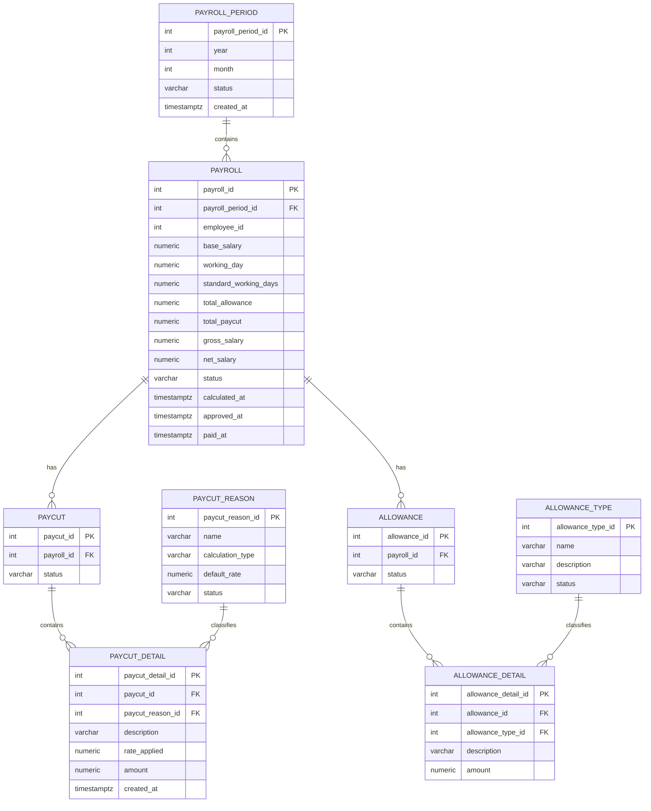
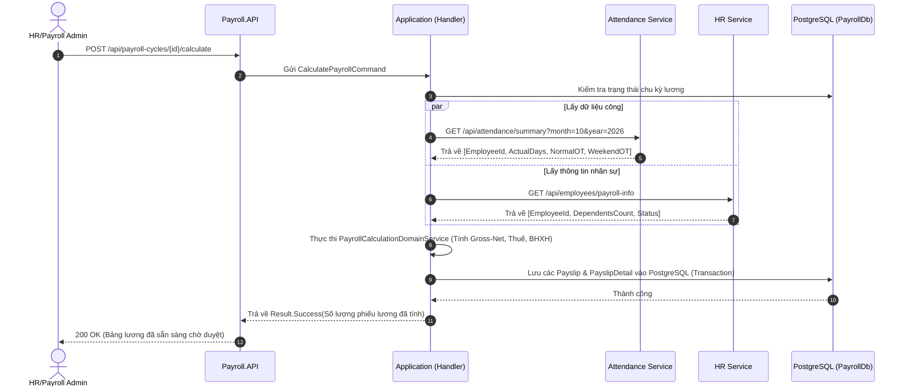

# TÀI LIỆU THIẾT KẾ KIẾN TRÚC MỤC TIÊU - SERVICE PAYROLL
**Hệ thống:** HRM (Human Resource Management)  
**Kiến trúc:** Clean Architecture (Onion / Hexagonal Architecture)  
**Hệ quản trị cơ sở dữ liệu:** PostgreSQL  
**Nền tảng:** .NET 10 / C#  

---

## 1. TỔNG QUAN KIẾN TRÚC (ARCHITECTURAL OVERVIEW)

Trong hệ thống HRM, **Payroll Service** đóng vai trò xử lý bảng lương, quản lý phụ cấp, khấu trừ bảo hiểm, tính thuế thu nhập cá nhân (TNCN) và phát hành phiếu lương (Payslip).

Mục tiêu áp dụng **Clean Architecture** là:
- **Độc lập Framework:** Nghiệp vụ cốt lõi không bị phụ thuộc vào ASP.NET Core hay Entity Framework Core.
- **Độc lập Cơ sở dữ liệu:** Lớp nghiệp vụ không phụ thuộc trực tiếp vào PostgreSQL; việc chuyển đổi hoặc tối ưu hóa lưu trữ diễn ra ở lớp ngoài cùng (Infrastructure).
- **Dễ dàng kiểm thử (Testability):** Có thể viết Unit Test cho toàn bộ công thức tính lương (Gross -> Net, BHXH, Thuế lũy tiến) mà không cần kết nối database thật.
- **Quy tắc phụ thuộc một chiều (Dependency Rule):** Mã nguồn chỉ phụ thuộc từ ngoài vào trong:  
  `API / Presentation` $\rightarrow$ `Infrastructure` $\rightarrow$ `Application` $\rightarrow$ `Domain`.



---

### 1.1. Bản chất phân tầng: Phân biệt "Core Business" và "Business Logic"

Trong Clean Architecture và Domain-Driven Design (DDD), khái niệm "nghiệp vụ" không phải là một khối duy nhất mà được chia tách thành **hai cấp độ hoàn toàn độc lập**:



#### A. Core Business (Enterprise Business Rules) – Nằm ở `Payroll.Domain`
* **Định nghĩa:** Là những **quy tắc nghiệp vụ cốt lõi, bất biến của ngành nghề**. Những quy tắc này **vẫn tồn tại ngay cả khi doanh nghiệp không có hệ thống phần mềm** (kể cả khi kế toán tính lương bằng giấy bút hay bảng tính Excel thì các quy tắc này vẫn giữ nguyên).
* **Ví dụ thực tế trong Payroll:**
  - Quy định của Nhà nước về **Thuế TNCN lũy tiến từng phần 7 bậc** (đến 5 triệu đóng 5%, từ 5–10 triệu đóng 10%,...).
  - Tỷ lệ trích nộp bảo hiểm: Người lao động đóng **BHXH 8%, BHYT 1.5%, BHTN 1%** (áp trần 20 lần lương cơ sở / lương vùng).
  - Mức giảm trừ gia cảnh: Bản thân 11.000.000đ/tháng, mỗi người phụ thuộc 4.400.000đ/tháng.
  - Một phiếu lương (Payslip) **không bao giờ được có tiền thực nhận âm**.
  - Không được phép sửa đổi phiếu lương nếu kỳ lương đã ở trạng thái `Paid` (Đã chi trả).
* **Đặc tính:** Hoàn toàn thuần túy C# (POCO), không có bất kỳ phụ thuộc nào vào Database, Web framework, hoặc thư viện bên ngoài.

#### B. Business Logic / Application Rules (Use Cases) – Nằm ở `Payroll.Application`
* **Định nghĩa:** Là **quy trình nghiệp vụ của phần mềm (Workflows / Use Cases)**. Nó chỉ ra cách thức ứng dụng tiếp nhận yêu cầu từ người dùng, điều phối dữ liệu giữa các dịch vụ ngoài và cơ sở dữ liệu để hoàn thành một kịch bản sử dụng.
* **Ví dụ thực tế trong Payroll:**
  - **Kịch bản tính lương tháng (`CalculatePayrollCommand`):**
    1. Tiếp nhận HTTP Request từ Admin qua Web API.
    2. Xác thực quyền hạn của người gọi thao tác.
    3. Kiểm tra xem kỳ lương này đã được phê duyệt chưa (nếu đã duyệt thì chặn lại).
    4. Gọi sang `Attendance Service` để lấy file tổng hợp ngày công và giờ OT của từng nhân viên.
    5. Gọi sang `HR Service` để lấy danh sách nhân sự đang hoạt động và số người phụ thuộc.
    6. Truyền các tham số trên vào **Core Business** để tính ra tiền thuế, bảo hiểm, lương thực nhận (Net).
    7. Lưu kết quả bảng lương vào cơ sở dữ liệu PostgreSQL qua Unit of Work.
    8. Gửi thông báo hoàn tất tính lương cho bộ phận kế toán.

#### C. Bảng so sánh đối chiếu trực quan

| Tiêu chí so sánh | Core Business (`Domain Layer`) | Business Logic (`Application Layer`) |
| :--- | :--- | :--- |
| **Bản chất** | Luật chơi, công thức tính toán và ràng buộc bất biến. | Quy trình thực hiện, điều phối luồng dữ liệu (Workflow). |
| **Sự tồn tại** | Tồn tại độc lập với phần mềm (luật lao động, chính sách công ty). | Chỉ tồn tại khi có phần mềm và gắn liền với Use Case. |
| **Lý do thay đổi** | Khi Nhà nước đổi luật thuế/bảo hiểm, hoặc công ty đổi quy chế lương. | Khi đổi quy trình duyệt, đổi giao diện, thêm bước gửi email, đổi hệ thống ngoài. |
| **Ví dụ điển hình** | $\text{Net} = \text{Gross} - \text{Bảo hiểm} - \text{Thuế TNCN}$ | `Nhận Request -> Gọi Attendance -> Tính toán -> Lưu PostgreSQL -> Bắn Event` |

> **Tại sao bắt buộc phải tách rời hai khái niệm này?**  
> 1. **Nguyên lý Đơn trách nhiệm (Single Responsibility):** Khi Nhà nước cập nhật biểu thuế TNCN mới (thay đổi Core Business), bạn chỉ sửa đúng hàm tính toán trong Domain Service mà không lo ảnh hưởng đến quy trình gọi API hay lưu trữ DB. Ngược lại, khi công ty muốn thêm bước "Gửi thông báo Zalo sau khi tính lương" (thay đổi Workflow), công thức tính thuế không bị rủi ro lỗi.  
> 2. **Khả năng kiểm thử (Unit Testing 100%):** Core Business có thể được kiểm thử độc lập cực nhanh với hàng trăm test case dữ liệu biên mà không cần dựng database giả (Mock DbContext) hay dựng mock HTTP.  
> 3. **Khả năng tái sử dụng (Reusability):** Lõi Core Business có thể tái sử dụng cho API Controller, Background Worker chạy định kỳ, hay công cụ CLI nhập liệu từ Excel.

---

## 2. CẤU TRÚC DỰ ÁN VÀ THƯ MỤC (PROJECT & FOLDER STRUCTURE)

Để đảm bảo phân tách rõ ràng và bảo vệ Dependency Rule bằng trình biên dịch .NET, cấu trúc mục tiêu của service `Payroll` được chia thành **4 Project** đặt trong `src/Payroll/`:

```text
src/
└── Payroll/
    ├── Payroll.Domain/                     # Lớp thực thể và quy tắc nghiệp vụ lõi (Core Business)
    ├── Payroll.Application/                # Lớp điều phối use case (Business Logic)
    ├── Payroll.Infrastructure/             # Lớp kết nối PostgreSQL và tích hợp ngoài
    └── Payroll.API/                        # Web API (Endpoints, DI container, Middleware)
```

---

### 2.1. Sơ đồ cây thư mục tổng thể

```text
src/Payroll/
├── Payroll.Domain/
│   ├── Common/
│   │   ├── BaseEntity.cs                   # Id, CreatedAt, UpdatedAt, IsDeleted
│   │   ├── IAggregateRoot.cs
│   │   └── ValueObject.cs
│   ├── Entities/
│   │   ├── EmployeeSalaryProfile.cs        # Hồ sơ lương nhân viên (Lương cơ bản, phụ cấp định kỳ)
│   │   ├── PayrollCycle.cs                 # Kỳ lương (Tháng 10/2026, trạng thái Nháp/Chốt/Đã chi trả)
│   │   ├── Payslip.cs                      # Phiếu lương chi tiết từng nhân viên trong kỳ
│   │   ├── PayslipDetail.cs                # Các mục cấu thành lương (Lương ngày công, OT, Phụ cấp, Phạt)
│   │   ├── SalaryComponent.cs              # Định nghĩa khoản thu nhập / khấu trừ
│   │   └── TaxBracket.cs                   # Bậc thuế TNCN lũy tiến
│   ├── Enums/
│   │   ├── PayrollStatus.cs                # Draft, Calculated, Approved, Paid, Cancelled
│   │   ├── ComponentType.cs                # Earning, Deduction, CompanyContribution
│   │   └── SalaryType.cs                   # Gross, Net
│   ├── ValueObjects/
│   │   ├── Money.cs                        # Số tiền và đơn vị (VND)
│   │   ├── WorkSummary.cs                  # Tổng hợp ngày công, giờ OT nhận từ Attendance
│   │   └── InsuranceRates.cs               # Tỷ lệ BHXH (8%), BHYT (1.5%), BHTN (1%)
│   ├── Services/
│   │   ├── IPayrollCalculationDomainService.cs # Domain Service tính lương Gross-Net
│   │   └── PayrollCalculationDomainService.cs
│   └── Exceptions/
│       ├── PayrollDomainException.cs
│       └── InvalidPayrollOperationException.cs
│
├── Payroll.Application/
│   ├── Common/
│   │   ├── Interfaces/
│   │   │   ├── IApplicationDbContext.cs    # Contract trừu tượng cho DbContext
│   │   │   ├── IUnitOfWork.cs              # Quản lý transaction
│   │   │   ├── IDateTimeProvider.cs
│   │   │   └── ICurrentUserService.cs
│   │   ├── Models/
│   │   │   ├── Result.cs                   # Result Pattern (Thành công / Thất bại)
│   │   │   └── PagedResult.cs
│   │   └── Behaviors/
│   │       ├── ValidationBehavior.cs       # MediatR Pipeline validate request tự động
│   │       └── LoggingBehavior.cs
│   ├── Contracts/
│   │   ├── Repositories/                   # Interface Repositories
│   │   │   ├── IPayrollCycleRepository.cs
│   │   │   ├── IPayslipRepository.cs
│   │   │   └── ISalaryProfileRepository.cs
│   │   └── External/                       # Interface gọi sang Service khác
│   │       ├── IAttendanceServiceClient.cs # Lấy số công, OT từ service Attendance
│   │       └── IHrServiceClient.cs         # Lấy thông tin nhân viên, người phụ thuộc từ HR
│   ├── Features/
│   │   ├── PayrollCycles/                  # Tính năng quản lý kỳ lương
│   │   │   ├── Commands/
│   │   │   │   ├── CreatePayrollCycleCommand.cs
│   │   │   │   ├── CalculatePayrollCommand.cs      # Core Use Case: Chạy tính lương tự động
│   │   │   │   └── ApprovePayrollCycleCommand.cs   # Phê duyệt kỳ lương
│   │   │   ├── Queries/
│   │   │   │   ├── GetPayrollCycleByIdQuery.cs
│   │   │   │   └── GetPayrollCycleListQuery.cs
│   │   │   └── DTOs/
│   │   │       └── PayrollCycleDto.cs
│   │   └── Payslips/                       # Tính năng tra cứu phiếu lương
│   │       ├── Queries/
│   │       │   ├── GetMyPayslipQuery.cs
│   │       │   └── GetPayslipsByCycleIdQuery.cs
│   │       └── DTOs/
│   │           ├── PayslipDto.cs
│   │           └── PayslipDetailDto.cs
│   ├── Validators/
│   │   ├── CalculatePayrollCommandValidator.cs
│   │   └── CreatePayrollCycleCommandValidator.cs
│   └── DependencyInjection.cs              # Extension method đăng ký Application services
│
├── Payroll.Infrastructure/
│   ├── Persistence/
│   │   ├── PayrollDbContext.cs             # Entity Framework Core DbContext
│   │   ├── UnitOfWork.cs                   # Triển khai IUnitOfWork
│   │   ├── Configurations/                 # Fluent API cấu hình bảng PostgreSQL
│   │   │   ├── PayrollCycleConfiguration.cs
│   │   │   ├── PayslipConfiguration.cs
│   │   │   ├── PayslipDetailConfiguration.cs
│   │   │   └── EmployeeSalaryProfileConfiguration.cs
│   │   ├── Repositories/                   # Triển khai các Repository dùng EF Core & Npgsql
│   │   │   ├── PayrollCycleRepository.cs
│   │   │   ├── PayslipRepository.cs
│   │   │   └── SalaryProfileRepository.cs
│   │   └── Migrations/                     # EF Core Migrations cho PostgreSQL
│   ├── ExternalClients/                    # Triển khai gọi API sang Attendance & HR
│   │   ├── AttendanceServiceClient.cs      # HttpClient / Refit gọi Attendance API
│   │   └── HrServiceClient.cs              # HttpClient / Refit gọi HR API
│   ├── ExportServices/
│   │   ├── ExcelPayrollExporter.cs         # Xuất bảng lương ra Excel (ClosedXML/EPPlus)
│   │   └── PdfPayslipGenerator.cs          # Sinh phiếu lương PDF (QuestPDF)
│   └── DependencyInjection.cs              # Cấu hình Npgsql, DbContext, HttpClient, DI
│
└── Payroll.API/
    ├── Controllers/                        # REST API Controllers (hoặc Minimal Endpoints)
    │   ├── PayrollCyclesController.cs
    │   └── PayslipsController.cs
    ├── Middlewares/
    │   ├── GlobalExceptionMiddleware.cs    # Bắt lỗi toàn cục, trả về chuẩn RFC 7807 ProblemDetails
    │   └── RequestPerformanceMiddleware.cs
    ├── appsettings.json                    # ConnectionStrings PostgreSQL & Service Endpoints
    ├── appsettings.Development.json
    ├── Program.cs                          # Entry point cấu hình Middleware pipeline
    └── Payroll.API.csproj
```

---

### 2.2. Giải thích chi tiết ý nghĩa và vai trò của từng thư mục và thư mục con

Dưới đây là phần thuyết minh chi tiết cho từng project và tất cả các thư mục con bên trong service `Payroll`:

#### A. Project `Payroll.Domain` (Core Business Layer)
Tầng này đóng vai trò là hạt nhân trung tâm của service, thuần C# và không phụ thuộc vào bất kỳ thư viện bên ngoài nào.
* 📁 **`Common/`**: Chứa các lớp cơ sở (Base Classes) và interface nền tảng cho mô hình hướng đối tượng:
  * `BaseEntity.cs`: Chứa các trường dữ liệu định danh dùng chung cho tất cả bảng (`Id`, `CreatedAt`, `UpdatedAt`, `IsDeleted`).
  * `ValueObject.cs`: Lớp trừu tượng cho các đối tượng so sánh bằng giá trị bên trong thay vì ID.
  * `IAggregateRoot.cs`: Interface đánh dấu các thực thể gốc (Aggregate Root) kiểm soát tính toàn vẹn dữ liệu của các thực thể con phụ thuộc.
* 📁 **`Entities/`**: Chứa các thực thể chính có danh tính (ID) và vòng đời độc lập:
  * `PayrollCycle.cs`: Chu kỳ tính lương (Tháng, Năm, số ngày công chuẩn, trạng thái).
  * `Payslip.cs`: Phiếu lương cụ thể của một nhân viên trong chu kỳ đó.
  * `PayslipDetail.cs`: Từng dòng thu nhập/khấu trừ chi tiết cấu thành nên phiếu lương.
  * `EmployeeSalaryProfile.cs`: Hồ sơ lương cá nhân của nhân viên (mức lương thỏa thuận, tài khoản ngân hàng).
  * `SalaryComponent.cs`: Danh mục các loại khoản lương (ăn trưa, xăng xe, phụ cấp độc hại, trách nhiệm).
  * `TaxBracket.cs`: Cấu hình các bậc thuế TNCN lũy tiến.
* 📁 **`Enums/`**: Các kiểu liệt kê định nghĩa tập trạng thái cố định:
  * `PayrollStatus.cs`: Trạng thái kỳ lương (`Draft` - Nháp, `Calculated` - Đã tính, `Approved` - Đã duyệt, `Paid` - Đã thanh toán, `Cancelled` - Đã hủy).
  * `ComponentType.cs`: Phân loại khoản tiền (`Earning` - Thu nhập cộng vào, `Deduction` - Khấu trừ, `CompanyContribution` - Doanh nghiệp đóng).
  * `SalaryType.cs`: Loại hình thỏa thuận lương (`Gross`, `Net`).
* 📁 **`ValueObjects/`**: Các đối tượng nhỏ không có định danh ID riêng, mang tính bất biến:
  * `Money.cs`: Kết hợp số tiền (`Amount`) và đơn vị tiền tệ (`VND`) để tránh sai sót cộng nhầm ngoại tệ.
  * `WorkSummary.cs`: Gói gọn kết quả chấm công nhận được (`ActualWorkingDays`, `NormalOtHours`, `WeekendOtHours`).
  * `InsuranceRates.cs`: Tỷ lệ phần trăm đóng bảo hiểm của người lao động và người sử dụng lao động.
* 📁 **`Services/`**: Các quy tắc nghiệp vụ lõi thao tác trên nhiều thực thể cùng lúc:
  * `PayrollCalculationDomainService.cs`: Chứa toàn bộ công thức toán học tính thuế TNCN lũy tiến, tính BHXH/BHYT/BHTN, tính tiền làm thêm giờ (OT) theo Luật Lao động Việt Nam.
* 📁 **`Exceptions/`**: Chứa các ngoại lệ nghiệp vụ cụ thể:
  * `PayrollDomainException.cs`: Bắn lỗi khi người dùng cố tình thực hiện thao tác sai quy tắc nghiệp vụ (ví dụ: *"Không thể sửa phiếu lương khi kỳ lương đã được chi trả"*).

#### B. Project `Payroll.Application` (Business Logic Layer)
Tầng này chịu trách nhiệm hiện thực hóa các Use Case của người dùng thông qua mô hình CQRS (Command Query Responsibility Segregation) và thư viện MediatR.
* 📁 **`Common/`**: Các thành phần hạ tầng phần mềm dùng chung:
  * 📁 **`Interfaces/`**: Hợp đồng trừu tượng (Dependency Inversion):
    * `IApplicationDbContext.cs`: Khai báo các `DbSet` để tầng Application truy vấn mà không cần biết chi tiết EF Core.
    * `IUnitOfWork.cs`: Quản lý giao dịch (Transaction) `SaveChangesAsync()`.
    * `ICurrentUserService.cs`: Trích xuất thông tin người dùng đang gọi API từ JWT Token.
  * 📁 **`Models/`**: Các lớp gói dữ liệu chung:
    * `Result.cs`: Triển khai Result Pattern, chuẩn hóa kết quả thành công/thất bại mà không cần lạm dụng bắn Exception.
    * `PagedResult.cs`: Định dạng kết quả trả về khi phân trang danh sách (trang hiện tại, tổng số dòng, dữ liệu).
  * 📁 **`Behaviors/`**: Các Pipeline Behavior của MediatR chạy chặn ngang request:
    * `ValidationBehavior.cs`: Tự động kích hoạt FluentValidation trước khi chuyển request đến Handler.
    * `LoggingBehavior.cs`: Tự động ghi log thời gian xử lý của từng Command/Query.
* 📁 **`Contracts/`**: Chứa các Interface giao tiếp hai chiều:
  * 📁 **`Repositories/`**: Khai báo các hàm truy vấn dữ liệu (`IPayrollCycleRepository.cs`, `IPayslipRepository.cs`).
  * 📁 **`External/`**: Khai báo interface gọi sang các microservice lân cận (`IAttendanceServiceClient.cs` để lấy công, `IHrServiceClient.cs` để lấy nhân viên và số người phụ thuộc).
* 📁 **`Features/`**: Tổ chức theo cấu trúc Feature Folders (Vertical Slice) cho từng phân hệ nghiệp vụ:
  * 📁 **`PayrollCycles/`**:
    * 📁 `Commands/`: Các tác vụ ghi dữ liệu (`CreatePayrollCycleCommand`, `CalculatePayrollCommand`, `ApprovePayrollCycleCommand`) kèm theo Handler xử lý tương ứng.
    * 📁 `Queries/`: Các tác vụ đọc dữ liệu (`GetPayrollCycleByIdQuery`, `GetPayrollCycleListQuery`).
    * 📁 `DTOs/`: Đối tượng truyền dữ liệu (`PayrollCycleDto`).
  * 📁 **`Payslips/`**:
    * 📁 `Queries/`: Tra cứu phiếu lương (`GetMyPayslipQuery` cho nhân viên, `GetPayslipsByCycleIdQuery` cho kế toán).
    * 📁 `DTOs/`: `PayslipDto`, `PayslipDetailDto`.
* 📁 **`Validators/`**: Chứa các lớp kiểm tra dữ liệu đầu vào (Input Validation) bằng FluentValidation (ví dụ: tháng phải từ 1 đến 12, số tiền phụ cấp không được âm).
* 📄 **`DependencyInjection.cs`**: Extension method gom toàn bộ đăng ký MediatR, FluentValidation, AutoMapper/Mapster vào DI container.

#### C. Project `Payroll.Infrastructure` (PostgreSQL & External Integration Layer)
Tầng kỹ thuật hiện thực hóa các Interface được định nghĩa ở Application, chịu trách nhiệm lưu trữ PostgreSQL và giao tiếp mạng.
* 📁 **`Persistence/`**: Toàn bộ logic tương tác cơ sở dữ liệu PostgreSQL:
  * 📄 `PayrollDbContext.cs`: Lớp DbContext của EF Core cấu hình kết nối tới PostgreSQL database.
  * 📄 `UnitOfWork.cs`: Triển khai `IUnitOfWork`, đảm bảo tính toàn vẹn giao dịch (ACID) khi lưu dữ liệu.
  * 📁 **`Configurations/`**: Áp dụng Fluent API để cấu hình chi tiết từng bảng PostgreSQL:
    * `PayrollCycleConfiguration.cs`: Đặt tên bảng dạng `payroll_cycles`, cấu hình khóa chính và unique index.
    * `PayslipConfiguration.cs`: Chỉ định chính xác kiểu dữ liệu PostgreSQL như `numeric(18,2)` cho tiền lương, `timestamp with time zone` cho ngày giờ UTC, `gen_random_uuid()` cho UUID.
  * 📁 **`Repositories/`**: Triển khai các phương thức truy vấn LINQ/SQL cụ thể (`PayrollCycleRepository.cs`, `PayslipRepository.cs`).
  * 📁 **`Migrations/`**: Chứa các file Migration C# do công cụ `dotnet ef` tự động sinh ra nhằm quản lý lịch sử thay đổi schema cơ sở dữ liệu.
* 📁 **`ExternalClients/`**: Triển khai gọi API ra các service bên ngoài qua HTTP/REST hoặc gRPC:
  * `AttendanceServiceClient.cs`: Sử dụng `HttpClient` có cấu hình Polly Retry để lấy bảng chấm công tháng từ `Attendance Service`.
  * `HrServiceClient.cs`: Gọi sang `HR Service` để lấy danh sách người phụ thuộc phục vụ giảm trừ gia cảnh.
* 📁 **`ExportServices/`**: Các dịch vụ bổ trợ sinh tệp tin:
  * `ExcelPayrollExporter.cs`: Xuất bảng tổng hợp thanh toán lương ra file Excel `.xlsx`.
  * `PdfPayslipGenerator.cs`: Sinh phiếu lương chi tiết dạng PDF để gửi email cho nhân viên.
* 📄 **`DependencyInjection.cs`**: Cấu hình `AddDbContext<PayrollDbContext>`, thiết lập Npgsql Connection Pooling, Retry Policy và đăng ký các Repository vào DI container.

#### D. Project `Payroll.API` (Presentation Layer)
Điểm bắt đầu chạy ứng dụng (Entry Point), tiếp nhận HTTP Request và điều phối trả về HTTP Response.
* 📁 **`Controllers/`** (hoặc `Endpoints/` nếu dùng Minimal APIs):
  * `PayrollCyclesController.cs`: Tiếp nhận HTTP POST/GET cho kỳ lương. Controller chỉ nhận request và gửi thẳng vào MediatR (`_mediator.Send()`), hoàn toàn mỏng (Thin Controller).
  * `PayslipsController.cs`: Các endpoint tra cứu phiếu lương cho nhân viên và kế toán.
* 📁 **`Middlewares/`**: Chứa các bộ lọc chặn xuyên suốt vòng đời Request:
  * `GlobalExceptionMiddleware.cs`: Hứng toàn bộ Exception chưa được xử lý, chuyển đổi `DomainException` thành HTTP 400 Bad Request, và Exception hệ thống thành HTTP 500 kèm định dạng chuẩn RFC 7807 ProblemDetails.
  * `RequestPerformanceMiddleware.cs`: Đo thời gian thực thi request và cảnh báo nếu có API xử lý quá chậm.
* 📄 **`appsettings.json`**: Lưu chuỗi kết nối PostgreSQL (`ConnectionStrings:PayrollDb`) và URL các microservice liên kết (`AttendanceServiceUrl`, `HrServiceUrl`).
* 📄 **`Program.cs`**: Nơi khởi tạo ứng dụng: kích hoạt DI (`AddApplicationServices`, `AddInfrastructureServices`), cấu hình OpenAPI/Swagger, bật HTTPS Redirection, CORS, Authentication/Authorization và map các router.

---

## 3. CHI TIẾT LỚP BUSINESS LOGIC (APPLICATION & DOMAIN)

Lớp Business Logic được tổ chức thành 2 tầng con:
1. **Domain Layer:** Chứa công thức tính toán và quy tắc nghiệp vụ bất biến (Invariants).
2. **Application Layer:** Điều phối luồng nghiệp vụ (Orchestration), xác thực dữ liệu đầu vào và tương tác với các hệ thống ngoài.

### 3.1. Quy tắc nghiệp vụ tính lương chuẩn Việt Nam (Domain Rules)

Quy trình tính toán bảng lương hàng tháng tuân theo Luật Lao động và Thuế TNCN Việt Nam:

$$\text{Tổng thu nhập (Gross)} = \text{Lương cơ bản thực tế} + \text{Phụ cấp chịu thuế} + \text{Phụ cấp miễn thuế} + \text{Lương làm thêm giờ (OT)}$$

Trong đó:
1. **Lương cơ bản theo ngày công:**
   $$\text{Lương ngày công} = \frac{\text{Lương cơ bản hợp đồng}}{\text{Số ngày làm việc chuẩn}} \times \text{Số ngày công thực tế (lấy từ Attendance)}$$
2. **Lương làm thêm giờ (OT):**
   - Ngày thường: $150\% \times \text{Đơn giá giờ chuẩn}$
   - Cuối tuần (Thứ 7, CN): $200\% \times \text{Đơn giá giờ chuẩn}$
   - Ngày Lễ, Tết: $300\% \times \text{Đơn giá giờ chuẩn}$
   *(Phần vượt trên $100\%$ được miễn thuế TNCN theo quy định hiện hành).*
3. **Các khoản trích đóng bảo hiểm (Người lao động chịu 10.5%):**
   - BHXH: $8\%$ (Áp trần tối đa $20$ lần mức lương cơ sở)
   - BHYT: $1.5\%$ (Áp trần tối đa $20$ lần mức lương cơ sở)
   - BHTN: $1\%$ (Áp trần tối đa $20$ lần mức lương tối thiểu vùng)
4. **Thu nhập tính thuế TNCN:**
   $$\text{Thu nhập tính thuế} = \text{Gross} - \text{Phụ cấp miễn thuế} - \text{Các khoản bảo hiểm bắt buộc} - \text{Giảm trừ gia cảnh bản thân (11tr)} - (\text{Số người phụ thuộc} \times 4.4\text{tr})$$
5. **Thuế TNCN lũy tiến từng phần:**
   - Bậc 1 (đến 5 triệu): $5\%$
   - Bậc 2 (5 - 10 triệu): $10\%$
   - Bậc 3 (10 - 18 triệu): $15\%$
   - Bậc 4 (18 - 32 triệu): $20\%$
   - Bậc 5 (32 - 52 triệu): $25\%$
   - Bậc 6 (52 - 80 triệu): $30\%$
   - Bậc 7 (trên 80 triệu): $35\%$
6. **Lương thực nhận (Net):**
   $$\text{Thực nhận (Net)} = \text{Tổng Gross} - \text{Tổng đóng BH} - \text{Thuế TNCN} - \text{Khấu trừ khác / Ứng lương}$$

### 3.2. Mã nguồn mẫu cho Domain Service (`PayrollCalculationDomainService.cs`)

```csharp
namespace Payroll.Domain.Services;

public class PayrollCalculationDomainService : IPayrollCalculationDomainService
{
    private const decimal SelfDeduction = 11_000_000m;      // Giảm trừ bản thân
    private const decimal DependentDeduction = 4_400_000m;  // Giảm trừ người phụ thuộc

    public Payslip CalculatePayslip(
        EmployeeSalaryProfile profile, 
        WorkSummary work, 
        int dependentCount,
        int standardWorkingDays)
    {
        // 1. Tính lương theo ngày công thực tế
        decimal dailyRate = profile.BaseSalary / standardWorkingDays;
        decimal actualBaseSalary = dailyRate * work.ActualWorkingDays;

        // 2. Tính tiền làm thêm giờ (OT)
        decimal hourlyRate = dailyRate / 8;
        decimal normalOtPay = work.NormalOtHours * hourlyRate * 1.5m;
        decimal weekendOtPay = work.WeekendOtHours * hourlyRate * 2.0m;
        decimal holidayOtPay = work.HolidayOtHours * hourlyRate * 3.0m;
        decimal totalOtPay = normalOtPay + weekendOtPay + holidayOtPay;

        // 3. Phụ cấp (Ăn trưa, đi lại, điện thoại, trách nhiệm)
        decimal taxableAllowances = profile.TaxableAllowances;
        decimal nonTaxableAllowances = profile.NonTaxableAllowances;

        decimal totalGross = actualBaseSalary + totalOtPay + taxableAllowances + nonTaxableAllowances;

        // 4. Bảo hiểm bắt buộc (NLĐ đóng 10.5%)
        decimal insuranceBase = Math.Min(profile.BaseSalary, profile.InsuranceCap);
        decimal socialInsurance = insuranceBase * 0.08m;   // BHXH 8%
        decimal healthInsurance = insuranceBase * 0.015m;  // BHYT 1.5%
        decimal unemploymentIns = insuranceBase * 0.01m;   // BHTN 1%
        decimal totalInsurance = socialInsurance + healthInsurance + unemploymentIns;

        // 5. Thu nhập chịu thuế & Thu nhập tính thuế TNCN
        // Chú ý: Phần OT vượt 100% được miễn thuế
        decimal taxFreeOt = (work.NormalOtHours * hourlyRate * 0.5m) 
                          + (work.WeekendOtHours * hourlyRate * 1.0m) 
                          + (work.HolidayOtHours * hourlyRate * 2.0m);
        
        decimal totalFamilyDeduction = SelfDeduction + (dependentCount * DependentDeduction);
        decimal taxableIncome = totalGross - nonTaxableAllowances - taxFreeOt;
        decimal assessableIncome = Math.Max(0, taxableIncome - totalInsurance - totalFamilyDeduction);

        // 6. Tính thuế TNCN lũy tiến
        decimal personalIncomeTax = CalculateProgressiveTax(assessableIncome);

        // 7. Lương Net cuối cùng
        decimal totalNet = totalGross - totalInsurance - personalIncomeTax;

        return Payslip.Create(
            profile.EmployeeId,
            actualBaseSalary,
            totalOtPay,
            taxableAllowances + nonTaxableAllowances,
            totalInsurance,
            personalIncomeTax,
            totalNet
        );
    }

    private decimal CalculateProgressiveTax(decimal income)
    {
        if (income <= 0) return 0;
        if (income <= 5_000_000m) return income * 0.05m;
        if (income <= 10_000_000m) return 250_000m + (income - 5_000_000m) * 0.10m;
        if (income <= 18_000_000m) return 750_000m + (income - 10_000_000m) * 0.15m;
        if (income <= 32_000_000m) return 1_950_000m + (income - 18_000_000m) * 0.20m;
        if (income <= 52_000_000m) return 4_750_000m + (income - 32_000_000m) * 0.25m;
        if (income <= 80_000_000m) return 9_750_000m + (income - 52_000_000m) * 0.30m;
        return 18_150_000m + (income - 80_000_000m) * 0.35m;
    }
}
```

### 3.3. Application Use Case: Điều phối quy trình tính lương (`CalculatePayrollHandler.cs`)

```csharp
namespace Payroll.Application.Features.PayrollCycles.Commands;

public record CalculatePayrollCommand(Guid PayrollCycleId) : IRequest<Result<int>>;

public class CalculatePayrollCommandHandler : IRequestHandler<CalculatePayrollCommand, Result<int>>
{
    private readonly IPayrollCycleRepository _cycleRepo;
    private readonly ISalaryProfileRepository _profileRepo;
    private readonly IAttendanceServiceClient _attendanceClient;
    private readonly IHrServiceClient _hrClient;
    private readonly IPayrollCalculationDomainService _calculationService;
    private readonly IUnitOfWork _unitOfWork;

    public CalculatePayrollCommandHandler(
        IPayrollCycleRepository cycleRepo,
        ISalaryProfileRepository profileRepo,
        IAttendanceServiceClient attendanceClient,
        IHrServiceClient hrClient,
        IPayrollCalculationDomainService calculationService,
        IUnitOfWork unitOfWork)
    {
        _cycleRepo = cycleRepo;
        _profileRepo = profileRepo;
        _attendanceClient = attendanceClient;
        _hrClient = hrClient;
        _calculationService = calculationService;
        _unitOfWork = unitOfWork;
    }

    public async Task<Result<int>> Handle(CalculatePayrollCommand request, CancellationToken ct)
    {
        var cycle = await _cycleRepo.GetByIdWithPayslipsAsync(request.PayrollCycleId, ct);
        if (cycle == null)
            return Result<int>.Failure("Không tìm thấy kỳ lương.");

        if (cycle.Status == PayrollStatus.Approved || cycle.Status == PayrollStatus.Paid)
            return Result<int>.Failure("Kỳ lương đã được phê duyệt, không thể tính lại.");

        // 1. Lấy danh sách hồ sơ lương nhân viên đang hoạt động
        var activeProfiles = await _profileRepo.GetActiveProfilesAsync(ct);

        // 2. Lấy dữ liệu công & OT từ Attendance Service
        var attendanceData = await _attendanceClient.GetMonthlyAttendanceSummaryAsync(cycle.Month, cycle.Year, ct);

        // 3. Lấy thông tin người phụ thuộc từ HR Service
        var dependentsData = await _hrClient.GetEmployeeDependentsCountAsync(ct);

        // 4. Xóa bảng lương cũ của chu kỳ hiện tại (nếu tính lại)
        cycle.ClearPayslips();

        // 5. Chạy tính toán song song hoặc tuần tự cho từng nhân viên
        foreach (var profile in activeProfiles)
        {
            var work = attendanceData.GetValueOrDefault(profile.EmployeeId, WorkSummary.Zero);
            var dependentCount = dependentsData.GetValueOrDefault(profile.EmployeeId, 0);

            var payslip = _calculationService.CalculatePayslip(
                profile,
                work,
                dependentCount,
                cycle.StandardWorkingDays
            );

            cycle.AddPayslip(payslip);
        }

        cycle.MarkAsCalculated();

        // 6. Lưu vào PostgreSQL thông qua Unit Of Work
        await _unitOfWork.SaveChangesAsync(ct);

        return Result<int>.Success(cycle.Payslips.Count);
    }
}
```

---

## 4. CHI TIẾT LỚP KẾT NỐI DATABASE POSTGRESQL (INFRASTRUCTURE)

Lớp kết nối PostgreSQL chịu trách nhiệm:
1. Giao tiếp với PostgreSQL thông qua Entity Framework Core với driver **`Npgsql.EntityFrameworkCore.PostgreSQL`**.
2. Chuẩn hóa quy ước đặt tên PostgreSQL (`snake_case` cho tables/columns) bằng gói `EFCore.NamingConventions`.
3. Cấu hình kiểu dữ liệu chính xác (`numeric(18,2)` cho tiền tệ, `timestamp with time zone` cho ngày giờ UTC, `uuid` cho ID khóa chính).
4. Áp dụng **Repository Pattern** và **Unit of Work** để trừu tượng hóa truy vấn và quản lý giao dịch (ACID transactions).
5. Quản lý Pool kết nối và cơ chế tự động thử lại khi mất kết nối (`EnableRetryOnFailure`).

### 4.1. Các thư viện NuGet bắt buộc cho `Payroll.Infrastructure`

```xml
<ItemGroup>
    <!-- Driver PostgreSQL cho EF Core -->
    <PackageReference Include="Npgsql.EntityFrameworkCore.PostgreSQL" Version="9.0.3" />
    
    <!-- Tự động chuyển đổi PascalCase C# sang snake_case PostgreSQL -->
    <PackageReference Include="EFCore.NamingConventions" Version="9.0.0" />
    
    <!-- Hỗ trợ Migration và Design-time -->
    <PackageReference Include="Microsoft.EntityFrameworkCore.Design" Version="9.0.2">
      <PrivateAssets>all</PrivateAssets>
      <IncludeAssets>runtime; build; native; contentfiles; analyzers; buildtransitive</IncludeAssets>
    </PackageReference>
</ItemGroup>
```

### 4.2. Cấu hình Connection String (`appsettings.json`)

```json
{
  "ConnectionStrings": {
    "PayrollDb": "Host=localhost;Port=5432;Database=hrm_payroll;Username=postgres;Password=YourPassword;Pooling=true;Minimum Pool Size=5;Maximum Pool Size=50;Connection Lifetime=300;"
  },
  "ExternalServices": {
    "AttendanceServiceUrl": "http://localhost:5001",
    "HrServiceUrl": "http://localhost:5002"
  }
}
```

### 4.3. Thiết kế `PayrollDbContext`

```csharp
namespace Payroll.Infrastructure.Persistence;

public class PayrollDbContext : DbContext, IUnitOfWork
{
    public PayrollDbContext(DbContextOptions<PayrollDbContext> options) : base(options)
    {
    }

    public DbSet<PayrollCycle> PayrollCycles => Set<PayrollCycle>();
    public DbSet<Payslip> Payslips => Set<Payslip>();
    public DbSet<PayslipDetail> PayslipDetails => Set<PayslipDetail>();
    public DbSet<EmployeeSalaryProfile> SalaryProfiles => Set<EmployeeSalaryProfile>();

    protected override void OnModelCreating(ModelBuilder modelBuilder)
    {
        base.OnModelCreating(modelBuilder);
        
        // Tự động quét và áp dụng tất cả các cấu hình IEntityTypeConfiguration<T> trong Assembly
        modelBuilder.ApplyConfigurationsFromAssembly(typeof(PayrollDbContext).Assembly);
    }

    public override async Task<int> SaveChangesAsync(CancellationToken cancellationToken = default)
    {
        // Tự động gán CreatedAt / UpdatedAt trước khi lưu
        foreach (var entry in ChangeTracker.Entries<BaseEntity>())
        {
            switch (entry.State)
            {
                case EntityState.Added:
                    entry.Entity.CreatedAt = DateTimeOffset.UtcNow;
                    break;
                case EntityState.Modified:
                    entry.Entity.UpdatedAt = DateTimeOffset.UtcNow;
                    break;
            }
        }

        return await base.SaveChangesAsync(cancellationToken);
    }
}
```

### 4.4. Cấu hình Fluent API cho PostgreSQL (`PayslipConfiguration.cs`)

Cấu hình chi tiết kiểu dữ liệu, index, quan hệ khóa ngoại phù hợp với PostgreSQL:

```csharp
namespace Payroll.Infrastructure.Persistence.Configurations;

public class PayslipConfiguration : IEntityTypeConfiguration<Payslip>
{
    public void Configure(EntityTypeBuilder<Payslip> builder)
    {
        builder.ToTable("payslips");

        builder.HasKey(x => x.Id);
        builder.Property(x => x.Id)
               .HasDefaultValueSql("gen_random_uuid()"); // Hàm sinh UUID v4 mặc định của PostgreSQL

        builder.Property(x => x.EmployeeId)
               .IsRequired();

        // Định dạng tiền tệ chính xác cao trên PostgreSQL (numeric 18, 2)
        builder.Property(x => x.ActualBaseSalary)
               .HasColumnType("numeric(18,2)")
               .IsRequired();

        builder.Property(x => x.OvertimePay)
               .HasColumnType("numeric(18,2)")
               .HasDefaultValue(0);

        builder.Property(x => x.TotalAllowances)
               .HasColumnType("numeric(18,2)")
               .HasDefaultValue(0);

        builder.Property(x => x.TotalInsuranceDeduction)
               .HasColumnType("numeric(18,2)")
               .HasDefaultValue(0);

        builder.Property(x => x.PersonalIncomeTax)
               .HasColumnType("numeric(18,2)")
               .HasDefaultValue(0);

        builder.Property(x => x.NetSalary)
               .HasColumnType("numeric(18,2)")
               .IsRequired();

        builder.Property(x => x.CreatedAt)
               .HasColumnType("timestamp with time zone")
               .IsRequired();

        builder.Property(x => x.UpdatedAt)
               .HasColumnType("timestamp with time zone");

        // Đánh index phục vụ tìm kiếm nhanh theo nhân viên và kỳ lương
        builder.HasIndex(x => new { x.PayrollCycleId, x.EmployeeId })
               .IsUnique();

        // Quan hệ 1 - N với PayslipDetail (cascade delete)
        builder.HasMany(x => x.Details)
               .WithOne()
               .HasForeignKey(d => d.PayslipId)
               .OnDelete(DeleteBehavior.Cascade);
    }
}
```

### 4.5. Triển khai Repository Pattern (`PayslipRepository.cs`)

```csharp
namespace Payroll.Infrastructure.Persistence.Repositories;

public class PayslipRepository : IPayslipRepository
{
    private readonly PayrollDbContext _context;

    public PayslipRepository(PayrollDbContext context)
    {
        _context = context;
    }

    public async Task<Payslip?> GetByIdAsync(Guid id, CancellationToken ct = default)
    {
        return await _context.Payslips
            .Include(p => p.Details)
            .FirstOrDefaultAsync(p => p.Id == id, ct);
    }

    public async Task<Payslip?> GetByEmployeeAndCycleAsync(Guid cycleId, Guid employeeId, CancellationToken ct = default)
    {
        return await _context.Payslips
            .Include(p => p.Details)
            .AsNoTracking()
            .FirstOrDefaultAsync(p => p.PayrollCycleId == cycleId && p.EmployeeId == employeeId, ct);
    }

    public async Task<List<Payslip>> GetByCycleIdAsync(Guid cycleId, CancellationToken ct = default)
    {
        return await _context.Payslips
            .AsNoTracking()
            .Where(p => p.PayrollCycleId == cycleId)
            .ToListAsync(ct);
    }

    public void Add(Payslip payslip) => _context.Payslips.Add(payslip);

    public void Update(Payslip payslip) => _context.Payslips.Update(payslip);
}
```

### 4.6. Đăng ký kết nối Database trong `DependencyInjection.cs` (Lớp Infrastructure)

```csharp
namespace Payroll.Infrastructure;

public static class DependencyInjection
{
    public static IServiceCollection AddInfrastructureServices(this IServiceCollection services, IConfiguration configuration)
    {
        var connectionString = configuration.GetConnectionString("PayrollDb");

        // Cấu hình Npgsql PostgreSQL DbContext
        services.AddDbContext<PayrollDbContext>(options =>
        {
            options.UseNpgsql(connectionString, npgsqlOptions =>
            {
                npgsqlOptions.EnableRetryOnFailure(
                    maxRetryCount: 3,
                    maxRetryDelay: TimeSpan.FromSeconds(5),
                    errorCodesToAdd: null);
                npgsqlOptions.MigrationsAssembly(typeof(PayrollDbContext).Assembly.FullName);
            })
            .UseSnakeCaseNamingConvention(); // Chuyển đổi PascalCase thành snake_case chuẩn Postgres
        });

        // Đăng ký UnitOfWork và Repositories
        services.AddScoped<IUnitOfWork>(sp => sp.GetRequiredService<PayrollDbContext>());
        services.AddScoped<IPayrollCycleRepository, PayrollCycleRepository>();
        services.AddScoped<IPayslipRepository, PayslipRepository>();
        services.AddScoped<ISalaryProfileRepository, SalaryProfileRepository>();

        // Đăng ký HttpClients giao tiếp với Attendance & HR Services
        services.AddHttpClient<IAttendanceServiceClient, AttendanceServiceClient>(client =>
        {
            client.BaseAddress = new Uri(configuration["ExternalServices:AttendanceServiceUrl"]!);
        });

        services.AddHttpClient<IHrServiceClient, HrServiceClient>(client =>
        {
            client.BaseAddress = new Uri(configuration["ExternalServices:HrServiceUrl"]!);
        });

        return services;
    }
}
```

---

## 5. THIẾT KẾ CƠ SỞ DỮ LIỆU POSTGRESQL (PHYSICAL SCHEMA THEO ERD CHÍNH THỨC)

Mô hình dữ liệu quan hệ cho `hrm_payroll` trong PostgreSQL được chuẩn hóa theo ERD chính thức của đồ án:



---

## 6. GIAO TIẾP VỚI CÁC SERVICE KHÁC TRONG HỆ THỐNG HRM

Trong hệ thống phân tán HRM, `Payroll` không lưu trực tiếp dữ liệu chấm công hay hồ sơ cá nhân mà giao tiếp thông qua API hoặc Event:



---

## 7. LỘ TRÌNH TRIỂN KHAI VÀ DI TRÚ TỪ CODE HIỆN TẠI

Hiện tại thư mục `src/Payroll/` mới chỉ có một file `Payroll.csproj` dạng Web API mặc định. Dưới đây là các bước cụ thể để tái cấu trúc:

### Bước 1: Tạo các project thành phần bằng .NET CLI
Chạy các lệnh sau từ thư mục gốc của giải pháp (`HRM/`):

```powershell
# Di chuyển project hiện tại thành Payroll.API
Move-Item src/Payroll src/Payroll_temp
New-Item -ItemType Directory -Force -Path src/Payroll
Move-Item src/Payroll_temp src/Payroll/Payroll.API

# Tạo 3 project Class Library còn lại
dotnet new classlib -o src/Payroll/Payroll.Domain -f net10.0
dotnet new classlib -o src/Payroll/Payroll.Application -f net10.0
dotnet new classlib -o src/Payroll/Payroll.Infrastructure -f net10.0

# Thêm tham chiếu (Dependencies) giữa các tầng theo đúng Clean Architecture
# Application phụ thuộc vào Domain
dotnet add src/Payroll/Payroll.Application/Payroll.Application.csproj reference src/Payroll/Payroll.Domain/Payroll.Domain.csproj

# Infrastructure phụ thuộc vào Application và Domain
dotnet add src/Payroll/Payroll.Infrastructure/Payroll.Infrastructure.csproj reference src/Payroll/Payroll.Application/Payroll.Application.csproj
dotnet add src/Payroll/Payroll.Infrastructure/Payroll.Infrastructure.csproj reference src/Payroll/Payroll.Domain/Payroll.Domain.csproj

# API phụ thuộc vào Application và Infrastructure (để DI cấu hình runtime)
dotnet add src/Payroll/Payroll.API/Payroll.API.csproj reference src/Payroll/Payroll.Application/Payroll.Application.csproj
dotnet add src/Payroll/Payroll.API/Payroll.API.csproj reference src/Payroll/Payroll.Infrastructure/Payroll.Infrastructure.csproj
```

### Bước 2: Cập nhật file Solution (`HRM.slnx`)
Đăng ký các project mới vào Solution:
```powershell
dotnet sln add src/Payroll/Payroll.Domain/Payroll.Domain.csproj
dotnet sln add src/Payroll/Payroll.Application/Payroll.Application.csproj
dotnet sln add src/Payroll/Payroll.Infrastructure/Payroll.Infrastructure.csproj
dotnet sln add src/Payroll/Payroll.API/Payroll.API.csproj
```

### Bước 3: Cài đặt các gói NuGet cần thiết

```powershell
# Cài đặt cho Infrastructure
dotnet add src/Payroll/Payroll.Infrastructure package Npgsql.EntityFrameworkCore.PostgreSQL
dotnet add src/Payroll/Payroll.Infrastructure package EFCore.NamingConventions
dotnet add src/Payroll/Payroll.Infrastructure package Microsoft.EntityFrameworkCore.Design

# Cài đặt cho Application
dotnet add src/Payroll/Payroll.Application package MediatR
dotnet add src/Payroll/Payroll.Application package FluentValidation.DependencyInjectionExtensions

# Cài đặt cho API
dotnet add src/Payroll/Payroll.API package Microsoft.EntityFrameworkCore.Design
```

### Bước 4: Khởi tạo Database Migration cho PostgreSQL
Sau khi định nghĩa các Entity và `PayrollDbContext`:
```powershell
dotnet ef migrations add InitialPayrollSchema `
  --project src/Payroll/Payroll.Infrastructure `
  --startup-project src/Payroll/Payroll.API `
  --output-dir Persistence/Migrations

dotnet ef database update `
  --project src/Payroll/Payroll.Infrastructure `
  --startup-project src/Payroll/Payroll.API
```

---

## 8. TỔNG KẾT VÀ NGUYÊN TẮC DUY TRÌ KIẾN TRÚC

1. **Không rò rỉ EF Core vào Domain:** Trong `Payroll.Domain`, không sử dụng các attribute của EF Core (như `[Table]`, `[Column]`, `[ForeignKey]`). Toàn bộ cấu hình bảng bắt buộc sử dụng **Fluent API** đặt trong `Payroll.Infrastructure/Persistence/Configurations/`.
2. **Tiền tệ và Số thập phân:** Mọi phép tính tiền lương bắt buộc dùng kiểu `decimal` trong C# và kiểu `numeric(18,2)` trong PostgreSQL. Tuyệt đối không dùng `float` hay `double` để tránh sai số dấu phẩy động.
3. **Múi giờ UTC:** Toàn bộ cột thời gian được lưu dưới dạng `timestamptz` (`timestamp with time zone`) trong PostgreSQL và ánh xạ thành `DateTimeOffset` hoặc `DateTime` với Kind là UTC trong C#.
4. **Tính toán độc lập:** Toàn bộ công thức thuế TNCN và bảo hiểm nằm trọn vẹn trong `PayrollCalculationDomainService`, có thể kiểm thử độc lập 100% bằng Unit Tests (xUnit/NUnit) với các bộ test case khác nhau.
