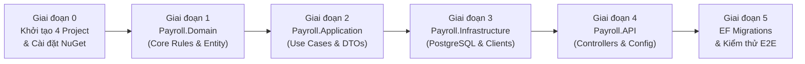

# HƯỚNG DẪN THỨ TỰ TRIỂN KHAI VÀ HOÀN THIỆN SERVICE PAYROLL
**Hệ thống:** HRM (Human Resource Management)  
**Kiến trúc:** Clean Architecture  
**Hệ quản trị CSDL:** PostgreSQL (Npgsql + EF Core)  
**Mục tiêu:** Hướng dẫn chi tiết từng bước, thứ tự cài đặt các thành phần từ số 0 đến khi chạy được hoàn chỉnh.

---

## 1. TRIẾT LÝ THỨ TỰ TRIỂN KHAI: "INSIDE - OUT" (TỪ TRONG RA NGOÀI)

Trong Clean Architecture, quy tắc vàng để lập trình viên không bị phụ thuộc vòng (circular dependency) hoặc bế tắc khi thiếu tầng khác là triển khai theo phương pháp **Inside-Out (Từ trong ra ngoài)**:

$$\text{Domain (Lõi)} \longrightarrow \text{Application (Nghiệp vụ)} \longrightarrow \text{Infrastructure (CSDL PostgreSQL)} \longrightarrow \text{API (Giao diện)}$$



### Tại sao lại đi theo thứ tự này?
1. **`Domain` không phụ thuộc vào ai:** Bạn có thể viết và compile ngay lập tức, viết luôn Unit Test để kiểm tra công thức tính lương Gross-Net, bảo hiểm, thuế TNCN.
2. **`Application` chỉ phụ thuộc vào `Domain`:** Viết xong Use Case và định nghĩa sẵn các interface (hợp đồng) mà chưa cần quan tâm DB PostgreSQL được code thế nào.
3. **`Infrastructure` hiện thực các interface của `Application`:** Kết nối PostgreSQL, viết DbContext và Repository.
4. **`API` chỉ đóng vai trò ráp nối (Wiring):** Đăng ký Dependency Injection và mở cổng nhận HTTP Request.

---

## 2. BẢNG LỘ TRÌNH TỔNG QUAN (IMPLEMENTATION ROADMAP)

| Giai đoạn | Tầng đảm nhiệm | Thành phần chính cần tạo | Lệnh kiểm tra đạt chuẩn |
| :--- | :--- | :--- | :--- |
| **Giai đoạn 0** | Khởi tạo | 4 Projects, Solution slnx, NuGet Packages | `dotnet build HRM.slnx` thành công |
| **Giai đoạn 1** | `Payroll.Domain` | Entities, Value Objects, Enums, Domain Service | Viết Unit Test pass 100% công thức lương |
| **Giai đoạn 2** | `Payroll.Application` | Interfaces, DTOs, CQRS Handlers, Validators | `dotnet build src/Payroll/Payroll.Application` |
| **Giai đoạn 3** | `Payroll.Infrastructure` | DbContext, Fluent API, Repositories, HttpClients | `dotnet build src/Payroll/Payroll.Infrastructure` |
| **Giai đoạn 4** | `Payroll.API` | Controllers, Middlewares, DI Container, Program.cs | `dotnet run --project src/Payroll/Payroll.API` |
| **Giai đoạn 5** | Database & Test | PostgreSQL Migration, Seed Data, Swagger E2E | Gọi API tính lương trả về HTTP 200 OK |

---

## 3. CHI TIẾT TỪNG BƯỚC THỰC HIỆN

---

### GIAI ĐOẠN 0: KHỞI TẠO CẤU TRÚC PROJECT VÀ CÀI ĐẶT NUGET

Mục tiêu: Đưa service `Payroll` từ 1 project đơn lẻ thành 4 project Clean Architecture chuẩn mực.

#### Bước 0.1: Chuyển đổi và tạo 4 Project bằng .NET CLI
Mở PowerShell tại thư mục gốc của dự án (`c:\Users\David-NXT\Desktop\SGU\Nam3\C#\HRM`):

```powershell
# 1. Đổi tên thư mục Payroll hiện tại thành Payroll.API
Rename-Item -Path "src/Payroll" -NewName "Payroll_temp"
New-Item -ItemType Directory -Force -Path "src/Payroll"
Move-Item -Path "src/Payroll_temp" -Destination "src/Payroll/Payroll.API"

# 2. Tạo 3 project Class Library còn lại
dotnet new classlib -o src/Payroll/Payroll.Domain -f net10.0
dotnet new classlib -o src/Payroll/Payroll.Application -f net10.0
dotnet new classlib -o src/Payroll/Payroll.Infrastructure -f net10.0
```

#### Bước 0.2: Thiết lập quan hệ phụ thuộc (References)
```powershell
# Application tham chiếu Domain
dotnet add src/Payroll/Payroll.Application/Payroll.Application.csproj reference src/Payroll/Payroll.Domain/Payroll.Domain.csproj

# Infrastructure tham chiếu Application và Domain
dotnet add src/Payroll/Payroll.Infrastructure/Payroll.Infrastructure.csproj reference src/Payroll/Payroll.Application/Payroll.Application.csproj
dotnet add src/Payroll/Payroll.Infrastructure/Payroll.Infrastructure.csproj reference src/Payroll/Payroll.Domain/Payroll.Domain.csproj

# API tham chiếu Application và Infrastructure
dotnet add src/Payroll/Payroll.API/Payroll.API.csproj reference src/Payroll/Payroll.Application/Payroll.Application.csproj
dotnet add src/Payroll/Payroll.API/Payroll.API.csproj reference src/Payroll/Payroll.Infrastructure/Payroll.Infrastructure.csproj
```

#### Bước 0.3: Đăng ký các Project vào Solution (`HRM.slnx`)
```powershell
dotnet sln add src/Payroll/Payroll.Domain/Payroll.Domain.csproj
dotnet sln add src/Payroll/Payroll.Application/Payroll.Application.csproj
dotnet sln add src/Payroll/Payroll.Infrastructure/Payroll.Infrastructure.csproj
dotnet sln add src/Payroll/Payroll.API/Payroll.API.csproj
```

#### Bước 0.4: Cài đặt các thư viện NuGet cần thiết
```powershell
# 1. Cài đặt cho Infrastructure (PostgreSQL & EF Core)
dotnet add src/Payroll/Payroll.Infrastructure package Npgsql.EntityFrameworkCore.PostgreSQL
dotnet add src/Payroll/Payroll.Infrastructure package EFCore.NamingConventions
dotnet add src/Payroll/Payroll.Infrastructure package Microsoft.EntityFrameworkCore.Design

# 2. Cài đặt cho Application (MediatR & Validation)
dotnet add src/Payroll/Payroll.Application package MediatR
dotnet add src/Payroll/Payroll.Application package FluentValidation.DependencyInjectionExtensions

# 3. Cài đặt cho API (Hỗ trợ Migration CLI & Swagger)
dotnet add src/Payroll/Payroll.API package Microsoft.EntityFrameworkCore.Design
dotnet add src/Payroll/Payroll.API package Swashbuckle.AspNetCore
```

Kiểm tra: Chạy `dotnet build` để đảm bảo 4 project liên kết không lỗi cú pháp.

---

### GIAI ĐOẠN 1: XÂY DỰNG TẦNG `Payroll.Domain` (CORE BUSINESS)

> **Nguyên tắc:** Tầng này chỉ dùng C# thuần, không import bất kỳ namespace nào liên quan đến EF Core (`Microsoft.EntityFrameworkCore`) hay Web.

Thứ tự code trong `src/Payroll/Payroll.Domain/`:

```text
1. Common/          (BaseEntity, IAggregateRoot, ValueObject)
2. Enums/           (PayrollStatus, ComponentType, SalaryType)
3. ValueObjects/    (Money, WorkSummary, InsuranceRates)
4. Entities/        (PayrollCycle, Payslip, PayslipDetail, EmployeeSalaryProfile)
5. Exceptions/      (PayrollDomainException)
6. Services/        (PayrollCalculationDomainService)
```

#### Bước 1.1: Tạo các lớp nền tảng (`Common/`)
* Tạo file `Common/BaseEntity.cs`: Định nghĩa `Guid Id`, `DateTimeOffset CreatedAt`, `DateTimeOffset? UpdatedAt`.
* Tạo file `Common/IAggregateRoot.cs`: Interface rỗng để đánh dấu `PayrollCycle` là gốc của bảng lương.

#### Bước 1.2: Tạo các tập hằng số (`Enums/`)
* `Enums/PayrollStatus.cs`: `Draft = 0`, `Calculated = 1`, `Approved = 2`, `Paid = 3`, `Cancelled = 4`.
* `Enums/ComponentType.cs`: `Earning = 0`, `Deduction = 1`, `Allowance = 2`.

#### Bước 1.3: Tạo các Value Objects (`ValueObjects/`)
* `ValueObjects/WorkSummary.cs`: Chứa kết quả chấm công (`ActualWorkingDays`, `NormalOtHours`, `WeekendOtHours`, `HolidayOtHours`).
* `ValueObjects/InsuranceRates.cs`: Tỷ lệ trích nộp bảo hiểm (`SocialRate = 0.08m`, `HealthRate = 0.015m`, `UnemploymentRate = 0.01m`).

#### Bước 1.4: Tạo các Entities chính (`Entities/`)
* `Entities/PayrollCycle.cs`:
  - Thuộc tính: `Id`, `Month`, `Year`, `StandardWorkingDays`, `Status`, `FromDate`, `ToDate`.
  - Danh sách con: `private readonly List<Payslip> _payslips;`
  - Các hàm nghiệp vụ (Encapsulation): `AddPayslip()`, `ClearPayslips()`, `MarkAsCalculated()`, `Approve()`.
* `Entities/Payslip.cs`:
  - Thuộc tính: `EmployeeId`, `ActualBaseSalary`, `OvertimePay`, `TotalAllowances`, `TotalInsuranceDeduction`, `PersonalIncomeTax`, `NetSalary`.
  - Quan hệ: `List<PayslipDetail> Details`.
* `Entities/EmployeeSalaryProfile.cs`:
  - Thuộc tính: `EmployeeId`, `BaseSalary`, `TaxableAllowances`, `NonTaxableAllowances`, `InsuranceSalaryCap`.

#### Bước 1.5: Hiện thực Domain Service tính toán lương (`Services/`)
* Tạo `Services/IPayrollCalculationDomainService.cs`.
* Tạo `Services/PayrollCalculationDomainService.cs`: Chứa công thức:
  - Lương theo ngày công thực tế.
  - Lương OT (hệ số 1.5, 2.0, 3.0).
  - Khấu trừ bảo hiểm (8% BHXH, 1.5% BHYT, 1% BHTN).
  - Giảm trừ gia cảnh (bản thân 11tr, người phụ thuộc 4.4tr/người).
  - Biểu thuế TNCN lũy tiến 7 bậc.
  - Lương thực nhận: $\text{Net} = \text{Gross} - \text{Bảo hiểm} - \text{Thuế TNCN}$.

*Tiêu chí nghiệm thu Giai đoạn 1:* Tầng `Payroll.Domain` biên dịch thành công, không có cảnh báo warning.

---

### GIAI ĐOẠN 2: XÂY DỰNG TẦNG `Payroll.Application` (BUSINESS LOGIC)

Thứ tự code trong `src/Payroll/Payroll.Application/`:

```text
1. Common/Interfaces/       (IUnitOfWork, IApplicationDbContext)
2. Common/Models/           (Result, PagedResult)
3. Contracts/Repositories/  (IPayrollCycleRepository, IPayslipRepository)
4. Contracts/External/      (IAttendanceServiceClient, IHrServiceClient)
5. Features/                (Commands, Queries, DTOs, Handlers)
6. Validators/              (FluentValidation)
7. DependencyInjection.cs   (Đăng ký MediatR & Validators)
```

#### Bước 2.1: Định nghĩa các hợp đồng (Interfaces & Contracts)
* `Common/Interfaces/IUnitOfWork.cs`: Khai báo phương thức `Task<int> SaveChangesAsync(CancellationToken ct = default);`.
* `Contracts/Repositories/IPayrollCycleRepository.cs`: Khai báo:
  - `Task<PayrollCycle?> GetByIdWithPayslipsAsync(Guid id, CancellationToken ct);`
  - `void Add(PayrollCycle cycle);`
  - `void Update(PayrollCycle cycle);`
* `Contracts/External/IAttendanceServiceClient.cs`:
  - `Task<Dictionary<Guid, WorkSummary>> GetMonthlyAttendanceSummaryAsync(int month, int year, CancellationToken ct);`
* `Contracts/External/IHrServiceClient.cs`:
  - `Task<Dictionary<Guid, int>> GetEmployeeDependentsCountAsync(CancellationToken ct);`

#### Bước 2.2: Xây dựng Result Pattern (`Common/Models/Result.cs`)
* Tạo class `Result<T>` đóng gói trạng thái thành công / thất bại, mã lỗi và thông báo lỗi thân thiện để gửi về cho Controller mà không cần ném Exception bừa bãi.

#### Bước 2.3: Xây dựng Feature tính lương (Vertical Slice CQRS)
* Tạo thư mục `Features/PayrollCycles/Commands/`:
  - `CalculatePayrollCommand.cs`: `public record CalculatePayrollCommand(Guid PayrollCycleId) : IRequest<Result<int>>;`
  - `CalculatePayrollCommandHandler.cs`:
    1. Lấy thông tin chu kỳ từ `IPayrollCycleRepository`.
    2. Lấy hồ sơ lương từ `ISalaryProfileRepository`.
    3. Gọi `IAttendanceServiceClient` lấy số công, giờ OT.
    4. Gọi `IHrServiceClient` lấy số người phụ thuộc.
    5. Vòng lặp gọi `IPayrollCalculationDomainService` tính toán từng `Payslip`.
    6. Gọi `_unitOfWork.SaveChangesAsync()`.
* Tạo thư mục `Features/PayrollCycles/Queries/`:
  - `GetPayrollCycleByIdQuery.cs` kèm DTO `PayrollCycleDto.cs`.
* Tạo thư mục `Features/Payslips/Queries/`:
  - `GetMyPayslipQuery.cs` cho phép nhân viên tra cứu phiếu lương cá nhân.

#### Bước 2.4: Viết bộ kiểm tra dữ liệu đầu vào (FluentValidation)
* Tạo `Validators/CalculatePayrollCommandValidator.cs`: Kiểm tra `PayrollCycleId` không được là `Guid.Empty`.
* Tạo `Validators/CreatePayrollCycleCommandValidator.cs`: Kiểm tra tháng từ 1–12, năm $\ge 2024$, số ngày công chuẩn từ 20–26 ngày.

#### Bước 2.5: Đăng ký Dependency Injection (`DependencyInjection.cs`)
```csharp
namespace Payroll.Application;

public static class DependencyInjection
{
    public static IServiceCollection AddApplicationServices(this IServiceCollection services)
    {
        var assembly = typeof(DependencyInjection).Assembly;
        services.AddMediatR(cfg => cfg.RegisterServicesFromAssembly(assembly));
        services.AddValidatorsFromAssembly(assembly);
        return services;
    }
}
```

---

### GIAI ĐOẠN 3: XÂY DỰNG TẦNG `Payroll.Infrastructure` (POSTGRESQL & TÍCH HỢP NGOÀI)

Thứ tự code trong `src/Payroll/Payroll.Infrastructure/`:

```text
1. Persistence/Configurations/   (Fluent API mapping với PostgreSQL)
2. Persistence/PayrollDbContext  (Khai báo DbContext & triển khai IUnitOfWork)
3. Persistence/Repositories/     (PayrollCycleRepository, PayslipRepository)
4. ExternalClients/              (AttendanceServiceClient, HrServiceClient)
5. DependencyInjection.cs        (Cấu hình Npgsql & DI container)
```

#### Bước 3.1: Viết Fluent API Configurations cho PostgreSQL
Tạo các class trong `Persistence/Configurations/`:
* `PayrollCycleConfiguration.cs`: Đặt bảng `payroll_cycles`, khóa chính, unique index `(year, month)`.
* `PayslipConfiguration.cs`:
  - Map `ActualBaseSalary`, `OvertimePay`, `NetSalary` sang kiểu `numeric(18,2)`.
  - Khóa chính sinh tự động bằng hàm PostgreSQL: `.HasDefaultValueSql("gen_random_uuid()")`.
  - Lưu thời gian theo chuẩn UTC: `.HasColumnType("timestamp with time zone")`.
* `PayslipDetailConfiguration.cs`: Thiết lập khóa ngoại với bảng `payslips` (Cascade Delete).

#### Bước 3.2: Viết `PayrollDbContext.cs`
* Kế thừa `DbContext` và implement interface `IUnitOfWork`.
* Đăng ký `DbSet<PayrollCycle>`, `DbSet<Payslip>`, `DbSet<PayslipDetail>`, `DbSet<EmployeeSalaryProfile>`.
* Override hàm `OnModelCreating`: Gọi `modelBuilder.ApplyConfigurationsFromAssembly(...)`.
* Override hàm `SaveChangesAsync`: Tự động điền `CreatedAt` và `UpdatedAt` theo `DateTimeOffset.UtcNow`.

#### Bước 3.3: Triển khai các Repositories
* Tạo `Persistence/Repositories/PayrollCycleRepository.cs`: Sử dụng `_context.PayrollCycles.Include(x => x.Payslips)...`.
* Tạo `Persistence/Repositories/PayslipRepository.cs`.

#### Bước 3.4: Triển khai External Clients
* Tạo `ExternalClients/AttendanceServiceClient.cs`: Dùng `HttpClient` gọi GET `api/attendance/monthly-summary?month=...&year=...`.
* Tạo `ExternalClients/HrServiceClient.cs`: Gọi GET `api/employees/payroll-profiles`.

#### Bước 3.5: Đăng ký kết nối Database trong `DependencyInjection.cs`
```csharp
namespace Payroll.Infrastructure;

public static class DependencyInjection
{
    public static IServiceCollection AddInfrastructureServices(this IServiceCollection services, IConfiguration configuration)
    {
        var connectionString = configuration.GetConnectionString("PayrollDb");

        services.AddDbContext<PayrollDbContext>(options =>
        {
            options.UseNpgsql(connectionString, npgsql =>
            {
                npgsql.EnableRetryOnFailure(3);
                npgsql.MigrationsAssembly(typeof(PayrollDbContext).Assembly.FullName);
            })
            .UseSnakeCaseNamingConvention(); // Chuyển sang snake_case chuẩn PostgreSQL
        });

        services.AddScoped<IUnitOfWork>(sp => sp.GetRequiredService<PayrollDbContext>());
        services.AddScoped<IPayrollCycleRepository, PayrollCycleRepository>();
        services.AddScoped<IPayslipRepository, PayslipRepository>();
        services.AddScoped<ISalaryProfileRepository, SalaryProfileRepository>();

        services.AddHttpClient<IAttendanceServiceClient, AttendanceServiceClient>(client =>
        {
            client.BaseAddress = new Uri(configuration["ExternalServices:AttendanceServiceUrl"]!);
        });

        services.AddHttpClient<IHrServiceClient, HrServiceClient>(client =>
        {
            client.BaseAddress = new Uri(configuration["ExternalServices:HrServiceUrl"]!);
        });

        return services;
    }
}
```

---

### GIAI ĐOẠN 4: HOÀN THIỆN TẦNG `Payroll.API` (PRESENTATION LAYER)

Thứ tự code trong `src/Payroll/Payroll.API/`:

```text
1. appsettings.json                 (Chuỗi kết nối PostgreSQL)
2. Middlewares/                     (GlobalExceptionMiddleware)
3. Controllers/                     (PayrollCyclesController, PayslipsController)
4. Program.cs                       (Kích hoạt toàn bộ pipeline)
```

#### Bước 4.1: Cấu hình `appsettings.json`
```json
{
  "Logging": {
    "LogLevel": {
      "Default": "Information",
      "Microsoft.AspNetCore": "Warning"
    }
  },
  "ConnectionStrings": {
    "PayrollDb": "Host=localhost;Port=5432;Database=hrm_payroll;Username=postgres;Password=postgres;Pooling=true;"
  },
  "ExternalServices": {
    "AttendanceServiceUrl": "http://localhost:5001",
    "HrServiceUrl": "http://localhost:5002"
  },
  "AllowedHosts": "*"
}
```

#### Bước 4.2: Viết `GlobalExceptionMiddleware.cs`
Bắt mọi lỗi không mong muốn, chuyển các lỗi `PayrollDomainException` thành HTTP 400 Bad Request và lỗi hệ thống thành HTTP 500 kèm JSON chuẩn RFC 7807 (`ProblemDetails`).

#### Bước 4.3: Viết các Controller mỏng (Thin Controllers)
* Tạo `Controllers/PayrollCyclesController.cs`:
  - `POST /api/payroll-cycles`: Gửi `CreatePayrollCycleCommand` vào `_mediator.Send()`.
  - `POST /api/payroll-cycles/{id}/calculate`: Gửi `CalculatePayrollCommand(id)`.
  - `POST /api/payroll-cycles/{id}/approve`: Gửi `ApprovePayrollCycleCommand(id)`.
  - `GET /api/payroll-cycles/{id}`: Gửi `GetPayrollCycleByIdQuery(id)`.
* Tạo `Controllers/PayslipsController.cs`:
  - `GET /api/payslips/my-payslip?cycleId=...`: Tra cứu phiếu lương của nhân viên đang đăng nhập.

#### Bước 4.4: Hoàn thiện `Program.cs`
```csharp
using Payroll.Application;
using Payroll.Infrastructure;
using Payroll.API.Middlewares;

var builder = WebApplication.CreateBuilder(args);

// 1. Đăng ký các tầng Clean Architecture
builder.Services.AddApplicationServices();
builder.Services.AddInfrastructureServices(builder.Configuration);

// 2. Đăng ký Web API & Swagger
builder.Services.AddControllers();
builder.Services.AddEndpointsApiExplorer();
builder.Services.AddSwaggerGen();

var app = builder.Build();

// 3. Cấu hình HTTP Pipeline
app.UseMiddleware<GlobalExceptionMiddleware>();

if (app.Environment.IsDevelopment())
{
    app.UseSwagger();
    app.UseSwaggerUI();
}

app.UseHttpsRedirection();
app.UseAuthorization();
app.MapControllers();

app.Run();
```

---

### GIAI ĐOẠN 5: TẠO DATABASE MIGRATION VÀ CHẠY KIỂM THỬ E2E

Sau khi 4 tầng đã biên dịch hoàn chỉnh:

#### Bước 5.1: Chuẩn bị Cơ sở dữ liệu PostgreSQL
Đảm bảo PostgreSQL đang chạy (qua Docker hoặc cài đặt cục bộ):
```powershell
# Chạy nhanh PostgreSQL bằng Docker nếu chưa cài đặt (tùy chọn)
docker run --name pg-hrm -e POSTGRES_PASSWORD=postgres -e POSTGRES_DB=hrm_payroll -p 5432:5432 -d postgres:16-alpine
```

#### Bước 5.2: Khởi tạo Migration đầu tiên
Chạy lệnh EF Core CLI từ thư mục gốc của dự án:
```powershell
dotnet ef migrations add InitialPayrollSchema `
  --project src/Payroll/Payroll.Infrastructure `
  --startup-project src/Payroll/Payroll.API `
  --output-dir Persistence/Migrations
```

#### Bước 5.3: Cập nhật Schema vào PostgreSQL
```powershell
dotnet ef database update `
  --project src/Payroll/Payroll.Infrastructure `
  --startup-project src/Payroll/Payroll.API
```
*Kết quả:* Kiểm tra trong pgAdmin hoặc DBeaver sẽ thấy các bảng: `payroll_cycles`, `payslips`, `payslip_details`, `employee_salary_profiles`.

#### Bước 5.4: Khởi chạy Service và Test trên Swagger UI
```powershell
dotnet run --project src/Payroll/Payroll.API
```
Truy cập trình duyệt: `https://localhost:7xxx/swagger` và thực hiện kịch bản test:
1. **Bước 1:** Gọi `POST /api/payroll-cycles` tạo kỳ lương Tháng 10/2026.
2. **Bước 2:** Gọi `POST /api/payroll-cycles/{id}/calculate` để kích hoạt tính lương.
3. **Bước 3:** Gọi `GET /api/payroll-cycles/{id}` kiểm tra danh sách phiếu lương với các số tiền Gross, Net, Thuế TNCN đã được tính toán chính xác.
4. **Bước 4:** Gọi `POST /api/payroll-cycles/{id}/approve` để chốt kỳ lương.

---

## 4. CHECKLIST NGHIỆM THU (DEFINITION OF DONE)

Đánh dấu hoàn thành khi kiểm tra đủ các tiêu chí sau:

- [ ] **Biên dịch độc lập:** Dự án `Payroll.Domain` không có bất kỳ dòng `using Microsoft.EntityFrameworkCore` nào.
- [ ] **Chuẩn hóa PostgreSQL:** Bảng và cột trong PostgreSQL tự động chuyển về dạng chữ thường có dấu gạch dưới (`snake_case`).
- [ ] **Độ chính xác tiền tệ:** Toàn bộ cột tiền tệ trên PostgreSQL lưu kiểu `numeric(18,2)`, trên C# là kiểu `decimal`.
- [ ] **Múi giờ:** Các cột thời gian trong database có kiểu `timestamp with time zone`.
- [ ] **Không lưu logic trong Controller:** Tất cả Controller chỉ làm nhiệm vụ tiếp nhận tham số và gọi `_mediator.Send()`.
- [ ] **Unit Test:** Công thức tính thuế lũy tiến và tính bảo hiểm có Unit Test kiểm tra các trường hợp lương cao, lương thấp, có/không có người phụ thuộc.
