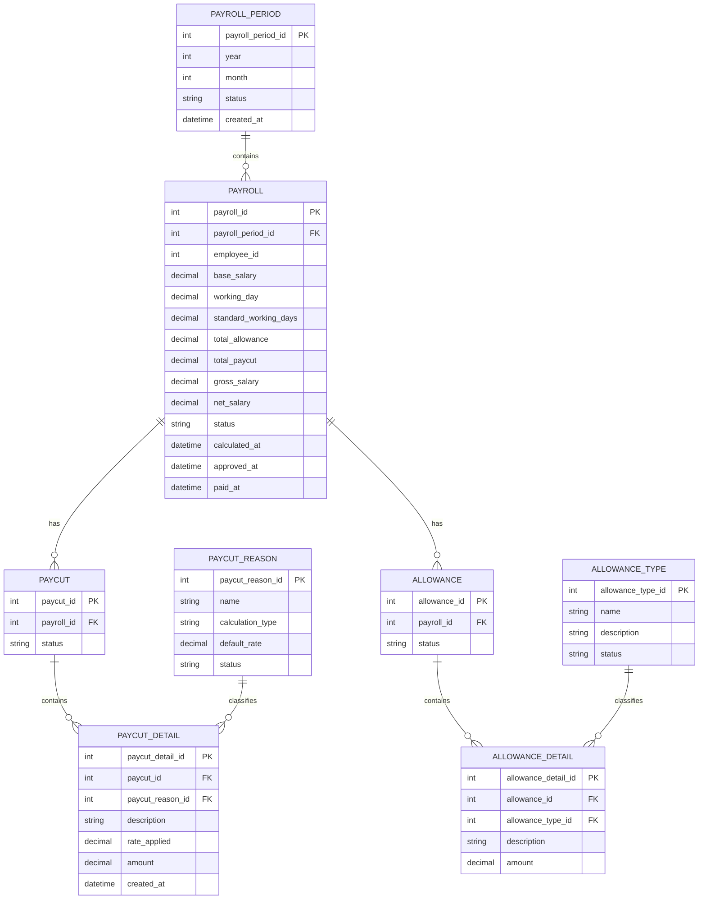

# THIẾT KẾ KIẾN TRÚC & QUY TRÌNH TRIỂN KHAI SERVICE PAYROLL

**Hệ thống:** HRM (Human Resource Management) - Đồ án môn học C# (Năm 3 SGU)  
**Mô hình dữ liệu:** Chuẩn hóa theo sơ đồ ERD chính thức của dự án  
**Định hướng kiến trúc:** Clean Architecture tinh giản (Pragmatic Clean Architecture)  
**Cơ sở dữ liệu:** PostgreSQL (Npgsql + Entity Framework Core)  
**Nền tảng:** .NET 10 / ASP.NET Core Web API

---

## 1. SƠ ĐỒ THỰC THỂ LIÊN KẾT (ERD CHÍNH THỨC CỦA HỆ THỐNG)

Dưới đây là sơ đồ quan hệ thực thể (Entity Relationship Diagram) được thiết kế theo đúng chuẩn ERD được phê duyệt của service `Payroll`:



---

## 2. GIẢI THÍCH CHI TIẾT CÁC BẢNG TRONG CƠ SỞ DỮ LIỆU

Cơ sở dữ liệu gồm **7 bảng** chính, phân cấp quản lý lương, phụ cấp và các khoản khấu trừ cực kỳ chuyên nghiệp:

| Bảng                   | Khóa chính                    | Khóa ngoại                          | Ý nghĩa nghiệp vụ                                                                                                                                                    |
| :--------------------- | :---------------------------- | :---------------------------------- | :------------------------------------------------------------------------------------------------------------------------------------------------------------------- |
| **`payroll_period`**   | `payroll_period_id` (`int`)   | -                                   | Quản lý kỳ tính lương (Tháng, Năm, trạng thái `draft`, `calculated`, `approved`, `paid`).                                                                            |
| **`payroll`**          | `payroll_id` (`int`)          | `payroll_period_id`                 | Bảng lương tổng hợp của từng nhân viên (`employee_id`): ngày công, lương cơ bản, tổng phụ cấp, tổng khấu trừ, lương Gross, lương Net và mốc thời gian duyệt/chi trả. |
| **`allowance`**        | `allowance_id` (`int`)        | `payroll_id`                        | Đại diện cho gói phụ cấp được cấp trong phiếu lương của nhân viên.                                                                                                   |
| **`allowance_type`**   | `allowance_type_id` (`int`)   | -                                   | Danh mục loại phụ cấp: Ăn trưa, Xăng xe, Trách nhiệm, Làm thêm giờ (OT), Thâm niên.                                                                                  |
| **`allowance_detail`** | `allowance_detail_id` (`int`) | `allowance_id`, `allowance_type_id` | Chi tiết số tiền của từng khoản phụ cấp thuộc phiếu lương.                                                                                                           |
| **`paycut`**           | `paycut_id` (`int`)           | `payroll_id`                        | Đại diện cho gói các khoản trừ lương của nhân viên trong kỳ.                                                                                                         |
| **`paycut_reason`**    | `paycut_reason_id` (`int`)    | -                                   | Danh mục lý do trừ lương: BHXH (8%), BHYT (1.5%), BHTN (1%), Thuế TNCN, Đi trễ/về sớm, Nghỉ không phép.                                                              |
| **`paycut_detail`**    | `paycut_detail_id` (`int`)    | `paycut_id`, `paycut_reason_id`     | Chi tiết số tiền bị trừ, tỷ lệ áp dụng (`rate_applied`) và diễn giải.                                                                                                |

### Công thức tính toán tổng thể:

1. **Lương cơ bản theo công:**  
   $$\text{Lương ngày công} = \text{base\_salary} \times \left(\frac{\text{working\_day}}{\text{standard\_working\_days}}\right)$$
2. **Tổng phụ cấp (`total_allowance`):**  
   $$\text{total\_allowance} = \sum (\text{allowance\_detail.amount})$$
3. **Tổng thu nhập Gross (`gross_salary`):**  
   $$\text{gross\_salary} = \text{Lương ngày công} + \text{total\_allowance}$$
4. **Tổng khoản trừ (`total_paycut`):**  
   $$\text{total\_paycut} = \sum (\text{paycut\_detail.amount})$$  
   _(Bao gồm: Bảo hiểm 10.5% + Thuế TNCN lũy tiến + Phạt đi muộn/nghỉ không phép)_
5. **Lương thực nhận Net (`net_salary`):**  
   $$\text{net\_salary} = \text{gross\_salary} - \text{total\_paycut}$$

---

## 3. CẤU TRÚC THƯ MỤC DỰ ÁN TRONG `src/Payroll/`

Cấu trúc dự án áp dụng Clean Architecture tinh giản (1 Project duy nhất, phân chia theo 3 vùng trách nhiệm):

```text
src/Payroll/
├── Controllers/                            # [TẦNG 1: PRESENTATION]
│   ├── PayrollPeriodsController.cs         # API tạo kỳ lương, chốt kỳ, tính lương
│   ├── PayrollsController.cs               # API tra cứu bảng lương nhân viên
│   ├── AllowanceTypesController.cs         # API quản lý danh mục loại phụ cấp
│   └── PaycutReasonsController.cs          # API quản lý danh mục lý do trừ lương
│
├── Core/                                   # [TẦNG 2: BUSINESS LOGIC & DOMAIN]
│   ├── Entities/                           # Thực thể C# bám sát 7 bảng ERD
│   │   ├── PayrollPeriod.cs
│   │   ├── Payroll.cs
│   │   ├── Allowance.cs
│   │   ├── AllowanceType.cs
│   │   ├── AllowanceDetail.cs
│   │   ├── Paycut.cs
│   │   ├── PaycutReason.cs
│   │   └── PaycutDetail.cs
│   ├── DTOs/                               # Đối tượng truyền nhận qua API
│   │   ├── CreatePeriodRequest.cs
│   │   ├── PayrollPeriodDto.cs
│   │   ├── PayrollSummaryDto.cs
│   │   ├── AllowanceDetailDto.cs
│   │   └── PaycutDetailDto.cs
│   ├── Interfaces/                         # Hợp đồng trừu tượng
│   │   ├── IPayrollService.cs              # Interface xử lý tính toán lương
│   │   ├── IPayrollRepository.cs           # Interface truy vấn Database
│   │   ├── IAttendanceClient.cs            # Gọi Attendance Service
│   │   └── IHrClient.cs                    # Gọi HR Service
│   └── Services/                           # LOGIC TÍNH TOÁN NGHIỆP VỤ
│       └── PayrollService.cs               # Thuật toán tính Gross-Net, thuế, bảo hiểm
│
├── Infrastructure/                         # [TẦNG 3: DATABASE POSTGRESQL & TÍCH HỢP]
│   ├── Data/
│   │   ├── PayrollDbContext.cs             # DbContext của EF Core
│   │   └── Configurations/                 # Fluent API cấu hình bảng theo ERD
│   │       ├── PayrollPeriodConfiguration.cs
│   │       ├── PayrollConfiguration.cs
│   │       ├── AllowanceConfiguration.cs
│   │       └── PaycutConfiguration.cs
│   ├── Repositories/
│   │   └── PayrollRepository.cs            # LINQ truy vấn PostgreSQL
│   └── External/                           # Client gọi API liên service
│       ├── AttendanceClient.cs             # Lấy số công (working_day) từ Attendance
│       └── HrClient.cs                     # Lấy lương cơ bản và người phụ thuộc từ HR
│
├── appsettings.json                        # Chuỗi kết nối PostgreSQL & URL các service
├── appsettings.Development.json
├── Program.cs                              # Đăng ký DI & HTTP Pipeline
└── Payroll.csproj                          # Thư viện EF Core, Npgsql
```

---

## 4. CHI TIẾT MÃ NGUỒN CÁC THỰC THỂ (ENTITIES)

Tất cả các thực thể đều sử dụng kiểu khóa chính `int` tự tăng (Identity) và `decimal` cho tiền tệ/ngày công theo đúng hình ảnh ERD:

### 4.1. `PayrollPeriod.cs`

```csharp
namespace Payroll.Core.Entities;

public class PayrollPeriod
{
    public int PayrollPeriodId { get; set; }
    public int Year { get; set; }
    public int Month { get; set; }
    public string Status { get; set; } = "draft"; // draft, calculated, approved, paid
    public DateTime CreatedAt { get; set; } = DateTime.UtcNow;

    // Quan hệ 1 - N với Payroll
    public List<Payroll> Payrolls { get; set; } = new();
}
```

### 4.2. `Payroll.cs`

```csharp
namespace Payroll.Core.Entities;

public class Payroll
{
    public int PayrollId { get; set; }
    public int PayrollPeriodId { get; set; }
    public int EmployeeId { get; set; }

    public decimal BaseSalary { get; set; }
    public decimal WorkingDay { get; set; }
    public decimal StandardWorkingDays { get; set; } = 22m;

    public decimal TotalAllowance { get; set; }
    public decimal TotalPaycut { get; set; }
    public decimal GrossSalary { get; set; }
    public decimal NetSalary { get; set; }

    public string Status { get; set; } = "draft"; // draft, calculated, approved, paid
    public DateTime? CalculatedAt { get; set; }
    public DateTime? ApprovedAt { get; set; }
    public DateTime? PaidAt { get; set; }

    // Navigation Properties
    public PayrollPeriod? PayrollPeriod { get; set; }
    public List<Allowance> Allowances { get; set; } = new();
    public List<Paycut> Paycuts { get; set; } = new();
}
```

### 4.3. Các thực thể Phụ cấp: `Allowance.cs`, `AllowanceType.cs`, `AllowanceDetail.cs`

```csharp
namespace Payroll.Core.Entities;

public class Allowance
{
    public int AllowanceId { get; set; }
    public int PayrollId { get; set; }
    public string Status { get; set; } = "active";

    public Payroll? Payroll { get; set; }
    public List<AllowanceDetail> Details { get; set; } = new();
}

public class AllowanceType
{
    public int AllowanceTypeId { get; set; }
    public string Name { get; set; } = string.Empty;
    public string Description { get; set; } = string.Empty;
    public string Status { get; set; } = "active";

    public List<AllowanceDetail> AllowanceDetails { get; set; } = new();
}

public class AllowanceDetail
{
    public int AllowanceDetailId { get; set; }
    public int AllowanceId { get; set; }
    public int AllowanceTypeId { get; set; }
    public string Description { get; set; } = string.Empty;
    public decimal Amount { get; set; }

    public Allowance? Allowance { get; set; }
    public AllowanceType? AllowanceType { get; set; }
}
```

### 4.4. Các thực thể Khấu trừ lương: `Paycut.cs`, `PaycutReason.cs`, `PaycutDetail.cs`

```csharp
namespace Payroll.Core.Entities;

public class Paycut
{
    public int PaycutId { get; set; }
    public int PayrollId { get; set; }
    public string Status { get; set; } = "active";

    public Payroll? Payroll { get; set; }
    public List<PaycutDetail> Details { get; set; } = new();
}

public class PaycutReason
{
    public int PaycutReasonId { get; set; }
    public string Name { get; set; } = string.Empty;
    public string CalculationType { get; set; } = "percentage"; // percentage, fixed, formula
    public decimal DefaultRate { get; set; }
    public string Status { get; set; } = "active";

    public List<PaycutDetail> PaycutDetails { get; set; } = new();
}

public class PaycutDetail
{
    public int PaycutDetailId { get; set; }
    public int PaycutId { get; set; }
    public int PaycutReasonId { get; set; }
    public string Description { get; set; } = string.Empty;
    public decimal RateApplied { get; set; }
    public decimal Amount { get; set; }
    public DateTime CreatedAt { get; set; } = DateTime.UtcNow;

    public Paycut? Paycut { get; set; }
    public PaycutReason? PaycutReason { get; set; }
}
```

---

## 5. THIẾT KẾ CƠ SỞ DỮ LIỆU POSTGRESQL VỚI EF CORE

### 5.1. `PayrollDbContext.cs` (`Infrastructure/Data/`)

Khai báo đầy đủ 7 `DbSet` và áp dụng ánh xạ Fluent API:

```csharp
namespace Payroll.Infrastructure.Data;

using Microsoft.EntityFrameworkCore;
using Payroll.Core.Entities;

public class PayrollDbContext : DbContext
{
    public PayrollDbContext(DbContextOptions<PayrollDbContext> options) : base(options) { }

    public DbSet<PayrollPeriod> PayrollPeriods => Set<PayrollPeriod>();
    public DbSet<Payroll> Payrolls => Set<Payroll>();
    public DbSet<Allowance> Allowances => Set<Allowance>();
    public DbSet<AllowanceType> AllowanceTypes => Set<AllowanceType>();
    public DbSet<AllowanceDetail> AllowanceDetails => Set<AllowanceDetail>();
    public DbSet<Paycut> Paycuts => Set<Paycut>();
    public DbSet<PaycutReason> PaycutReasons => Set<PaycutReason>();
    public DbSet<PaycutDetail> PaycutDetails => Set<PaycutDetail>();

    protected override void OnModelCreating(ModelBuilder modelBuilder)
    {
        base.OnModelCreating(modelBuilder);

        // 1. payroll_period
        modelBuilder.Entity<PayrollPeriod>(b =>
        {
            b.ToTable("payroll_period");
            b.HasKey(p => p.PayrollPeriodId);
            b.Property(p => p.PayrollPeriodId).HasColumnName("payroll_period_id").ValueGeneratedOnAdd();
            b.Property(p => p.Status).HasMaxLength(50);
            b.HasIndex(p => new { p.Year, p.Month }).IsUnique();
        });

        // 2. payroll
        modelBuilder.Entity<Payroll>(b =>
        {
            b.ToTable("payroll");
            b.HasKey(p => p.PayrollId);
            b.Property(p => p.PayrollId).HasColumnName("payroll_id").ValueGeneratedOnAdd();
            b.Property(p => p.BaseSalary).HasColumnType("numeric(18,2)");
            b.Property(p => p.WorkingDay).HasColumnType("numeric(5,2)");
            b.Property(p => p.StandardWorkingDays).HasColumnType("numeric(5,2)");
            b.Property(p => p.TotalAllowance).HasColumnType("numeric(18,2)");
            b.Property(p => p.TotalPaycut).HasColumnType("numeric(18,2)");
            b.Property(p => p.GrossSalary).HasColumnType("numeric(18,2)");
            b.Property(p => p.NetSalary).HasColumnType("numeric(18,2)");

            b.HasOne(p => p.PayrollPeriod)
             .WithMany(period => period.Payrolls)
             .HasForeignKey(p => p.PayrollPeriodId)
             .OnDelete(DeleteBehavior.Cascade);
        });

        // 3. allowance & allowance_detail
        modelBuilder.Entity<Allowance>(b =>
        {
            b.ToTable("allowance");
            b.HasKey(a => a.AllowanceId);
            b.Property(a => a.AllowanceId).HasColumnName("allowance_id").ValueGeneratedOnAdd();
            b.HasOne(a => a.Payroll)
             .WithMany(p => p.Allowances)
             .HasForeignKey(a => a.PayrollId);
        });

        modelBuilder.Entity<AllowanceType>(b =>
        {
            b.ToTable("allowance_type");
            b.HasKey(t => t.AllowanceTypeId);
            b.Property(t => t.AllowanceTypeId).HasColumnName("allowance_type_id").ValueGeneratedOnAdd();
        });

        modelBuilder.Entity<AllowanceDetail>(b =>
        {
            b.ToTable("allowance_detail");
            b.HasKey(d => d.AllowanceDetailId);
            b.Property(d => d.AllowanceDetailId).HasColumnName("allowance_detail_id").ValueGeneratedOnAdd();
            b.Property(d => d.Amount).HasColumnType("numeric(18,2)");

            b.HasOne(d => d.Allowance)
             .WithMany(a => a.Details)
             .HasForeignKey(d => d.AllowanceId)
             .OnDelete(DeleteBehavior.Cascade);

            b.HasOne(d => d.AllowanceType)
             .WithMany(t => t.AllowanceDetails)
             .HasForeignKey(d => d.AllowanceTypeId);
        });

        // 4. paycut & paycut_detail
        modelBuilder.Entity<Paycut>(b =>
        {
            b.ToTable("paycut");
            b.HasKey(p => p.PaycutId);
            b.Property(p => p.PaycutId).HasColumnName("paycut_id").ValueGeneratedOnAdd();
            b.HasOne(p => p.Payroll)
             .WithMany(pr => pr.Paycuts)
             .HasForeignKey(p => p.PayrollId);
        });

        modelBuilder.Entity<PaycutReason>(b =>
        {
            b.ToTable("paycut_reason");
            b.HasKey(r => r.PaycutReasonId);
            b.Property(r => r.PaycutReasonId).HasColumnName("paycut_reason_id").ValueGeneratedOnAdd();
            b.Property(r => r.DefaultRate).HasColumnType("numeric(5,4)"); // vd 0.0800 cho 8%
        });

        modelBuilder.Entity<PaycutDetail>(b =>
        {
            b.ToTable("paycut_detail");
            b.HasKey(d => d.PaycutDetailId);
            b.Property(d => d.PaycutDetailId).HasColumnName("paycut_detail_id").ValueGeneratedOnAdd();
            b.Property(d => d.RateApplied).HasColumnType("numeric(5,4)");
            b.Property(d => d.Amount).HasColumnType("numeric(18,2)");

            b.HasOne(d => d.Paycut)
             .WithMany(p => p.Details)
             .HasForeignKey(d => d.PaycutId)
             .OnDelete(DeleteBehavior.Cascade);

            b.HasOne(d => d.PaycutReason)
             .WithMany(r => r.PaycutDetails)
             .HasForeignKey(d => d.PaycutReasonId);
        });
    }
}
```

---

## 6. LOGIC NGHIỆP VỤ TÍNH LƯƠNG (`Core/Services/PayrollService.cs`)

Service này điều phối việc tính toán:

1. Đọc số ngày công từ `Attendance Service`.
2. Tạo bản ghi `Allowance` và chèn các `AllowanceDetail` (Ăn trưa, Phụ cấp trách nhiệm, OT).
3. Tạo bản ghi `Paycut` và chèn các `PaycutDetail` (BHXH 8%, BHYT 1.5%, BHTN 1%, Thuế TNCN).
4. Tính tổng và chốt lương Net.

```csharp
namespace Payroll.Core.Services;

using Microsoft.EntityFrameworkCore;
using Payroll.Core.Entities;
using Payroll.Core.Interfaces;
using Payroll.Infrastructure.Data;

public class PayrollService : IPayrollService
{
    private readonly PayrollDbContext _context;
    private readonly IAttendanceClient _attendanceClient;
    private readonly IHrClient _hrClient;

    public PayrollService(
        PayrollDbContext context,
        IAttendanceClient attendanceClient,
        IHrClient hrClient)
    {
        _context = context;
        _attendanceClient = attendanceClient;
        _hrClient = hrClient;
    }

    public async Task<int> CalculatePeriodAsync(int periodId)
    {
        var period = await _context.PayrollPeriods
            .Include(p => p.Payrolls)
                .ThenInclude(pr => pr.Allowances)
            .Include(p => p.Payrolls)
                .ThenInclude(pr => pr.Paycuts)
            .FirstOrDefaultAsync(p => p.PayrollPeriodId == periodId);

        if (period == null)
            throw new KeyNotFoundException("Không tìm thấy kỳ lương.");

        if (period.Status == "approved" || period.Status == "paid")
            throw new InvalidOperationException("Kỳ lương đã được phê duyệt, không thể tính lại.");

        // 1. Xóa các dữ liệu tính toán cũ nếu đang tính lại
        if (period.Payrolls.Any())
        {
            _context.Payrolls.RemoveRange(period.Payrolls);
            await _context.SaveChangesAsync();
        }

        // 2. Lấy dữ liệu công từ Attendance Service (hoặc mock nếu chưa chạy)
        var attendanceData = await _attendanceClient.GetMonthlyAttendanceSummaryAsync(period.Month, period.Year);

        // 3. Lấy danh sách nhân viên từ HR Service (Id, Lương cơ bản, Số người phụ thuộc)
        var employees = await _hrClient.GetEmployeePayrollInfoAsync();

        // 4. Lấy danh mục phụ cấp và lý do trừ lương
        var lunchAllowanceType = await _context.AllowanceTypes.FirstOrDefaultAsync(t => t.Name.Contains("Ăn trưa"));
        var bhxhReason = await _context.PaycutReasons.FirstOrDefaultAsync(r => r.Name.Contains("BHXH"));
        var bhytReason = await _context.PaycutReasons.FirstOrDefaultAsync(r => r.Name.Contains("BHYT"));
        var bhtnReason = await _context.PaycutReasons.FirstOrDefaultAsync(r => r.Name.Contains("BHTN"));
        var pitReason = await _context.PaycutReasons.FirstOrDefaultAsync(r => r.Name.Contains("Thuế TNCN"));

        var newPayrolls = new List<Payroll>();

        foreach (var emp in employees)
        {
            attendanceData.TryGetValue(emp.EmployeeId, out var actualWorkingDays);
            if (actualWorkingDays <= 0) actualWorkingDays = 22m; // Mặc định đủ công nếu thiếu dữ liệu chấm công

            decimal standardDays = 22m;
            decimal baseSalary = emp.BaseSalary > 0 ? emp.BaseSalary : 10_000_000m;
            decimal earnedBaseSalary = baseSalary * (actualWorkingDays / standardDays);

            var payrollItem = new Payroll
            {
                PayrollPeriodId = periodId,
                EmployeeId = emp.EmployeeId,
                BaseSalary = baseSalary,
                WorkingDay = actualWorkingDays,
                StandardWorkingDays = standardDays,
                Status = "calculated",
                CalculatedAt = DateTime.UtcNow
            };

            // TẠO GÓI PHỤ CẤP (ALLOWANCE)
            var allowance = new Allowance { Status = "active" };
            decimal lunchAmount = 730_000m; // Phụ cấp ăn trưa 730k
            if (lunchAllowanceType != null)
            {
                allowance.Details.Add(new AllowanceDetail
                {
                    AllowanceTypeId = lunchAllowanceType.AllowanceTypeId,
                    Description = "Tiền ăn trưa tháng",
                    Amount = lunchAmount
                });
            }
            payrollItem.TotalAllowance = allowance.Details.Sum(d => d.Amount);
            payrollItem.Allowances.Add(allowance);

            // TÍNH LƯƠNG GROSS
            payrollItem.GrossSalary = earnedBaseSalary + payrollItem.TotalAllowance;

            // TẠO GÓI KHẤU TRỪ (PAYCUT)
            var paycut = new Paycut { Status = "active" };

            // Trừ bảo hiểm (10.5%)
            decimal bhxh = baseSalary * 0.08m;
            decimal bhyt = baseSalary * 0.015m;
            decimal bhtn = baseSalary * 0.01m;
            decimal totalInsurance = bhxh + bhyt + bhtn;

            if (bhxhReason != null)
                paycut.Details.Add(new PaycutDetail { PaycutReasonId = bhxhReason.PaycutReasonId, Description = "BHXH 8%", RateApplied = 0.08m, Amount = bhxh });
            if (bhytReason != null)
                paycut.Details.Add(new PaycutDetail { PaycutReasonId = bhytReason.PaycutReasonId, Description = "BHYT 1.5%", RateApplied = 0.015m, Amount = bhyt });
            if (bhtnReason != null)
                paycut.Details.Add(new PaycutDetail { PaycutReasonId = bhtnReason.PaycutReasonId, Description = "BHTN 1%", RateApplied = 0.01m, Amount = bhtn });

            // Tính thuế TNCN lũy tiến 7 bậc (giảm trừ bản thân 11tr, người phụ thuộc 4.4tr)
            decimal familyDeduction = 11_000_000m + (emp.DependentCount * 4_400_000m);
            decimal taxableIncome = payrollItem.GrossSalary - lunchAmount; // Phụ cấp ăn trưa miễn thuế
            decimal assessableIncome = Math.Max(0, taxableIncome - totalInsurance - familyDeduction);
            decimal pit = CalculateProgressiveTax(assessableIncome);

            if (pitReason != null && pit > 0)
                paycut.Details.Add(new PaycutDetail { PaycutReasonId = pitReason.PaycutReasonId, Description = "Thuế TNCN lũy tiến", RateApplied = 0m, Amount = pit });

            payrollItem.TotalPaycut = paycut.Details.Sum(d => d.Amount);
            payrollItem.Paycuts.Add(paycut);

            // TÍNH LƯƠNG NET THỰC NHẬN
            payrollItem.NetSalary = payrollItem.GrossSalary - payrollItem.TotalPaycut;

            newPayrolls.Add(payrollItem);
        }

        period.Status = "calculated";
        await _context.Payrolls.AddRangeAsync(newPayrolls);
        await _context.SaveChangesAsync();

        return newPayrolls.Count;
    }

    private decimal CalculateProgressiveTax(decimal income)
    {
        if (income <= 0) return 0;
        if (income <= 5_000_000m) return income * 0.05m;
        if (income <= 10_000_000m) return 250_000m + (income - 5_000_000m) * 0.10m;
        if (income <= 18_000_000m) return 750_000m + (income - 10_000_000m) * 0.15m;
        if (income <= 32_000_000m) return 1_950_000m + (income - 18_000_000m) * 0.20m;
        if (income <= 52_000_000m) return 4_750_000m + (income - 32_000_000m) * 0.25m;
        if (income <= 80_000_000m) return 9_750_000m + (income - 52_000_000m) * 0.30m;
        return 18_150_000m + (income - 80_000_000m) * 0.35m;
    }
}
```

---

## 7. DỮ LIỆU KHỞI TẠO MẪU CHO DANH MỤC (SEED DATA)

Để hệ thống tính lương chạy được ngay lập tức sau khi cập nhật Database, bạn có thể thêm đoạn Seed Data sau vào hàm `OnModelCreating` trong `PayrollDbContext.cs`:

```csharp
// Seed dữ liệu cho danh mục Loại phụ cấp
modelBuilder.Entity<AllowanceType>().HasData(
    new AllowanceType { AllowanceTypeId = 1, Name = "Phụ cấp ăn trưa", Description = "Hỗ trợ bữa ăn giữa ca, miễn thuế theo quy định", Status = "active" },
    new AllowanceType { AllowanceTypeId = 2, Name = "Phụ cấp xăng xe & đi lại", Description = "Hỗ trợ chi phí xăng xe", Status = "active" },
    new AllowanceType { AllowanceTypeId = 3, Name = "Phụ cấp trách nhiệm", Description = "Phụ cấp theo chức vụ quản lý", Status = "active" },
    new AllowanceType { AllowanceTypeId = 4, Name = "Làm thêm giờ (OT)", Description = "Tiền lương làm thêm ngoài giờ", Status = "active" }
);

// Seed dữ liệu cho danh mục Lý do khấu trừ
modelBuilder.Entity<PaycutReason>().HasData(
    new PaycutReason { PaycutReasonId = 1, Name = "Bảo hiểm xã hội (BHXH)", CalculationType = "percentage", DefaultRate = 0.0800m, Status = "active" },
    new PaycutReason { PaycutReasonId = 2, Name = "Bảo hiểm y tế (BHYT)", CalculationType = "percentage", DefaultRate = 0.0150m, Status = "active" },
    new PaycutReason { PaycutReasonId = 3, Name = "Bảo hiểm thất nghiệp (BHTN)", CalculationType = "percentage", DefaultRate = 0.0100m, Status = "active" },
    new PaycutReason { PaycutReasonId = 4, Name = "Thuế thu nhập cá nhân (TNCN)", CalculationType = "formula", DefaultRate = 0m, Status = "active" },
    new PaycutReason { PaycutReasonId = 5, Name = "Phạt đi muộn / về sớm", CalculationType = "fixed", DefaultRate = 100_000m, Status = "active" }
);
```

---

## 8. LỆNH POSTGRESQL MIGRATION CHO MÔ HÌNH MỚI

Sau khi copy các Entities và DbContext theo sơ đồ ERD mới, chạy 2 lệnh sau tại thư mục `src/Payroll`:

```powershell
# 1. Tạo migration mới bám sát ERD
dotnet ef migrations add CreatePayrollErdSchema

# 2. Áp dụng bảng và Seed data vào PostgreSQL
dotnet ef database update
```

Kiểm tra trong pgAdmin hoặc DBeaver, cơ sở dữ liệu `hrm_payroll` sẽ có đầy đủ **7 bảng** liên kết chặt chẽ:

- `payroll_period`
- `payroll`
- `allowance`
- `allowance_type`
- `allowance_detail`
- `paycut`
- `paycut_reason`
- `paycut_detail`
